# Transcript characterization and dataset preparation for lncRNA identification

**Podręcznik do skryptu `prepare_dataset_v2.R`** · CodPod_containers / lncRNA · wersja robocza 2

> Dokument prowadzi krok po kroku przez skrypt R. Numery 00–16 odpowiadają dokładnie sekcjom kodu. Najpierw budujemy charakterystykę transkryptomu, następnie przygotowujemy niezależne zbiory do oceny potencjału kodującego (CP), uczenia meta-klasyfikatora (ML) i predykcji (EX).
>
> **Status:** implementacja do walidacji w RStudio. Dotychczasowy kod użytkownika stanowi podstawę wersji 2, ale nowe rozszerzenia nie zostały uruchomione na pełnym zbiorze myszy. Dołączone testy syntetyczne należy wykonać przed analizą produkcyjną.

## Spis treści

| Sekcja | Co robimy |
|---|---|
| [00](#00-pakiety-i-konfiguracja) | Środowisko R, parametry i wybór ścieżki |
| [01](#01-dane-wejściowe) | Wczytanie FASTA i GTF |
| [02](#02-identyfikatory-transkryptów) | Ujednolicanie ID, kontrola wersji |
| [03](#03-adnotacja-i-metadane) | Struktura GTF, metadane i eksony |
| [04](#04-cechy-sekwencyjne) | Długość, GC, ORF, PAS i skład sekwencji |
| [05](#05-architektura-eksonowo-intronowa) | Eksony, introny, rozpiętość i izoformy |
| [06](#06-kontekst-genomowy) | Odległość i relacje z genami kodującymi |
| [07](#07-cechy-opcjonalne) | Miejsca splicingowe i dalsze rozszerzenia |
| [08](#08-integracja-cech) | Jedna kompletna tabela `final_features` |
| [09](#09-klasyfikacja-biotypów) | PC, NC, lncRNA, ambiguous |
| [10](#10-statystyki-opisowe-i-wykresy) | Charakterystyka grup biologicznych |
| [11](#11-eksport-grup-biologicznych) | Cztery FASTA oraz rekordy bez adnotacji |
| [12](#12-deduplikacja-i-kontrola-jakości) | Dane do modelowania i audyt odrzuceń |
| [13](#13-planowanie-liczebności) | EPV/EPP, test i projekt krzywych uczenia |
| [14](#14-podział-cp--ml--ex) | Dotychczasowy schemat CP/ML/EX |
| [15](#15-walidacja-i-selekcja-cech-ml) | Rozłączność, panele cech, leakage |
| [16](#16-eksport-i-reprodukowalność) | Wyniki i historia analizy |
| [A](#a-literatura-i-źródła-metodologiczne) | Dokumentacja i literatura |
| [B](#b-dalszy-rozwój-i-testy) | Ograniczenia, testy, kolejne etapy |

## Ogólna koncepcja

Wersja 1 odpowiadała na pytanie, jak podzielić sekwencje na niezależne pule CP i ML. Wersja 2 dodaje wcześniejszy, samodzielny etap biologicznej charakterystyki transkryptomu. Z tej samej tabeli można korzystać w analizach opisowych, w badaniach architektury genów i w klasyfikacji.

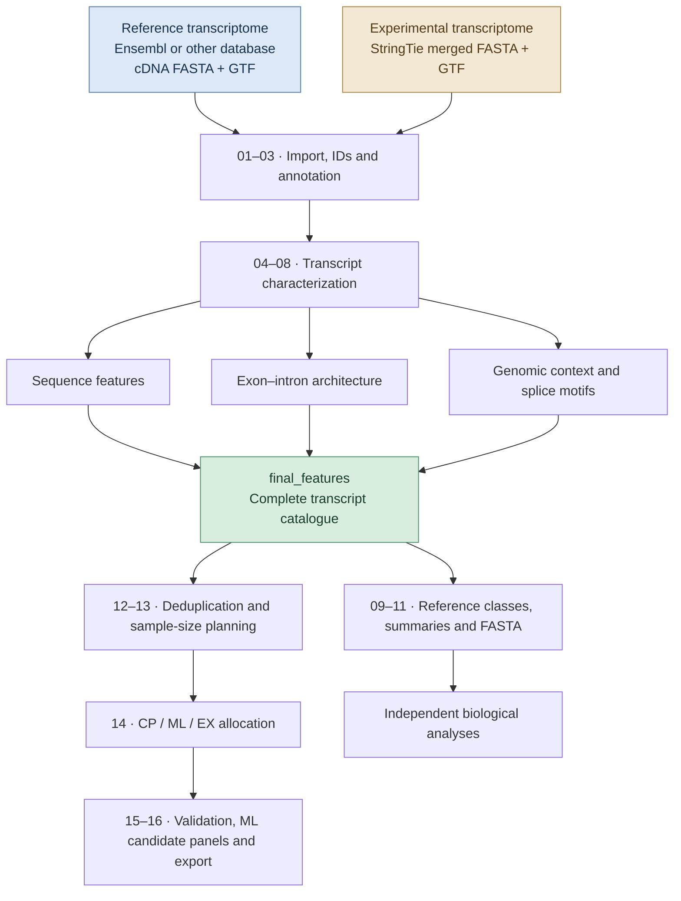

**Zasady:** zachowujemy oryginalną sekwencję i identyfikator, liczymy te same cechy dla referencji i EX, nie usuwamy informacji biologicznych tylko dlatego, że nie są potrzebne modelowi, nie wprowadzamy etykiety klas do predyktorów. Podział jest nadal na poziomie transkryptu; kontrola genów i podobieństwa sekwencji to dalsze poziomy walidacji.

---

## 00. Pakiety i konfiguracja

### Wymagania

R oraz zgodne z jego wersją wydanie Bioconductora. Podstawowe pakiety: `Biostrings`, `rtracklayer`, `GenomicRanges`, `IRanges`, `S4Vectors`. Opcjonalnie `GenomicFeatures` i `txdbmaker` dla wariantu TxDb, `Rsamtools` dla genomu i `ggplot2` dla wykresów. Skrypt sprawdza pakiety, nie instaluje ich automatycznie.

```r
install.packages("BiocManager")
BiocManager::install(c("Biostrings", "rtracklayer", "GenomicRanges",
                       "GenomicFeatures", "txdbmaker", "Rsamtools"))
install.packages("ggplot2")
```

Nie trzeba instalować pakietów już obecnych. W nowszych wydaniach Bioconductora tworzenie TxDb przeniesiono do `txdbmaker` [1–3]. Jawne wywołania `pakiet::funkcja` ograniczają konflikty nazw takie jak `select()` zaobserwowany wcześniej z `dplyr` i Bioconductorem.

### Pierwsze uruchomienie (RStudio)

1. Umieść oba pliki w projekcie RStudio. Ustaw katalog roboczy projektu i ścieżki w sekcji 00.
2. Przed analizą ustaw `run_self_tests <- TRUE`, `write_outputs <- FALSE`, wykonaj konfigurację i definicje funkcji aż do końca bloku `00A`. Do testów nie potrzebujesz właściwych FASTA i GTF.
3. Następnie ustaw `run_self_tests <- FALSE`, `write_outputs <- TRUE`, `run_split <- FALSE` i wybierz nowy `out_dir`. Wykonuj sekcje 01–11, oglądając tabele oraz komunikaty.
4. Po sprawdzeniu wyników ustaw `run_split <- TRUE`; wybierz A/B i parametry, wykonaj 12–16. Jeśli wykonujesz pełny przebieg ponownie, użyj nowego katalogu wyjściowego.

Nie uruchamiaj od razu całego pliku przez `source()` z domyślnymi ścieżkami, jeśli pliki nie są dostępne lokalnie. Po skonfigurowaniu i walidacji można wykonać cały plik jednym poleceniem. Funkcje są zebrane przed kodem głównym, ale import, ustawienia, integracja, statystyki i eksport są zwykłym kodem R, nie monolityczną funkcją.

### Parametry główne

| Parametr | Wartość przykładowa | Znaczenie |
|---|---|---|
| `input_mode` | `"ensembl"` | `ensembl`, `separate`, `experimental_only` |
| `ref_fasta`, `ref_gtf` | `cdna.fa.bgz`, `genes.gtf.bgz` | Referencyjny FASTA i GTF |
| `ref_id_mode` | `"ensembl"` | Specyficzna normalizacja Ensembl lub `exact` |
| `reference_release`, `assembly` | `Ensembl geneset 2026_04`, `GRCm39` | Jawna proweniencja, aktualizować ręcznie |
| `prefix` | `"Mus"` | Prefiks ID dla zbiorów CP/ML |
| `include_ex` | `FALSE` | Dołączenie eksperymentalnego FASTA/GTF |
| `ex_id_mode` | `"exact"` | Zachowanie ID StringTie |
| `structure_engine` | `"gtf"` | Bezpośredni GTF lub alternatywny `txdb` |
| `genome_fasta` | `NULL` | Lokalny genom do analizy splicingu |
| `pas_window` | 100 nt | Końcowe okno poszukiwania sygnałów PAS |
| `min_orf_nt` | 6 nt | Minimalna długość kompletnego ORF z kodonem STOP |
| `calc_kmers` | `FALSE` | `TRUE` dodaje częstości 64 trimerów (dinukleotydy zawsze) |
| `run_split` | `TRUE` | `FALSE` = tylko charakterystyka |
| `exclude_length_mismatch` | `TRUE` | Niezgodna długość FASTA/GTF wyklucza referencję z treningu |
| `write_outputs`, `make_plots` | `TRUE`, `TRUE` | Eksport oraz wykresy |
| `run_self_tests` | `FALSE` | Opcjonalne testy syntetyczne |
| `out_dir` | `dataset_v2_output` | Nowy/pusty katalog wyników |

Wartości liczbowe są propozycjami eksperymentalnymi, nie uniwersalnymi normami. Parametry podziału omówiono w sekcjach 12–14.

---

## 01. Dane wejściowe

| Wariant | FASTA | Adnotacja | Przeznaczenie |
|---|---|---|---|
| A – nowy Ensembl | `cdna.fa.bgz` | `genes.gtf.bgz` lub `genes.gtf.gz` | Podstawowa referencja: kodujące i niekodujące w jednym FASTA |
| B – osobne FASTA | `protein_coding.fa.gz`, `non_coding.fa.gz`, opcjonalnie `lncRNA.fa.gz`, `ambiguous.fa.gz` | Opcjonalny GTF | Wcześniejsze zasoby lub inne bazy |
| C – EX | `merged_transcriptome.fasta` | `merged.gtf` | Rekonstrukcja RNA-seq; opcjonalne tło referencyjnych genów PC |
| D – genom | `genome.fa` i indeks `.fai` | Ten sam assembly co GTF | Dodatkowa analiza donorów i akceptorów splicingu |

Nowy format Ensembl wykorzystany przez użytkownika: katalog `https://ftp.ebi.ac.uk/pub/ensemblorganisms/GCA/000/001/635/9/ensembl/2026_04/geneset/`. Jest to przypięty przykład z przekazanej konwersacji, a nie gwarancja najnowszego wydania lub dostępności plików. Przykładowe pobieranie (zakomentowane w R):

```r
base_url <- "https://ftp.ebi.ac.uk/pub/ensemblorganisms/GCA/000/001/635/9/ensembl/2026_04/geneset/"
options(timeout = 1200)
download.file(paste0(base_url, "cdna.fa.bgz"), "cdna.fa.bgz", mode = "wb")
download.file(paste0(base_url, "genes.gtf.bgz"), "genes.gtf.bgz", mode = "wb")
```

### Dlaczego cDNA, a nie sam CDS?

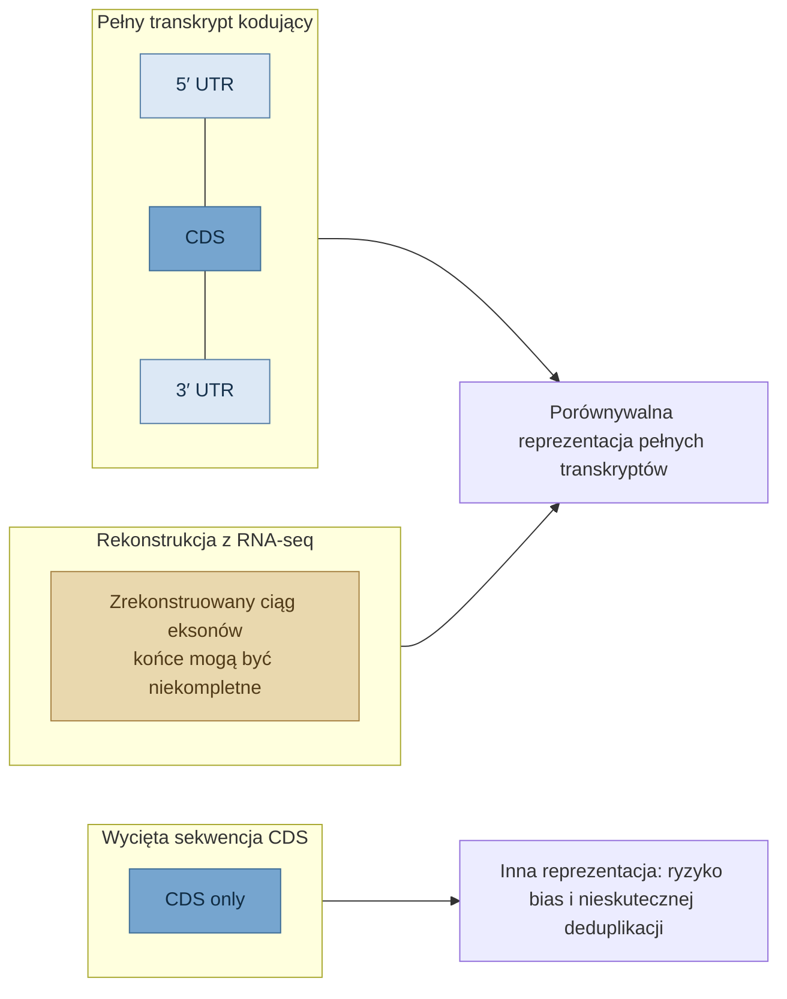

CDS zawiera odcinek kodujący; cDNA obejmuje splicowany transkrypt wraz z zaadnotowanymi UTR. StringTie odtwarza strukturę transkryptu z odczytów, nie gwarantuje kompletności końców ani prawidłowego przypisania nici w danych unstranded. FASTA pozyskany przez ekstrakcję z genomu może nie zawierać biologicznego ogona poly(A). Wersja 2 domyślnie stosuje pełne cDNA. Starszy wariant CDS jest dostępny opisowo (`separate_representation <- "CDS_only"`, `run_split <- FALSE`), ale nie jako domyślne wejście do wspólnego modelu.

### Wariant eksperymentalny

```r
include_ex <- TRUE
ex_file <- "merged_transcriptome.fasta"
ex_gtf <- "merged.gtf"
ex_id_mode <- "exact"
```

Obie pule przetwarzamy tymi samymi funkcjami. EX nie otrzymuje prawdziwej etykiety PC/lnc na podstawie przewidywania lub podobieństwa. Gdy `input_mode <- "experimental_only"`, `run_split` jest wyłączany; `ref_gtf` może wskazywać niezależną referencję kontekstu PC lub być `NULL`. Wariant EX wymaga tego samego genomu i zgodnego nazewnictwa chromosomów, jeśli chcemy korzystać z kontekstu referencji.

---

## 02. Identyfikatory transkryptów

### Przykłady z danych użytkownika

```text
ENSMUST00000194081.2 cdna GRCm39:1:108344807:108347562:1 gene:ENSMUSG00000104478.2 ...
MSTRG.123.1
NM_001234567.1
```

| Pole | Przykład | Funkcja |
|---|---|---|
| `original_header` | cały nagłówek FASTA | Zachowanie proweniencji |
| `fasta_id` | `ENSMUST00000194081.2` | Pierwsze pole bez opisu |
| `transcript_id` | `ENSMUST00000194081` | Klucz po normalizacji Ensembl |
| `gtf_transcript_id` | ID z GTF | Kontrola zgodności |
| `transcript_version` | `2` | Wersja z atrybutu GTF, jeśli obecna |
| `record_id` | `reference::ENSMUST00000194081` | Globalny klucz we wszystkich tabelach |

`extract_transcript_ids()` usuwa białe znaki po pierwszym polu, a końcową wersję tylko dla rozpoznanych identyfikatorów Ensembl w trybie `ensembl`. **Nigdy nie usuwa wszystkich kropek z StringTie.** Dla RefSeq/NCBI i innych formatów domyślnie stosować `exact`, dopóki nie zdefiniujemy poprawnego adaptera. Jeśli dwa różne ID po normalizacji stają się jednym, skrypt przerywa działanie zamiast arbitralnie przypisywać cechy.

Osobne pliki NC i lnc mogą zawierać te same ID. W tym wariancie identyczny rekord z NC i lnc jest scalany, z zachowaniem informacji o lnc; sprzeczne sekwencje lub PC/NC pod tym samym ID są błędem. Nadal zachowujemy różne ID z identyczną sekwencją, ponieważ mogą pochodzić z różnych loci.

## 03. Adnotacja i metadane

GTF jest podstawowym źródłem informacji strukturalnej i klasyfikacji. `rtracklayer::import(..., format="gtf")` tworzy `GRanges`. Funkcja `get_tx_meta()` korzysta z wierszy transcript/mRNA oraz exon, dzięki czemu obsługuje GTF bez jawnego wiersza transkryptu; wykrywa sprzeczne atrybuty dla jednego ID. Obsługiwane są również `gene_type` i `transcript_type` jako alternatywne nazwy pól. Nie wnioskujemy o etykiecie transkryptu wyłącznie na podstawie biotypu genu.

| Obiekt | Znaczenie |
|---|---|
| `anno` | Wczytane adnotacje, oddzielnie reference i experimental |
| `tx_meta` | Tabele metadanych |
| `exons_by_tx` | Eksony pogrupowane według ID transkryptu |
| `tx_ranges` | Całkowita rozpiętość każdego transkryptu |
| `introns_by_tx` | Introny wyliczone z przerw między eksonami |

Główne metadane: `gene_id`, `gene_name`, `gene_biotype`, `transcript_biotype`, `transcript_version`, `seqname`, `strand`, `tx_start`, `tx_end`, `source`. Brak atrybutu oznacza `NA`, a nie klasę non-coding. Skrypt nie parsuje dowolnego GFF3: jego relacje ID/Parent wymagają konwersji i kontroli biotypów. Przykład konwersji do GTF: `gffread -T -o genes.gtf genes.gff3`; należy zweryfikować, które atrybuty zostały zachowane.

**Dwie ścieżki strukturalne:** `structure_engine <- "gtf"` jest domyślną, uproszczoną metodą bez TxDb. `"txdb"` zachowuje sposób znany z poprzedniej konwersacji: `txdbmaker::makeTxDbFromGRanges()` i `GenomicFeatures::exonsBy()`. Obie korzystają z tych samych definicji cech; zgodność wyników trzeba sprawdzić na docelowej adnotacji. [1–4]

---

## 04. Cechy sekwencyjne

Obliczenia wykonywane bezpośrednio na `DNAStringSet`, przed deduplikacją modelową. Funkcje `calc_sequence_features()` oraz `calc_longest_orf_bp()` nie używają etykiet biologicznych.

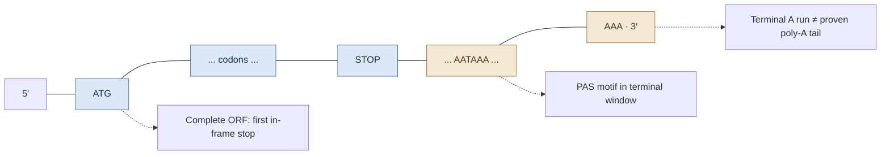

| Kolumna | Definicja / jednostka |
|---|---|
| `seq_length` | Długość sekwencji FASTA, nt |
| `gc_content` | (G+C)/(A+C+G+T), ułamek 0–1 |
| `a_content`, `c_content`, `g_content`, `t_content` | Udział zasad wśród ACGT |
| `n_fraction` | Liczba N / długość FASTA |
| `ambiguous_fraction` | Udział znaków innych niż ACGT |
| `sequence_entropy` | Entropia Shannona składu ACGT, bity |
| `max_orf_len` | Najdłuższy kompletny ORF w nt, wraz ze STOP |
| `orf_count` | Liczba kompletnych ORF; starty zagnieżdżone liczone osobno |
| `orf_start`, `orf_end` | Współrzędne najdłuższego ORF w cDNA (1-based, inclusive) |
| `orf_coverage` | `max_orf_len / seq_length` |
| `pas_present` | Czy AATAAA lub ATTAAA występuje w końcowym oknie |
| `pas_distance_from_end` | Liczba nt od końca najbliższego końcowi motywu do 3′ końca |
| `terminal_A_run` | Liczba kolejnych A na końcu 3′ |
| `k2_AA` … `k2_TT` | 16 częstości dinukleotydów wśród prawidłowych okien |
| `k3_*` | Opcjonalne 64 częstości trimerów |

### ORF: zasada i ograniczenia

Skanujemy trzy ramki na nici cDNA (zakładamy orientację 5′→3′). Każde ATG łączymy z **pierwszym** dalszym TAA, TAG lub TGA w tej samej ramce; długość zawiera STOP. Gdy nie ma kompletnego ORF, długość i liczba wynoszą 0, pozycje `NA`. Jeśli występują dwa równie długie ORF, wybierany jest wcześniejszy. Przyjmujemy standardowy kod jądrowy, więc mitochondrialne lub alternatywne kody genetyczne wymagają osobnego wariantu. Niejednoznaczne kodony wewnątrz ORF mogą ukrywać STOP; ORF nie jest dowodem translacji. Nie używamy informacji o CDS z adnotacji jako predyktora.

### Poly(A)

`pas_present` to obecność dwóch klasycznych motywów w ostatnich 100 nt (wartość konfigurowalna). To nie detektor wszystkich wariantów PAS ani dowód poliadenylacji. `terminal_A_run` również nie odróżnia genomowego ciągu A od rzeczywistego ogona. Do potwierdzenia ogona potrzeba odpowiednich danych eksperymentalnych. Warto porównać rozkłady obu cech dla referencji i EX, zanim trafią do modelu.

---

## 05. Architektura eksonowo-intronowa

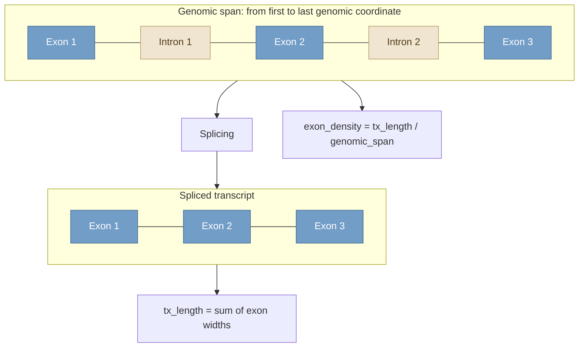

GTF ma współrzędne 1-based inclusive. Długość zakresu = koniec − początek + 1. Długość intronu jest przerwą między kolejnymi eksonami. Eksony nakładające się lub przylegające w jednym transkrypcie są sygnalizowane jako błąd struktury, nie sumowane po cichu. Pierwszy i ostatni ekson rozpatrujemy zgodnie z kierunkiem transkrypcji, więc dla nici minus pierwszy leży przy wyższych współrzędnych.

| Kolumny | Definicja |
|---|---|
| `exon_count`, `tx_length` | Liczba eksonów, suma ich długości |
| `mean_exon_len`, `median_exon_len` | Średnia i mediana długości eksonów |
| `min_exon_len`, `max_exon_len`, `sd_exon_len` | Min, max, odchylenie standardowe |
| `first_exon_len`, `last_exon_len` | Długość pierwszego i ostatniego eksonu w kierunku 5′→3′ |
| `first_exon_fraction`, `last_exon_fraction` | Ich udział w `tx_length` |
| `intron_count`, `total_intron_len` | Liczba i suma długości intronów |
| `mean_intron_len`, `median_intron_len` | Średnia i mediana długości intronów |
| `min_intron_len`, `max_intron_len`, `sd_intron_len` | Min, max, odchylenie standardowe |
| `genomic_span` | Rozpiętość genomowa w pz |
| `exon_density` | `tx_length / genomic_span` |
| `exon_intron_ratio` | `tx_length / total_intron_len` |
| `isoforms_per_gene` | Liczba ID transkryptów na `gene_id` w danej adnotacji |

Dla jednoeksonowego transkryptu `intron_count=0`, `total_intron_len=0`, ale średnia, mediana, odchylenie i stosunek ekson/intron to `NA`. Odchylenie standardowe jednego elementu jest nieokreślone. Dla nici `*` nie interpretujemy pierwszego i ostatniego eksonu. Zmienna `isoforms_per_gene` może silnie zależeć od jakości adnotacji lub rekonstrukcji, dlatego jest jedynie kandydatem do panelu rozszerzonego.

### Kierunek badawczy

W późniejszym eksperymencie można badać asymetrię struktury 5′–3′, rozkłady względnych pozycji złączy, podobieństwo łańcucha intronów i retencję intronów względem innych izoform. Samo znalezienie krótkiego intronu lub długiego eksonu nie stanowi dowodu retencji. Te bardziej zaawansowane miary pozostają zadaniami na przyszłość, nie są udawane jako gotowe kolumny.

---

## 06. Kontekst genomowy

Cechy w tej sekcji są przede wszystkim **opisem biologicznym**, a nie automatycznym wejściem ML. Referencję PC budujemy z genów, których `gene_biotype` jest w słowniku PC, lub z jawnie kodującego transkryptu, jeśli biotyp genu jest nieznany. Rozpiętość genu jest unią rozpiętości jego izoform w GTF, a nie niezależnym pomiarem. EX porównujemy z tą samą referencją PC.

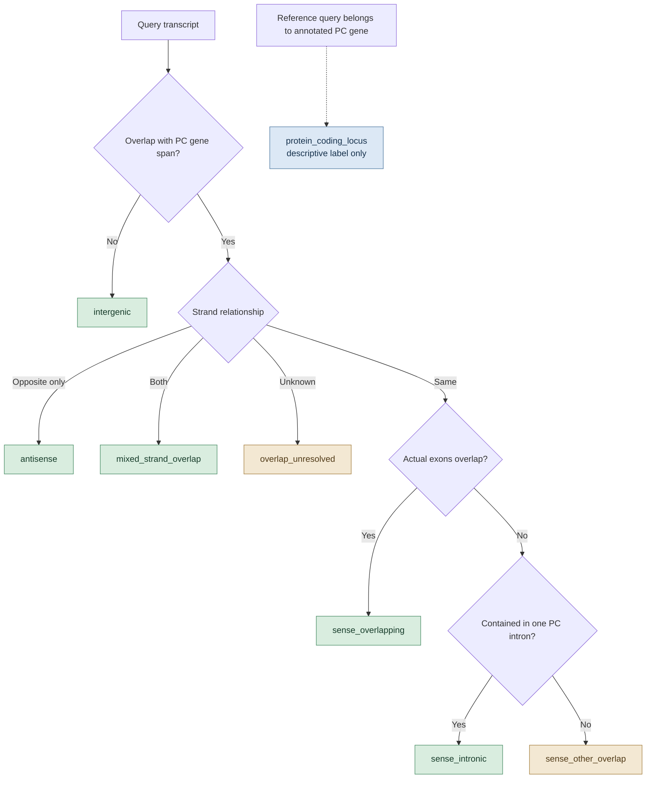

### Przestrzenna interpretacja (schematyczna, nie w skali)

```text
Gen PC (+)        [====]────────[===]────────[=====]  →
Intergenic  [==] →
Antisense              ← [==]────────────[==]
Sense intronic               [=] →
Sense overlapping                          [===]──────[==] →
```

| Kolumna | Definicja i interpretacja |
|---|---|
| `dist_to_pc` | Liczba baz pomiędzy zakresami query i najbliższego genu PC |
| `nearest_pc_gene_id` | ID jednego najbliższego genu; remisy nie mają biologicznej hierarchii |
| `dist_to_nearest_tss` | Minimalna różnica współrzędnych TSS query i referencyjnych izoform PC |
| `genomic_class` | Kategoria według schematu (dla własnego referencyjnego locus PC – etykieta opisowa) |
| `neighbor_orientation` | Tandem, divergent, convergent względem najbliższego nienakładającego się genu |
| `overlap_pc` | Rzeczywiste nakładanie rozpiętości genomowej, niezależnie od nici |
| `overlap_same_strand`, `overlap_opposite_strand` | Niezależne flagi zgodności/przeciwności nici; mogą być obie TRUE |
| `exonic_overlap_bp` | Liczba unikalnych baz eksonowych query pokrywających się z unią eksonów PC, obie nici |
| `exonic_overlap_fraction` | `exonic_overlap_bp / tx_length` |
| `overlapping_pc_genes` | Liczba nakładających się referencyjnych zakresów genów PC |

**Ważne rozróżnienia:** `distanceToNearest()` zwraca 0 również dla zakresów bezpośrednio sąsiadujących; dlatego overlap liczymy przez `findOverlaps()`, niezależnie od dystansu [4]. Odległość TSS liczymy jako różnicę współrzędnych, nie liczbę wolnych baz między punktami. Nakładanie eksonowe wymaga rzeczywistego przecięcia eksonów obu transkryptów, a `sense_intronic` zawierania całego zakresu w konkretnym intronie. Gdy nakładanie występuje na obu niciach, zachowujemy osobną kategorię. Nieznana nić nie jest dowodem antisense. Geny/contigi nieobecne w referencji nie dają pewnych odległości; brak referencji PC oznacza `NA`.

### Ryzyko self-match

Jeżeli referencyjny transkrypt PC porównujemy z adnotacją, w której on sam jest obecny, odległość będzie zwykle zero. `protein_coding_locus` dodatkowo wprost koduje biotyp genu. To może sztucznie zwiększyć skuteczność ML. Dlatego `genomic_class` i biotypy nie są w panelu Core ani Extended. Inne cechy genomowe w Extended wymagają niezależnej, symetrycznej procedury (np. wyłączenia genów query z referencji podczas walidacji, rozdzielenia po loci i analizy przenoszalności). **Wyłączenie własnego genu nie jest jeszcze zaimplementowane.** Podobnie odległości upstream/downstream względem orientacji query i jawne rozstrzyganie remisów są dalszym rozszerzeniem, a nie gotowym wynikiem.

---

## 07. Cechy opcjonalne

### Miejsca splicingowe z genomu

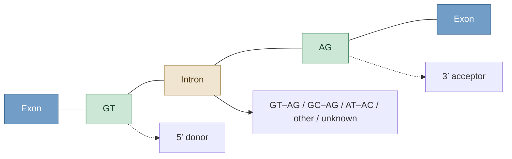

Włączamy `genome_fasta <- "genome.fa"` i jednorazowo wykonujemy `Rsamtools::indexFa(genome_fasta)` dla lokalnego nieskompresowanego lub odpowiednio indeksowanego BGZF FASTA. Chromosomy i assembly muszą odpowiadać GTF. `calc_splice_features()` pobiera dwa nukleotydy z każdego końca intronu, a dla nici minus odwraca kolejność i stosuje reverse complement. Nie można tego uzyskać z samego splicowanego cDNA.

| Kolumna | Znaczenie |
|---|---|
| `gt_ag`, `gc_ag`, `at_ac` | Liczby trzech typowych i rzadziej spotykanych par motywów |
| `canonical_junctions` | Suma GT–AG, GC–AG, AT–AC (operacyjna definicja w projekcie) |
| `noncanonical_junctions` | Inne odczytane, jednoznaczne motywy |
| `unknown_junctions` | Nieznana nić, brak kontigu, za krótki intron lub niejednoznaczne zasady |
| `noncanonical_fraction` | Inne motywy / wszystkie rozpoznane motywy; `NA` jeśli brak rozpoznanych |

Brak genomu daje `NA` we wszystkich kolumnach splicingowych, a nie zera. Przy dostępnym genomie jednoeksonowy transkrypt ma zero złączy i nieokreślony udział. Motyw nie potwierdza biologicznego splicingu; niekanoniczne złącze może być rzeczywiste albo artefaktem rekonstrukcji. Potrzebne są dane o poparciu odczytami.

### Dalsze moduły — niezaimplementowane w v2

| Obszar | Dane potrzebne | Przykładowe cechy |
|---|---|---|
| Ekspresja | Kwantyfikacja, próbki RNA-seq | TPM, wykrywalność, specyficzność tkankowa, replikaty |
| Wiarygodność złożeń | BAM i junction reads | Pokrycie, liczba odczytów wspierających złącza, jakość końców |
| Powtórzenia | RepeatMasker / BED | Udział LINE/SINE/LTR w eksonach |
| Ewolucja | Dopasowania, adnotacje gatunków | Konserwacja, syntenia |
| Translacja | Białka, domeny, Ribo-seq | Homologia, domeny, dowód translacji |
| RNA structure | Narzędzia ViennaRNA itp. | MFE, znormalizowana MFE, struktury stem-loop |
| CDS/UTR z GTF | Adnotacja CDS, UTR | Długości UTR i CDS – wyłącznie opisowe |
| Rozbudowany splicing | GTF referencyjny, RNA-seq | Nowe junctions, retencja intronu, porównania łańcuchów intronów |

---

## 08. Integracja cech

`final_features` to centralna tabela, zawierająca **unię ID z FASTA i GTF** w każdym źródle. Nie jest to zwykły inner join, który zgubiłby niedopasowane rekordy. `join_by_tx()` sprawdza unikalność klucza i zachowuje kolejność.

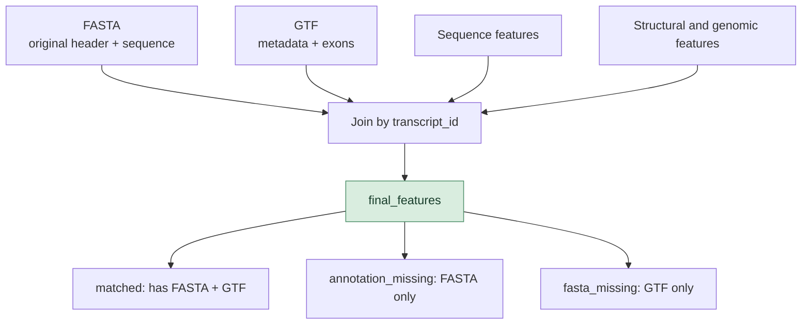

| Kontrola | Interpretacja |
|---|---|
| `has_fasta`, `has_gtf` | Dostępność rekordów w obu źródłach |
| `annotation_status` | `matched`, `annotation_missing`, `fasta_missing` |
| `seq_length` vs `tx_length` | Długość sekwencji vs suma długości eksonów |
| `length_difference`, `length_match` | Różnica i zgodność; wyjaśnić rozbieżności |
| `version_match` | Zgodność wersji Ensembl, jeżeli obie są znane |
| `sequence_group` | Numer pierwszej identycznej sekwencji w danym źródle |

Długości mogą się różnić z powodu niedopasowanej wersji, ekstrakcji CDS, artefaktów lub specyfiki pliku. Nie poprawiamy tego przez podstawienie jednej długości w miejsce drugiej. Domyślnie wykluczamy niezgodne długości z treningu referencyjnego; w panelach ML również maskujemy niezgodne cechy GTF jako `NA`. W `final_features` oryginalne liczby pozostają dostępne. Niezgodność wersji nie jest rozwiązywana przez usunięcie sufiksu ID.

W tym miejscu można zakończyć analizę opisową i zapisać tabelę (wykonując kolejne sekcje bez splitu). `final_features_extended` i `final_classified` to późniejsze aliasy pełnej tabeli, zgodne z dotychczasowym nazewnictwem.

---

## 09. Klasyfikacja biotypów

### Cztery grupy biologiczne i relacja zawierania

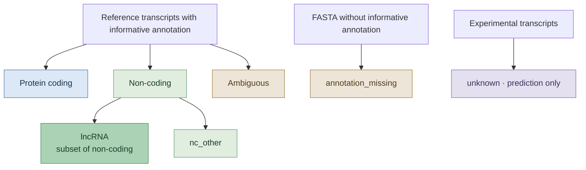

`lncRNA ⊆ non_coding`. PC, NC i ambiguous są rozłączne według ID. Suma czterech FASTA liczy lncRNA dwa razy; poprawna suma to PC + NC + ambiguous + annotation_missing (jeżeli są rekordy bez klasy). Sekwencje mogą być identyczne między biologicznymi grupami z powodu różnych adnotacji/loci, dlatego rozłączność według sekwencji sprawdzamy osobno przed ML.

| Grupa | Reguła operacyjna |
|---|---|
| `protein_coding` | `protein_coding` i wybrane IG/TR (`IG_C_gene`, `IG_D_gene`, `IG_J_gene`, `IG_V_gene`, analogiczne TR) |
| `non_coding` | Jawny słownik niekodujących: lncRNA oraz miRNA, snRNA, snoRNA, rRNA, sRNA, scaRNA, scRNA, misc_RNA, ribozyme, vault_RNA, Y_RNA, Mt_rRNA, Mt_tRNA, tRNA |
| `lncRNA` | `lncRNA`, `lincRNA`, antisense, sense_intronic, sense_overlapping, bidirectional_promoter_lncRNA, 3prime_overlapping_ncRNA, macro_lncRNA, long_non_coding_RNA |
| `ambiguous` | Pozostałe rozpoznane (wypełnione) biotypy, m.in. TEC, pseudogeny, retained_intron, processed_transcript, nonsense_mediated_decay, non_stop_decay, protein_coding_CDS_not_defined |
| `annotation_missing` | Brak informatywnego biotypu lub adnotacji; wyjątek: jawne zbiory osobnych FASTA |

Słowniki są konfigurowalnymi wektorami w sekcji 00. Nie są uniwersalną ontologią, a grupę ambiguous definiujemy na potrzeby konserwatywnego uczenia. Np. pseudogeny mogą być biologicznie interesującymi ncRNA, lecz tutaj nie są automatycznie pozytywną klasą. IG/TR również nie gwarantują kompletnego ORF. W razie potrzeby można ograniczyć listę do ścisłego `protein_coding`. Definicje biotypów sprawdzić w dokumentacji Ensembl/GENCODE [5].

Podstawowe kolumny: `main_class`, `is_lncrna`, `label_source`, `label_conflict`. Klasyfikacja po `transcript_biotype`, nie po `gene_biotype`. W osobnych FASTA bez adnotacji ufamy jawnej deklaracji grupy, a lncRNA można wyodrębniać dodatkowo przez plik lnc lub regex nagłówka. Konflikty pliku z GTF są raportowane i wykluczane z treningu. Nie stosujemy tu sztywnego filtra 200 nt: długość pozostaje cechą i podstawą późniejszej, jawnej decyzji.

---

## 10. Statystyki opisowe i wykresy

`calc_group_stats()` przygotowuje tabelę `summary_table` dla czterech grup. Liczebności GTF i FASTA są raportowane osobno; statystyki cech dotyczą rekordów dostępnych w FASTA, a brakujące wartości nie są liczone jako zero. Osobna tabela `experimental_summary` opisuje EX bez przypisywania klas PC/lncRNA.

| Raportowana statystyka | Co pozwala ocenić |
|---|---|
| `n_gtf`, `n_fasta`, `percent_fasta` | Pokrycie adnotacji i pliku sekwencji |
| `n_genes`, `n_unique_sequences` | Liczba znanych genów i identycznych sekwencji po zgrupowaniu |
| `median_seq_length`, `mean_seq_length` | Długości sekwencji |
| `median_exons`, `mean_exons`, `single_exon_percent` | Struktura eksonowa |
| `median_gc`, `median_orf`, `median_orf_coverage` | Rozkłady sekwencyjne |
| `median_dist_pc`, `overlap_pc_percent` | Kontekst genomowy; overlap z flagi, nie z dystansu |
| `missing_structure_percent` | Dostępność cech GTF |
| `relation` | Informacja o relacji grup (lnc jest podzbiorem NC) |

Uwaga: `n_genes=0` przy braku `gene_id` oznacza zero *znanych identyfikatorów*, nie brak biologicznych genów. Statystyki poszczególnych cech są warunkowe względem dostępnych wartości. `missingness.tsv` pomaga to kontrolować.

Przy `make_plots <- TRUE` powstaną rzeczywiste wykresy pudełkowe długości (log10), liczby eksonów, GC oraz pokrycia ORF; dodatkowo wykres udziałów klas genomowych. Wykresy używają rozłącznych PC, lncRNA, nc_other, ambiguous; nie pokazują podzbioru lncRNA dwa razy. Są zapisywane jako PNG w katalogu wyników. W tym dokumencie nie przedstawiono wymyślonych wyników dla myszy.

## 11. Eksport grup biologicznych

`fasta_pc`, `fasta_noncoding`, `fasta_lncrna`, `fasta_ambiguous` to obiekty `DNAStringSet` z zachowanymi oryginalnymi nagłówkami. Eksport do `protein_coding.fa.gz`, `non_coding.fa.gz`, `lncRNA.fa.gz`, `ambiguous.fa.gz` oraz `annotation_missing.fa.gz` odbywa się niezależnie od podziału modelowego. Pliki mogą mieć zero rekordów; wtedy skrypt zapisuje pusty gzip. Nie traktujemy ambiguous jako prawdziwej klasy pozytywnej lub negatywnej ML. Jest to ciekawy zbiór do późniejszej osobnej inferencji (np. analiza pseudogenów lub TEC).

---

## 12. Deduplikacja i kontrola jakości

Dopiero teraz przygotowujemy `input_records` z kluczami do pełnej tabeli. **Deduplikacja dotyczy modelu, a nie katalogu biologicznego.** Ta sama sekwencja może wystąpić w różnych loci, więc zachowujemy jej wszystkie oryginalne opisy.

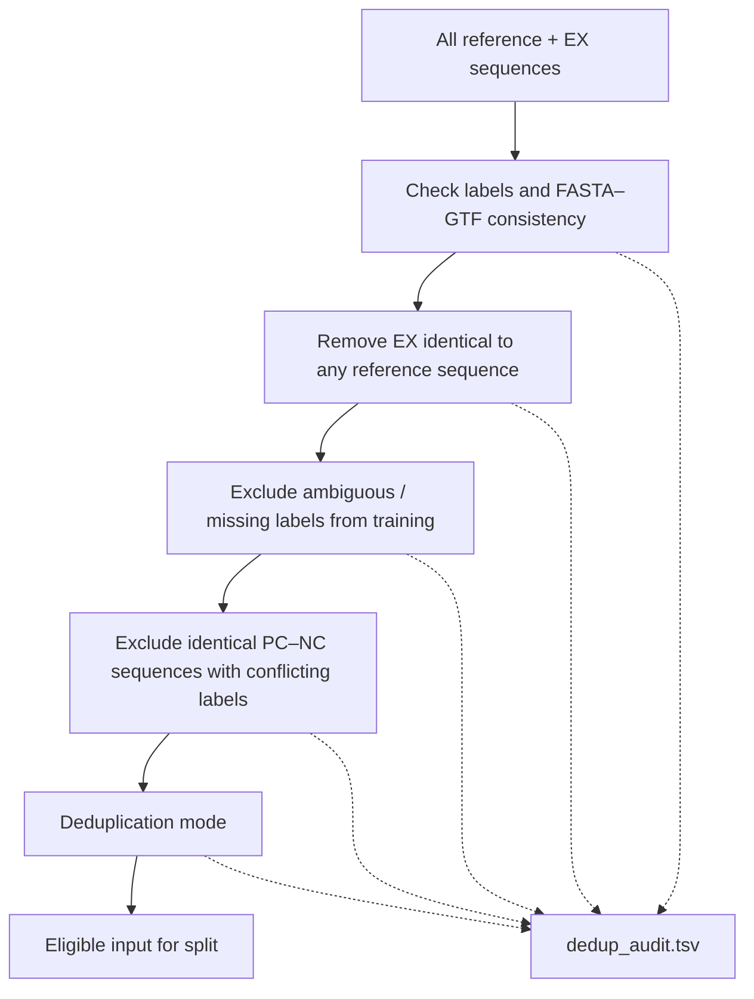

| `dedup_mode` | Działanie |
|---|---|
| `exact_seq` | Domyślnie jedna kopia identycznej sekwencji wśród kwalifikujących się rekordów |
| `header_id` | Deduplikacja po pierwszym polu nagłówka; dodatkowo przestrzeń źródła, jeśli dostępna |
| `none` | Bez dodatkowej deduplikacji kwalifikujących się rekordów; tylko diagnostyka |

Wszystkie trzy tryby wykluczają z EX sekwencje identyczne z **dowolną** referencją (także ambiguous i rekordami wykluczonymi z treningu) oraz wykluczają sprzeczne identyczne PC/NC z treningu. W modelowaniu przy identycznym lnc/nc_other zachowujemy priorytet lnc zgodny z wcześniejszą logiką; ten przypadek należy rozważyć w dalszych analizach wrażliwości, gdy NC inne jest negatywne dla ML. W stosunku do wersji 1 dodano wykluczanie konfliktów PC/NC i audyt, zamiast bezwzględnego priorytetu PC. Priorytet kwalifikujących się kopii pozostaje `cds > lnc_ext > nc > ex`.

`dedup_audit` zapisuje `record_id`, `raw_group`, `class`, `representative_record_id` i `reason`. Przyczyny to m.in. `known_reference_exact`, `not_labeled_for_training`, `conflicting_labels`, `duplicate`. Szczegółowe niezgodności adnotacji zapisane są w `annotation_qc.tsv`. Historyczna nazwa roli `cds` w funkcjach oznacza klasę PC i nie oznacza, że wycięto CDS. `inspect_counts()` podaje liczebności po deduplikacji oraz statusy odrzuceń.

**Ograniczenie:** zgodność dokładnej sekwencji nie usuwa podobnych izoform, fragmentów, różnic UTR ani bliskich homologów. EX może zawierać znane transkrypty z innym końcem. W przyszłości potrzebna jest osobna kontrola łańcucha intronów (np. gffcompare), podobieństwa sekwencji, genomowych loci i rodzin genów.

---

## 13. Planowanie liczebności

### 13.1 EPV/EPP – pomocnicza heurystyka

`estimate_sample_size()` nie wybiera za użytkownika ścieżki A/B. Liczy scenariusze na podstawie podanej liczby parametrów modelu `p`, orientacyjnej liczby obserwacji na parametr `e` i udziału danych dla ML. Dla modelu binarnego klasyczna dyskusja dotyczy parametrów regresji i liczby zdarzeń, nie liczby surowych kolumn w modelu RF/XGBoost. W projekcie stosujemy ją wyłącznie jako ostrożną heurystykę dla klasy ograniczającej liczebność (zwykle lncRNA).

```
orientacyjny cel dla ML train = p × e
przybliżona pula wejściowa klasy = ceil(cel / ((1 - cp_stage_prop) × ml_tt_prop))
```

Przy p=25 i podziale CP/ML 40/60, ML train/test 75/25:

| EPP (scenariusz) | ML train — jedna klasa | Pula wejściowa ograniczającej klasy (przed limitami) |
|---:|---:|---:|
| 10 | 250 | 556 |
| 15 | 375 | 834 |
| 20 | 500 | 1112 |

Wyniki orientacyjne; rzeczywiste losowanie i limity mogą zmienić liczebności. W A klasa pozytywna CP jest sumą lnc i nc_other, więc liczebności lnc nie są liczbą wszystkich pozytywnych CP. `planned_ml_parameters` ma obejmować przyszłe predyktory CP, kodowanie zmiennych kategorycznych, ewentualne transformacje i interakcje. Dla RF/XGB nie ma prostego odpowiednika liczby współczynników regresji. Nie wprowadzamy sztywnego progu 600, 1500 czy 2500 jako automatycznej decyzji [6–8].

### 13.2 Wielkość testu

Dla czułości i specyficzności można oszacować liczbę niezależnych transkryptów odpowiedniej klasy za pomocą normalnego przybliżenia rozkładu dwumianowego:

```
n ≈ ceil(z_(0.975)^2 × p × (1-p) / h^2)
```

Przy p=0,90 i połowie szerokości 95% CI h=0,03 daje około 385 obserwacji *danej klasy* (dla czułości – pozytywne, dla specyficzności – negatywne). To tylko plan, nie końcowy przedział ufności. Do raportowania preferować np. Wilson dla proporcji, odpowiednie metody AUC/PR-AUC lub bootstrap z jednostką resamplingu uwzględniającą zależność izoform. Szerokość CI dla AUC nie wynika bezpośrednio z tego wzoru [9].

### 13.3 Krzywe uczenia – empiryczny eksperyment, nie funkcja przygotowująca dane

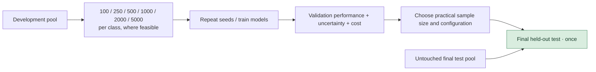

Ilustracja pojęciowa (nie wyniki):

```text
Validation metric
  ↑                        ─────?  model A
  │                ╭───────
  │           ╭────╯             ╭──? model B
  │      ╭────╯             ╭────╯
  │  ╭───╯             ╭────╯
  └──────────────────────────────────→ n per class
      100   250   500   1000   2000   5000
```

Krzywa może mieć inny kształt i nie musi osiągać plateau w tym zakresie [10]. Skrypt zapisuje `learning_curve_plan.tsv` (siatka liczebności i pięciu ziaren), **nie trenuje modeli i nie wylicza empirycznego optimum**. Rozmiary powyżej dostępnej puli trzeba odrzucić przed eksperymentem. Docelowo osobny skrypt `learning_curves.R` powinien badać osobno CP i ML, ich proporcje, skład klas, algorytmy i panele cech. Wybór wielkości oparty będzie o uzgodniony próg praktycznej poprawy, zmienność, koszt oraz walidację bez zaglądania do finalnego testu. PR-AUC jest szczególnie zależne od proporcji klas, więc raportować ją wraz z prevalencją [11].

---

## 14. Podział CP / ML / EX

Zachowano cztery funkcje z dotychczasowego skryptu: `load_and_dedup()`, `inspect_counts()`, `split_datasets()`, `extract_subset()`. Logika pozostaje rozpoznawalna. Dodatkowo funkcje mogą korzystać z tabeli scharakteryzowanych rekordów i sprawdzają parametry oraz niepuste klasy.

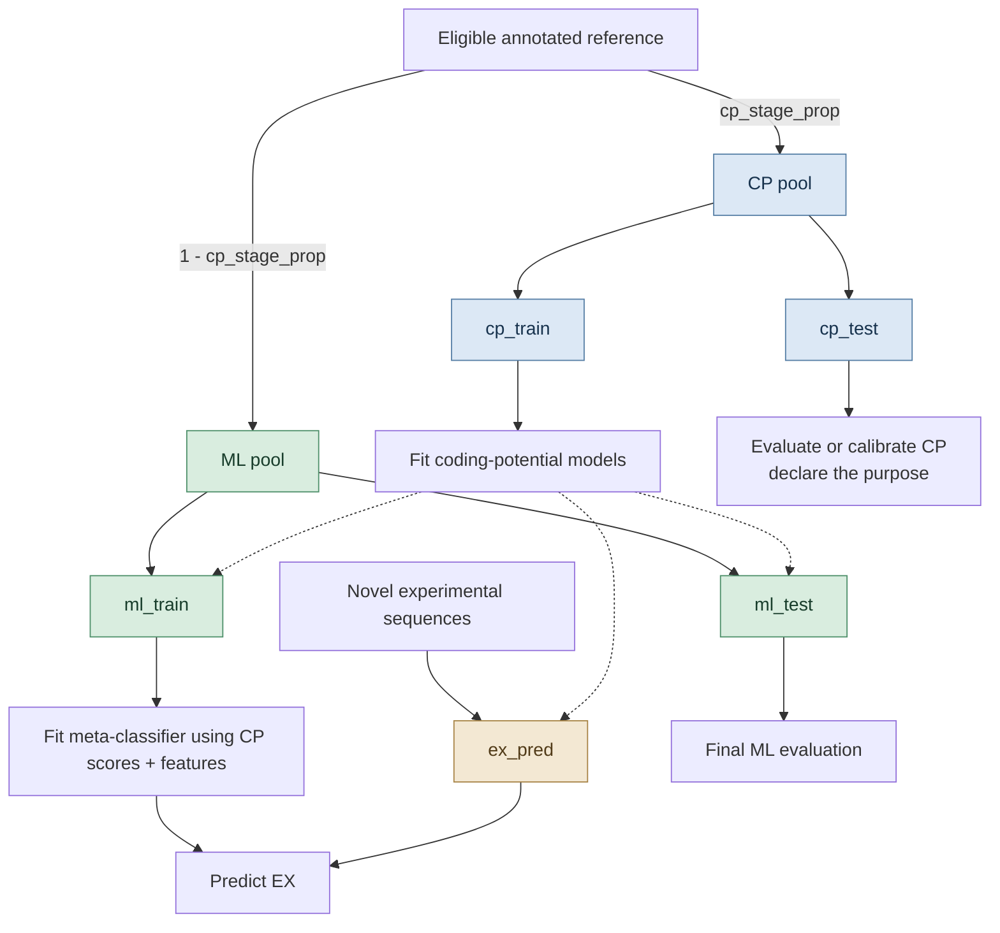

Przerywane strzałki oznaczają **predykcję z dopasowanych wcześniej modeli CP**, nie trenowanie CP na ML/EX. `cp_test` może służyć do kalibracji lub oceny: jeśli jest używany do strojenia CP, nie jest niezależnym końcowym testem CP. W obrębie `ml_train` trzeba później przeprowadzić walidację do wyboru cech/hiperparametrów; `ml_test` pozostaje nietknięty do finalnej ewaluacji. Narzędzia z modelami pretrenowanymi mogą mieć nieznany overlap własnych danych treningowych z naszym benchmarkiem – należy to jawnie raportować.

### Ścieżka A i B — wybór ręczny po inspekcji

| Etap | A: `extract_lnc=TRUE` | B: `extract_lnc=FALSE` |
|---|---|---|
| CP positive | `lnc` + `nc_other` | `nc` |
| CP negative | `cds` | `cds` |
| ML positive | `lnc` | `nc` |
| ML negative | `cds` lub `cds` + `nc_other` | `cds` |
| EX | `unknown` | `unknown` |

Ścieżka B rozwiązuje problem małej liczby dobrze opisanych lnc, ale zmienia zadanie: ML odróżnia szeroko rozumiane ncRNA od PC, nie specyficznie lncRNA. Nie można opisywać skuteczności B jako dowodu specyficznej identyfikacji lncRNA.

### Parametry podziału

| Parametr | Przykład | Działanie |
|---|---:|---|
| `seed` | 123 | Powtarzalność losowania |
| `cp_stage_prop` | 0.4 | 40% każdej klasy do CP, 60% do ML |
| `cp_tt_prop` | 0.8 | Train/test 80/20 dla CP |
| `ml_tt_prop` | 0.75 | Train/test 75/25 dla ML |
| `max_n_cp` | 2000 | Górny limit na rolę pos/neg CP, łącznie train+test |
| `max_n_ml` | 3000 | Górny limit na rolę pos/neg ML, łącznie train+test |
| `balance_train` | `TRUE` | Balans 1:1 w train, test nie jest dodatkowo balansowany |
| `ml_neg_mode` | `cds_only` | A: wyklucza nc_other z ML; alternatywa `cds_and_nc_other` |

Limity są dzielone na train/test wg zadanych proporcji i zaokrąglane w dół. Przy małych podklasach, odrzuceniu nc_other i balansowaniu proporcje zrealizowane mogą się różnić od nominalnych. Wspólna rola pozytywna CP może zawierać różny udział lnc/nc_other; stratyfikacja przed limitowaniem nie gwarantuje identycznego składu po limitowaniu. Skrypt drukuje oba rozkłady. `keep=FALSE` pozostaje w `wynik$legend` z `drop_reason`; do eksportu zbiorów trafiają tylko `keep=TRUE`. Pusta klasa w wymaganym train/test zatrzymuje podział i wymaga zmiany proporcji lub danych.

```r
cp_train <- extract_subset(wynik, "cp", "train")
cp_test  <- extract_subset(wynik, "cp", "test")
ml_train <- extract_subset(wynik, "ml", "train")
ml_test  <- extract_subset(wynik, "ml", "test")
ex_pred  <- extract_subset(wynik, "inference")
```

W `wynik$seqs` pozostają także rekordy odrzucone po split; właściwe zbiory do modelowania należy wyciągać przez `extract_subset()`. Nie używać bezpośrednio całego `wynik$seqs` do treningu.

---

## 15. Walidacja i selekcja cech ML

### Pełny katalog vs macierz predyktorów

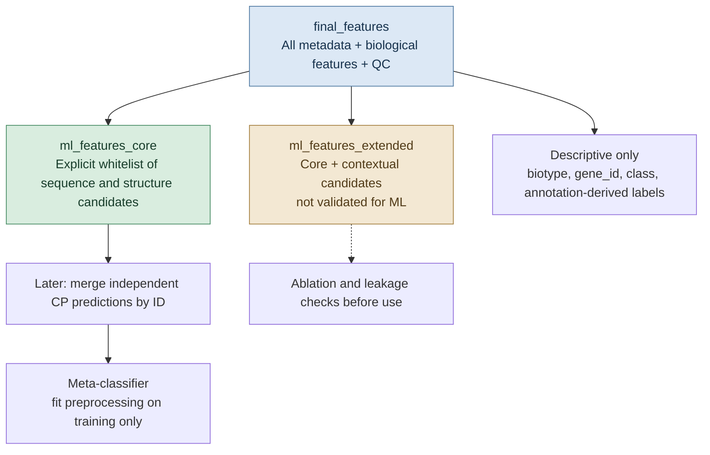

Core jest jawną listą w sekcji 15 (26 podstawowych kandydatów, opcjonalnie `noncanonical_fraction`). Obejmuje wybrane miary długości, ORF, GC, entropii, eksonów, intronów, rozpiętości i sygnałów PAS. Nie wszystkie kolumny biologiczne są na tej liście; np. dinukleotydy zachowujemy opisowo na tym etapie. Przed modelem trzeba sprawdzić korelacje i redundancję (długość transkryptu, suma eksonów, ORF coverage), braki i różnice rozkładów referencja vs EX. Wariant FASTA-only będzie wymagać jawnego podpanelu cech sekwencyjnych bez struktury GTF.

| Kolumna lub grupa | Opis | Core | Extended (warunkowo) |
|---|:---:|:---:|:---:|
| `transcript_biotype`, `main_class`, `is_lncrna`, `role` | Tak | Nie | Nie |
| `gene_biotype`, `gene_id`, identyfikatory, source | Tak | Nie | Nie |
| `seq_length`, GC, ORF, entropia | Tak | Tak | Tak |
| Struktura eksonowo-intronowa (wybrane) | Tak | Tak | Tak |
| PAS, terminalne A | Tak | Kandydat | Kandydat |
| `noncanonical_fraction` | Tak | Gdy genom dostępny | Gdy genom dostępny |
| `isoforms_per_gene` | Tak | Nie | Kandydat |
| `dist_to_pc`, TSS, orientacja i wybrane overlap | Tak | Nie | Kandydat po kontroli self-match |
| `genomic_class` | Tak | Nie | Nie |
| Adnotowana długość CDS/UTR | W przyszłości | Nie | Nie automatycznie |
| Wyniki CP | W przyszłości | Dołączyć później | Dołączyć później |

`ml_features_core` / `ml_features_extended` zachowują `record_id` wyłącznie jako klucz. Tabele poszczególnych zbiorów mają też `ID` i `role`: `role` to etykieta, nie predyktor. `feature_dictionary.tsv` przypisuje status, źródło, jednostkę, definicję lub opis pola i uwagi. Jest to słownik roboczy wymagający rozwijania wraz z katalogiem cech.

### Kontrole rozłączności

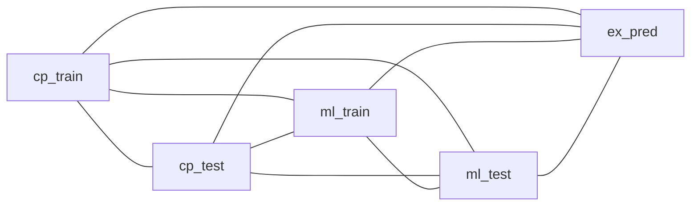

Każda krawędź odpowiada jednej z 10 par, dla których `validate_subsets()` sprawdza przecięcie ID oraz dokładnych sekwencji. Dodatkowo kontrolujemy duplikaty wewnątrz każdego zbioru i klucze do `final_features`. Niezerowe przecięcie zatrzymuje eksport zbiorów modelowych. `header_id` i `none` są więc przydatne diagnostycznie, ale mogą nie przejść końcowej walidacji.

**To nie gwarantuje braku wszelkiego leakage.** Wersja 2 raportuje `gene_overlap.tsv` dla czterech referencyjnych kohort, ale nie wymusza podziału gene-aware. Podstawowa jednostka pozostaje transkryptem zgodnie z wcześniejszą decyzją. Dodatkowy benchmark po genach/klastrach homologii, walidacja międzygatunkowa oraz kontrole zbieżności danych pretrenowanych CP są niezbędnymi dalszymi eksperymentami.

### Relacja identyfikatorów

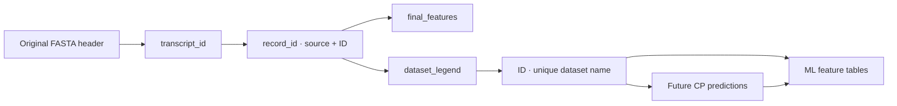

W przyszłym modelowaniu wszystkie transformacje (imputacja, skalowanie, wybór cech, tuning, kalibracja) uczymy na odpowiednich danych treningowych/rozwojowych. Nie dopasowujemy ich do `ml_test` ani EX. Same bezetykietowe cechy biologiczne można obliczyć przed podziałem, o ile ich definicja nie zależy od etykiet lub statystyk całego zbioru. Sekcja 15 nie imputuje i nie skaluje danych.

---

## 16. Eksport i reprodukowalność

Wyniki zapisujemy lokalnie w `out_dir`. Skrypt sprawdza, czy katalog jest pusty na początku pełnego uruchomienia. Przy ręcznym powtórzeniu późniejszych sekcji w tej samej sesji użytkownik powinien sam wybrać nowy katalog, jeśli chce zachować wcześniejszy wariant.

| Plik | Zawartość |
|---|---|
| `transcript_features.tsv`, `transcript_features.rds` | Pełna tabela wszystkich rekordów |
| `feature_dictionary.tsv` | Status i definicje cech |
| `transcriptome_summary.tsv` | Cztery grupy referencyjne |
| `experimental_summary.tsv` | Opis EX, jeśli wczytany |
| `annotation_qc.tsv`, `missingness.tsv` | Kontrola dopasowania i braków |
| `protein_coding.fa.gz`, `non_coding.fa.gz`, `lncRNA.fa.gz`, `ambiguous.fa.gz`, `annotation_missing.fa.gz` | Biologiczne grupy referencyjne, oryginalne nagłówki |
| `ml_features_core.tsv`, `ml_features_extended_candidates.tsv` | Katalogi kandydatów na cechy ML |
| `epv_plan.tsv`, `test_size_plan.tsv`, `learning_curve_plan.tsv` | Heurystyki i plan przyszłego eksperymentu |
| `dedup_audit.tsv` | Historia deduplikacji i odrzuceń (gdy split włączony) |
| `dataset_legend.tsv`, `dataset_split.rds` | Wyniki podziału i legendy |
| `cp_train.fa.gz`, `cp_test.fa.gz`, `ml_train.fa.gz`, `ml_test.fa.gz`, `ex_pred.fa.gz` | Gotowe zbiory FASTA |
| `*_features.tsv` dla powyższych pięciu zbiorów | Cechy Core, ID, record_id i rola, bez wyników CP |
| `subset_validation.tsv`, `gene_overlap.tsv` | Kontrole przecięć |
| `seq_length.png`, `exon_count.png`, `gc_content.png`, `orf_coverage.png`, `genomic_class.png` | Wykresy, gdy dostępne dane i `make_plots=TRUE` |
| `run_config.R`, `input_checksums.tsv`, `sessionInfo.txt` | Parametry, sumy MD5 lokalnych wejść, wersje R/pakietów |

`input_checksums.tsv` obejmuje wyłącznie lokalne pliki, nie pobrane w pamięci URL. Do odtwarzalnej analizy zalecane jest wcześniejsze pobranie i zachowanie przypiętych wersji plików. `run_config.R` zawiera zapis konfiguracji przez `dput()` (odczyt przez `dget()`), nie jest skryptem do samodzielnego treningu.

### Proponowana organizacja repozytorium (na przyszłość)

```text
scripts/
├── readme.md
├── todo.md
├── prepare_dataset.R              # dotychczasowa wersja 1
├── usage_prepare_dataset.R
├── prepare_dataset_v2.R           # nowy skrypt
├── prepare_dataset_v2.md          # ten podręcznik
├── functions/                     # w przyszłości, po testach
├── experiments/
│   ├── learning_curves.R
│   └── feature_selection.R
└── tests/
```

Nie trzeba od razu rozbijać skryptu na wiele plików. Najpierw przetestować v2 w całości, następnie przenosić stabilne funkcje do modułów. Katalogi i pliki w tym schemacie, poza dwoma dostarczonymi plikami, są propozycją dalszego rozwoju.

---

## A. Literatura i źródła metodologiczne

Poniższe pozycje rozdzielają dokumentację narzędzi, teorię statystyczną i tło biologiczne. Publikacje statystyczne nie potwierdzają uniwersalnego optimum dla lncRNA.

| Nr | Źródło | Znaczenie dla implementacji |
|---|---|---|
| 1 | [Biostrings – Bioconductor](https://bioconductor.org/packages/Biostrings/) | Operacje na DNAStringSet, częstości, dopasowania motywów i FASTA |
| 2 | [rtracklayer – Bioconductor](https://bioconductor.org/packages/rtracklayer/) | Import GTF/GFF i zakresów genomowych |
| 3 | [txdbmaker](https://bioconductor.org/packages/txdbmaker/), [GenomicFeatures](https://bioconductor.org/packages/GenomicFeatures/) | Budowa TxDb oraz ekstrakcja struktur transkryptów |
| 4 | [GenomicRanges – Bioconductor](https://bioconductor.org/packages/GenomicRanges/); [IRanges](https://bioconductor.org/packages/IRanges/) | Przecięcia zakresów, sąsiedztwo i dystanse. Rozróżnienie overlap od zero gap. |
| 5 | [GENCODE – gene and transcript biotypes](https://www.gencodegenes.org/pages/biotypes.html) | Znaczenie biotypów, w tym `protein_coding_CDS_not_defined`; operacyjne słowniki projektu wymagają sprawdzenia dla konkretnej wersji. |
| 6 | Riley RD et al. (2019). *Minimum sample size for developing a multivariable prediction model: Part II – binary and time-to-event outcomes*. Statistics in Medicine. [DOI: 10.1002/sim.7992](https://doi.org/10.1002/sim.7992) | Projektowanie liczebności z uwzględnieniem przeuczenia i parametrów modelu, nie jednej stałej reguły. |
| 7 | Riley RD et al. (2020). *Calculating the sample size required for developing a clinical prediction model*. BMJ. [DOI: 10.1136/bmj.m441](https://doi.org/10.1136/bmj.m441) | Krytyczne podejście do stałych reguł EPV/EPP. |
| 8 | van der Ploeg T, Austin PC, Steyerberg EW (2014). *Modern modelling techniques are data hungry: a simulation study for predicting dichotomous endpoints*. BMC Medical Research Methodology. [DOI: 10.1186/1471-2288-14-137](https://doi.org/10.1186/1471-2288-14-137) | Zapotrzebowanie na dane zależy od algorytmu. Wyniki z danych medycznych nie są bezpośrednimi progami lncRNA. |
| 9 | Brown LD, Cai TT, DasGupta A (2001). *Interval Estimation for a Binomial Proportion*. Statistical Science. [DOI: 10.1214/ss/1009213286](https://doi.org/10.1214/ss/1009213286) | Ograniczenia prostych przedziałów Wald; alternatywy do raportowania proporcji. |
| 10 | Viering T, Loog M (2023). *The Shape of Learning Curves: a Review*. IEEE TPAMI. [PubMed](https://pubmed.ncbi.nlm.nih.gov/36350870/) | Krzywe uczenia nie mają jednego uniwersalnego przebiegu ani plateau. |
| 11 | Saito T, Rehmsmeier M (2015). *The Precision-Recall Plot Is More Informative than the ROC Plot When Evaluating Binary Classifiers on Imbalanced Datasets*. PLoS ONE. [DOI: 10.1371/journal.pone.0118432](https://doi.org/10.1371/journal.pone.0118432) | Ocena modeli dla niezbalansowanych klas; PR-AUC oraz kontekst proporcji klas. |
| 12 | Wang L et al. (2013). *CPAT: Coding-Potential Assessment Tool using an alignment-free logistic regression model*. Nucleic Acids Research. [DOI: 10.1093/nar/gkt006](https://doi.org/10.1093/nar/gkt006) | Uzasadnienie analiz ORF, kompozycji i cech sekwencyjnych w predykcji CP. |
| 13 | Wucher V et al. (2017). *FEELnc: a tool for long non-coding RNA annotation and its application to the dog transcriptome*. Nucleic Acids Research. [DOI: 10.1093/nar/gkw1306](https://doi.org/10.1093/nar/gkw1306) | Przykład klasyfikacji lncRNA i kontekstu genomowego; nie dowód wartości każdej nowej cechy. |
| 14 | Pertea M et al. (2015). *StringTie enables improved reconstruction of a transcriptome from RNA-seq reads*. Nature Biotechnology. [DOI: 10.1038/nbt.3122](https://doi.org/10.1038/nbt.3122) | Rekonstrukcja transkryptów z RNA-seq i kontekst danych eksperymentalnych. |

Literatura jest punktem startowym. Kolejny etap powinien obejmować bibliografię dotyczącą walidacji sekwencyjnej (homologia, grupowanie loci), architektury eksonowo-intronowej lncRNA, kompletności transkryptów, miejsc splicingowych i porównywalności gatunków. Przy każdej nowej cesze dokumentujemy: źródło, definicję, hipotezę biologiczną, koszt, ograniczenia i wyniki własnej walidacji.

## B. Dalszy rozwój i testy

- [ ] Uruchomić testy `00A` w docelowym R/Bioconductor: ID Ensembl i StringTie, ORF z pierwszym STOP, eksony minus, klasy kontekstu genomowego, deduplikacja i oba warianty splitu.
- [ ] Porównać wyniki `gtf` i `txdb` na małym GTF (również bez wierszy transcript), następnie na rzeczywistej myszy; sprawdzić obsługę nietypowych rekordów GTF.
- [ ] Zweryfikować zgodność FASTA/GTF, wersje, długości, liczbę transkryptów i rzeczywisty rozkład biotypów; sprawdzić ID w każdym wyjściowym FASTA.
- [ ] Dodać testy genomowych motywów na obu niciach, w tym brakującego kontigu i jednoeksonowych transkryptów; zweryfikować indeks FASTA.
- [ ] Porównać cDNA vs CDS w osobnym, jawnie zaprojektowanym benchmarku CP, bez mieszania reprezentacji w podstawowym pipeline.
- [ ] Scharakteryzować EX tym samym kodem; porównać kompletność, rozkłady cech i brakujące wartości. Dodać kontrolę podobieństwa łańcuchów intronów i znanych transkryptów.
- [ ] Zrealizować krzywe uczenia z nienaruszonym finalnym testem, określić liczebność i proporcje; wykonać porównanie ścieżek A/B.
- [ ] Wykonać ablation study: CP-only, CP + sekwencja, CP + struktura, potem ostrożnie rozszerzenia genomowe. Sprawdzić self-match, niezależne loci i przenoszenie na gatunki niemodelowe.
- [ ] Uzupełnić słownik cech i literaturę, profilować zużycie RAM/czas na dużych transkryptomach, przygotować osobny zestaw testów regresyjnych.

**Zakres v2:** przygotowanie danych, charakterystyka, eksport i planowanie eksperymentów. Nie obejmuje jeszcze rzeczywistego uruchamiania kontenerów CP, trenowania ML, wyznaczania empirycznego optimum, zaawansowanego filtrowania homologii ani automatycznej publikacji na GitHubie.
