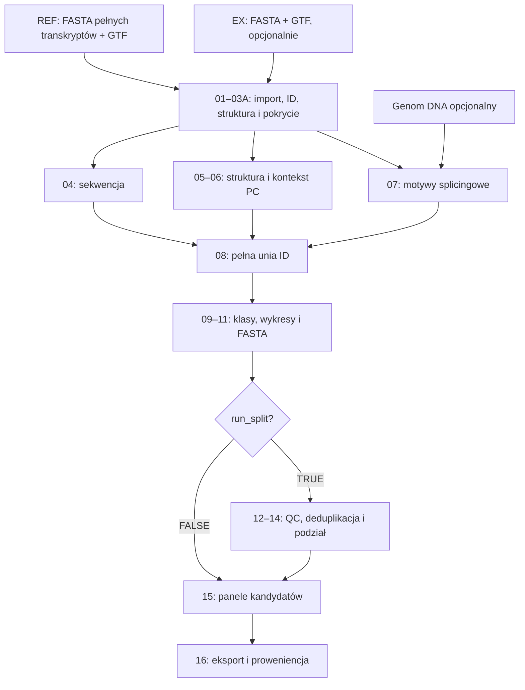
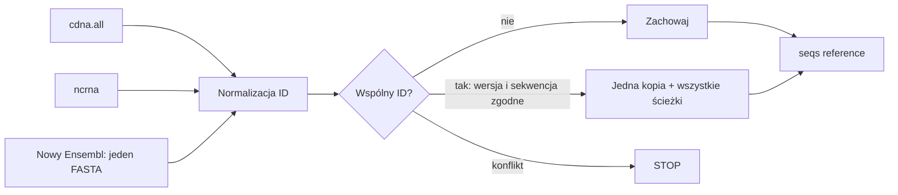
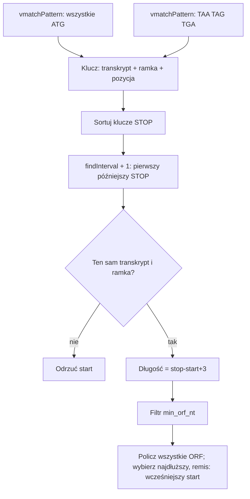
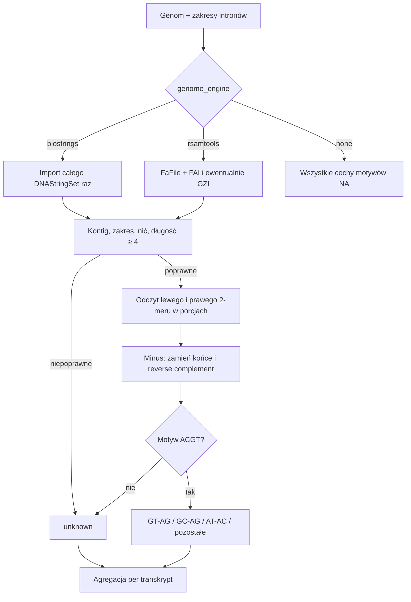
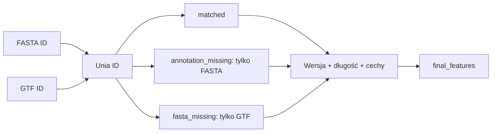
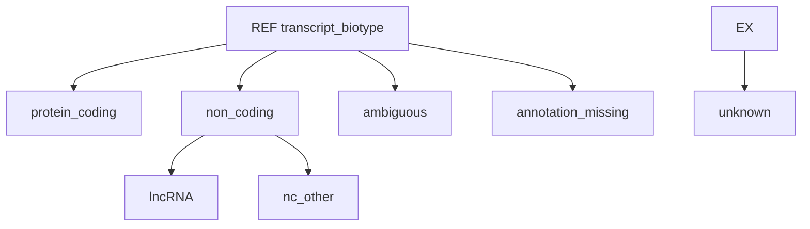
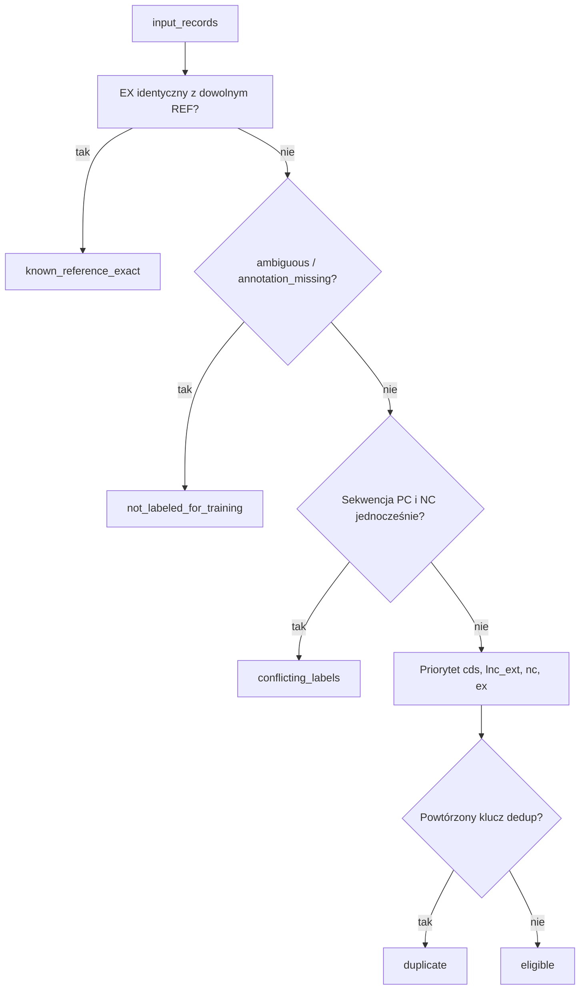
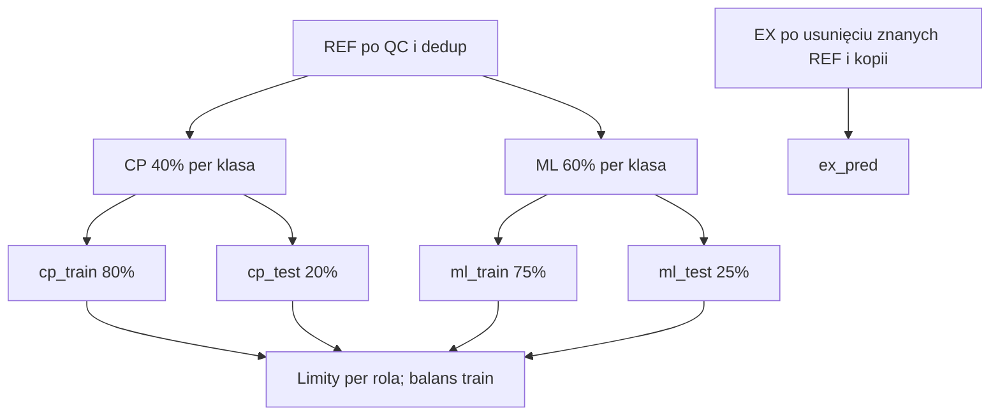
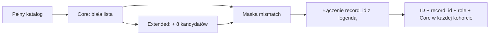

# Transcript characterization and dataset preparation — CodPod_containers

**Podręcznik techniczny i tutorial krok po kroku do `prepare_dataset_v4.1.R`**  
Wersja dokumentacji: 4.1 · 27 listopada 2026 · język polski

[Skrypt R](prepare_dataset_v4.1.R) · [Różnice względem V4](prepare_dataset_v4_to_v4.1.diff)

> **Cel:** zrozumieć, uruchomić, skontrolować i odtworzyć przygotowanie danych referencyjnych oraz eksperymentalnych do analiz lncRNA i potencjału kodującego. Podręcznik jest samodzielny: opisuje aktualny kod, a nie przyszłą implementację. Bloki oznaczone **Tutorial** to polecenia dodatkowe do wykonania w konsoli RStudio; nie są częścią automatycznego przebiegu V4.1. Schematy Mermaid są ilustracjami algorytmów, nie wynikami pomiarów. Wykresy R powstają z rzeczywistych obiektów użytkownika.
>
> **Stan walidacji:** użytkownik zgłosił poprawne zakończenie przebiegu Mm115 REF+EX po rozwiązaniu problemu z zapisem raportu. Nowy Ensembl REF-only był wcześniej sprawdzony w V3, ale wymaga ponownego testu w V4.1. Dokumentację opracowano na podstawie odczytu kodu V4.1 (1827 linii), wcześniejszych pomiarów i logów użytkownika. Nie uruchomiono tutaj R/Bioconductor ani dodatkowych fragmentów tutorialu. Nie przedstawiamy oczekiwanych liczebności po podziale jako wyników pomiaru.

## Spis treści

- [1. Koncepcja i zakres](#koncepcja)
- [2. Przygotowanie środowiska i trzy scenariusze](#start)
- [3. Parametry — kompletna konfiguracja](#parametry)
- [4. Tutorial sekcja po sekcji (00–16)](#tutorial)
  - [00 i 00A — konfiguracja i testy](#s00) · [01 — import](#s01) · [02 — ID](#s02) · [03 — GTF](#s03) · [03A — pokrycie](#s03a)
  - [04 — sekwencje](#s04) · [05 — struktura](#s05) · [06 — kontekst PC](#s06) · [07 — splicing](#s07) · [08 — integracja](#s08)
  - [09 — klasy](#s09) · [10 — statystyki](#s10) · [11 — FASTA](#s11) · [12 — QC i deduplikacja](#s12) · [13 — liczebności](#s13)
  - [14 — split](#s14) · [15 — walidacja](#s15) · [16 — eksport](#s16)
- [5. Referencja wszystkich funkcji](#funkcje)
- [6. Słownik kolumn i plików](#slownik)
- [7. Kalkulatory czasu, RAM i benchmarki](#wydajnosc)
- [8. Diagnostyka i bezpieczne wznowienie](#diagnostyka)
- [9. Protokół walidacji i publikacja](#walidacja)
- [10. Literatura i dalszy rozwój](#literatura)

<a id="koncepcja"></a>
## 1. Koncepcja i zakres

V4.1 spełnia dwa niezależne zadania: (i) charakterystyka katalogu transkryptów, (ii) budowa rozłącznych zbiorów do kolejnych etapów projektu. Można wykonać tylko pierwsze (`run_split=FALSE`). Skrypt nie uruchamia predyktorów CP, nie trenuje meta-klasyfikatora ML i nie nadaje etykiety biologicznej EX. Przygotowuje sekwencje, predyktory, etykiety referencyjne i audyt. CP oznacza etap coding potential, ML — późniejszą klasyfikację, EX — predykcję na materiale eksperymentalnym. Historyczne `cds` to **pełny transkrypt kodujący z UTR**, nie wycięty CDS. `pos` oznacza klasę niekodującą/lncRNA zgodnie z etapem, a nie klasę kodującą.



### 1.1 Trzy poziomy danych, których nie wolno mylić

| Poziom | Obiekt | Co zawiera |
|---|---|---|
| Katalog biologiczny | `final_features` | Wszystkie unikalne ID per źródło z unii FASTA/GTF, również ambiguous, brakujące, kopie sekwencji |
| Pula modelowa | `dane_surowe` | Rekordy z FASTA po QC i deduplikacji; REF z etykietą oraz EX unknown |
| Kohorty | `sets`, `wynik$legend` | Pięć FASTA po losowaniu, limitach i balansowaniu; legenda zachowuje też rekordy odrzucone w split |

Deduplikacja przy imporcie (identyfikatory) i deduplikacja modelowa (sekwencje) to różne operacje. Adnotacja nie jest dowodem translacji ani biologicznego braku translacji. Nie ma automatycznego progu 200 nt, filtra ekspresji, oceny homologii ani podziału grupowanego genami. Podział transkryptów ogranicza identyczność sekwencji, lecz nie gwarantuje niezależności genów, izoform ani homologów. EX nie jest oznaczonym testem zewnętrznym.

### 1.2 Co zmieniło się V4 → V4.1

V4 wprowadziła wybór silnika genomowego, V4.1 — adapter wielu referencyjnych FASTA, `fasta_files`, kontrolę pokrycia i wcześniejszy warunek konieczny dla splitu. Biotypy, ORF, PAS, struktura, motywy i algorytm splitu nie zostały celowo zmienione. W Mm115 cDNA miało 116 358 rekordów, ncRNA 158 776, bez wspólnych znormalizowanych ID. Wszystkie 152 133 ID lncRNA z GTF wystąpiły w ncRNA, żadne w cDNA. To wynik testu konkretnych plików, nie uniwersalna reguła dla każdego wydania.

<a id="start"></a>
## 2. Przygotowanie środowiska i trzy scenariusze

### 2.1 Pliki i pakiety

Przykład katalogu (ścieżki względne liczone od `getwd()`, nie od położenia skryptu):

```text
PrepDataset/
├── prepare_dataset_v4.1.R
├── prepare_dataset_v4.1_manual.md
├── Mm115/
│   ├── Mus_musculus.GRCm39.cdna.all.fa.gz
│   ├── Mus_musculus.GRCm39.ncrna.fa.gz
│   ├── Mus_musculus.GRCm39.115.gtf.gz
│   ├── Mus_musculus.GRCm39.dna.primary_assembly.fa.gz
│   ├── super_transcriptome.fa
│   └── super_merged.gtf
└── (nowy katalog wyników, tworzony przez skrypt)
```

R i kompatybilny Bioconductor. Nie instaluj ponownie działających pakietów bez potrzeby. Instalacja jednorazowa, jeśli brakuje:

```r
install.packages("BiocManager")
BiocManager::install(c("Biostrings", "rtracklayer", "GenomicRanges",
                       "IRanges", "S4Vectors"))
install.packages("ggplot2")
# Tylko gdy używasz odpowiedniego silnika:
# BiocManager::install(c("GenomicFeatures", "txdbmaker", "Rsamtools"))
```

| Pakiet | Rola |
|---|---|
| Biostrings | DNAStringSet, FASTA, wzorce, subseq, Views, reverseComplement |
| rtracklayer | Import GTF do GRanges |
| GenomicRanges / IRanges / S4Vectors | Współrzędne, GRangesList, nakładanie i agregacja |
| txdbmaker / GenomicFeatures | Alternatywny adapter TxDb |
| Rsamtools | Opcjonalny indeksowany odczyt genomu; może też być zależnością innego pakietu |
| ggplot2 | Wykresy sekcji 10 i dodatkowe ćwiczenia |

```r
getwd()
R.version.string
BiocManager::version()
sessionInfo()
# Przykład użytkownika, dostosuj:
# setwd("D:/lncRna/PrepDataset/")
```

FASTA musi zawierać transkrypty w orientacji 5′→3′, w alfabecie DNA. GTF musi opisywać tę samą assembly i wersję; plik genomu nie jest zamiennikiem cDNA. GTF to współrzędne 1-based inclusive. Sprawdź źródło EX (np. eksport z assemblera na tej samej assembly). GFF3 z `ID/Parent` wymaga konwersji i kontroli metadanych. Wydanie i assembly są etykietami konfiguracji, nie automatyczną walidacją genomu.

### 2.2 Konfiguracje do skopiowania do sekcji 00

**A. Nowy Ensembl, REF-only** — aktualnie najważniejszy kolejny test. Zastąp aktywne przypisania w skrypcie; nie dopisuj ich nad późniejszymi przypisaniami.

```r
input_mode <- "ensembl"
ref_fasta <- "cdna.fa.bgz"
ref_gtf <- "genes.gtf.bgz"
ref_id_mode <- "ensembl"
reference_release <- "Ensembl geneset 2026_04"
assembly <- "GRCm39" # zweryfikuj dla pobranych danych
prefix <- "Mus"
include_ex <- FALSE
genome_engine <- "none"
genome_fasta <- NULL
run_split <- TRUE
extract_lnc <- TRUE
out_dir <- "Mus_2026_04_REF_none_v4.1"
```

Przypięty URL z komentarza w skrypcie (nie sprawdzano obecnej dostępności serwera):

```r
base_url <- "https://ftp.ebi.ac.uk/pub/ensemblorganisms/GCA/000/001/635/9/ensembl/2026_04/geneset/"
# options(timeout=1200)
# download.file(paste0(base_url,"cdna.fa.bgz"), "cdna.fa.bgz", mode="wb")
# download.file(paste0(base_url,"genes.gtf.bgz"), "genes.gtf.bgz", mode="wb")
```

Wcześniejszy pomiar V3: 481 956 transkryptów, 8 417 898 rekordów GTF, 1 054 845 484 nt. Nie przyjmuj tych liczb bez sprawdzenia aktualnej kopii. EX nie jest otwierany przy `include_ex=FALSE` w tym trybie. `ex_pred` będzie pusty, ale eksport pięciu kohort nadal nastąpi.

**B. Ensembl 115 REF+EX** — domyślny przykład V4.1.

```r
input_mode <- "ensembl"
ref_fasta <- c("Mm115/Mus_musculus.GRCm39.cdna.all.fa.gz",
               "Mm115/Mus_musculus.GRCm39.ncrna.fa.gz")
ref_gtf <- "Mm115/Mus_musculus.GRCm39.115.gtf.gz"
ref_id_mode <- "ensembl"
reference_release <- "Ensembl release 115"
assembly <- "GRCm39"
prefix <- "Mus"
include_ex <- TRUE
ex_file <- "Mm115/super_transcriptome.fa"
ex_gtf <- "Mm115/super_merged.gtf"
ex_id_mode <- "exact"
structure_engine <- "gtf"
genome_engine <- "biostrings"
genome_fasta <- "Mm115/Mus_musculus.GRCm39.dna.primary_assembly.fa.gz"
run_split <- TRUE
extract_lnc <- TRUE
out_dir <- "Mm115_REF_EX_biostrings_v4.1_run01"
```

**C. Te same REF+EX bez genomu** — jak B, tylko:

```r
genome_engine <- "none"
genome_fasta <- NULL
out_dir <- "Mm115_REF_EX_none_v4.1_run01"
```

Nie wyłącza to GTF ani intronów/kontekstu PC; wyłącza odczyt motywów. Core ma o jedną cechę mniej. Porównanie B/C wymaga uzgodnienia wspólnego panelu.

**Pozostałe tryby:** `separate` z `pc_file`, `nc_file`, opcjonalnym `lnc_file`, `ambiguous_file`, `separate_gtf`; `experimental_only` zawsze wymusza `run_split=FALSE`, wczytuje EX nawet przy `include_ex=FALSE`, a `ref_gtf` może być tłem PC (lub NULL). W `experimental_only` nadal potrzebny jest `ex_gtf` — aktywny kod importuje go bez warunku NULL. W `separate` bez GTF etykiety to deklaracja użytkownika; cechy struktury są NA. Te warianty nie są głównymi scenariuszami potwierdzonymi przez użytkownika.

### 2.3 Sposób wykonania

1. Otwórz skrypt w RStudio, wybierz nową sesję. Ustaw ścieżki i parametry w sekcji 00.
2. Testy: ustaw `self_tests_only <- TRUE`, `self_test_rsamtools <- FALSE`, wykonaj `source("prepare_dataset_v4.1.R")`. Komunikat `stop()` po `Self-tests OK` jest zamierzony; brak importu danych. Przy pracy ręcznej nie zaznaczaj sekcji 01 po komunikacie kończącym test.
3. Przywróć w pliku `self_tests_only <- FALSE`, `run_self_tests <- FALSE`, `write_outputs <- TRUE`. W nowej sesji wykonaj sekcję 00 i wszystkie definicje funkcji (przed 00A), następnie 01–03A. Nie wykonuj w ciemno całego pliku po błędzie.
4. Kontynuuj po kolei według tutorialu. Po każdej sekcji zatrzymaj się na kontroli. Nie wykonuj od nowa sekcji 00 w już zapełnionym `out_dir` — zabezpieczenie zatrzyma przebieg.
5. Po walidacji można wykonać cały skrypt przez `source()` z ustawieniami zapisanymi w pliku i nowym katalogiem wyników.

<a id="parametry"></a>
## 3. Parametry — kompletna konfiguracja sekcji 00

Wartości w kolumnie „V4.1” są aktywnymi ustawieniami dostarczonego pliku, nie rekomendacją dla każdego zbioru. Zmiany wprowadzaj przed odpowiednią sekcją; po zmianie wejścia najlepiej odtwórz cały przebieg. Wiersze poniżej opisują parametry użytkownika, dalej także słowniki i ustawienia wewnętrzne.

| Parametr | V4.1 | Dopuszczalne / znaczenie / skutki |
|---|---|---|
| `input_mode` | `"ensembl"` | `ensembl`, `separate`, `experimental_only`. Decyduje o imporcie i źródle etykiet; ostatni wymusza brak splitu. |
| `ref_fasta` | wektor dwóch ścieżek Mm115 (B) | Jeden lub wiele niepustych, różnych stringów; ten sam release i assembly; pełne transkrypty. Zachowana kolejność wpływa na reprezentantów i split. |
| `ref_gtf` | `Mm115/Mus_musculus.GRCm39.115.gtf.gz` | W ensembl wymagany, w experimental_only może być NULL. W separate nieużywany. |
| `ref_id_mode` | `"ensembl"` | `ensembl` usuwa rozpoznany sufiks wersji, `exact` zachowuje go; zmiana wpływa na wszystkie połączenia. |
| `reference_release` | `"Ensembl release 115"` | Ręczny opis do proweniencji; aktualizować dla każdego wydania. |
| `assembly` | `"GRCm39"` | Ręczna etykieta assembly; nie konwertuje współrzędnych. |
| `prefix` | `"Mus"` | Prefiks nowych ID; sensownie bez spacji; zmienia nagłówki modelowe, nie sekwencje. |
| `pc_file` | `"protein_coding.fa.gz"` | Tylko separate; deklarowane PC, najlepiej pełne cDNA. |
| `nc_file` | `"non_coding.fa.gz"` | Tylko separate; deklarowane NC, może obejmować lncRNA. |
| `lnc_file` | `NULL` | Opcjonalna osobna pula lncRNA w separate, może pokrywać się z NC. |
| `ambiguous_file` | `NULL` | Opcjonalne ambiguous w separate, opisowe, nie do uczenia. |
| `separate_gtf` | `NULL` | Opcjonalne GTF dla separate; przy braku GTF klasy z deklaracji/nagłówka. |
| `separate_representation` | `"full_transcript"` | `full_transcript` lub `CDS_only`. CDS_only przy run_split=TRUE w separate zatrzymuje skrypt; CDS nieporównywalny z pełnym NC. |
| `include_ex` | `TRUE` | Pojedyncza wartość logiczna. W ensembl/separate FALSE nie importuje EX; experimental_only niezależnie wymaga EX. |
| `ex_file` | `"Mm115/super_transcriptome.fa"` | FASTA EX, przy aktywnym EX wymagany. |
| `ex_gtf` | `"Mm115/super_merged.gtf"` | GTF EX, wymagany w aktualnym kodzie przy aktywnym EX. |
| `ex_id_mode` | `"exact"` | Zachowuje `MSTRG.123.1`; `ensembl` tylko dla rzeczywistych ID Ensembl. |
| `structure_engine` | `"gtf"` | `gtf` bezpośrednio lub `txdb` z dodatkowymi pakietami. Porównaj struktury przed zamianą. |
| `genome_engine` | `"biostrings"` | `biostrings`, `rsamtools`, `none`; niezależny od REF/EX. Patrz 07. |
| `genome_fasta` | `Mm115/...dna.primary_assembly.fa.gz` | Lokalny genom DNA; NULL wymusza `none`. Przy rsamtools wymagane indeksy. |
| `splice_chunk_size` | `100000L` | Dodatnia liczba całkowita ≤ .Machine$integer.max; maks. intronów na porcję odczytu. Nie limituje wszystkich intronów ani RAM genomu. |
| `calc_kmers` | `FALSE` | Dinukleotydy zawsze, TRUE dodatkowo 64 trimery; większe tabele i koszt. K-mery nie wchodzą domyślnie do Core. |
| `pas_window` | `100L` | Dodatnia całkowita długość okna 3′, nt; dla krótszych sekwencji całe cDNA. |
| `min_orf_nt` | `6L` | Całkowite ≥6, minimalna długość ORF ze STOP; praktycznie ORF jest wielokrotnością 3. Nie jest filtrem długości transkryptu. |
| `sequence_chunk_size` | `3000L` | Maks. rekordów w porcji sekcji 04, dodatnia całkowita. |
| `sequence_chunk_nt` | `8000000` | Dodatnia skończona suma nt na porcję; pojedynczy rekord może przekroczyć limit, nie jest cięty. |
| `progress_enabled` | `TRUE` | Komunikaty czasu i postępu w funkcjach/porcjach; nie zmienia definicji cech. Nie wyłącza wszystkich print/cat. |
| `save_sequence_checkpoint` | `TRUE` | RDS po każdym całym źródle w 04, tylko gdy write_outputs; brak automatycznego resume. |
| `run_split` | `TRUE` | FALSE: charakterystyka + panele, bez 12/14 i walidacji kohort. Plan liczebności nadal powstaje. |
| `extract_lnc` | `TRUE` | A: rozróżnij lnc i nc_other; FALSE = B: całe NC. Nie zmieniaj tylko po to, aby ominąć błąd klas. |
| `dedup_mode` | `"exact_seq"` | `exact_seq`, `header_id`, `none`; ostatnie dwa nie gwarantują przejścia walidacji identycznych sekwencji. |
| `exclude_length_mismatch` | `TRUE` | Wyklucza REF z jawną niezgodnością długości. FALSE nie naprawia GTF; panele 15 nadal maskują strukturę. |
| `seed` | `123L` | Ziarno RNG; ten sam uporządkowany input, parametry i środowisko dla odtwarzalności. |
| `cp_stage_prop` | `0.4` | Ściśle 0–1, udział każdej klasy REF przydzielony do CP. Reszta do ML. |
| `cp_tt_prop` | `0.8` | Ściśle 0–1, train w CP; reszta test. |
| `ml_tt_prop` | `0.75` | Ściśle 0–1, train w ML; reszta test. |
| `max_n_cp` | `10000` | Dodatnia całkowita lub Inf; limit na rolę, łącznie train/test, rozdzielany przez floor. |
| `max_n_ml` | `20000` | Analogiczny limit ML, nie suma obu ról. |
| `balance_train` | `TRUE` | W train równa liczba pos i neg, poprzez redukcję większej klasy; test nie jest balansowany, ale ma limity. |
| `ml_neg_mode` | `"cds_only"` | W A: PC albo `cds_and_nc_other` (PC + pozostałe NC); w B nie zmienia ról. |
| `planned_ml_parameters` | `25L` | Dodatnia planowana liczba parametrów modelu dla heurystyki, nie automatyczna liczba kolumn. |
| `epv_values` | `c(10,15,20)` | Dodatnie scenariusze obserwacji na parametr, nie reguła doboru optymalnej próby. |
| `test_target_sensitivity` | `0.90` | Planowana proporcja (sensownie 0–1 bez krańców), dla analogicznego planu specyficzności użyj osobno odpowiedniej wartości. |
| `test_ci_half_width` | `0.03` | Dodatnia docelowa połowa szerokości 95% CI (tu 3 p.p.); plan Wald. |
| `out_dir` | `Mm115_analysis_REF_EX_biostrings_v4.1` | Domyślnie paste0 wg include_ex/silnika; zmień przy nowym wydaniu lub powtórzeniu. Katalog ma być nowy/pusty. |
| `write_outputs` | `TRUE` | FALSE: brak plików, tabele w RAM. Testy-only nadpisują na FALSE. |
| `make_plots` | `TRUE` | Wykresy w konsoli/Plots; PNG tylko gdy write_outputs. |
| `run_self_tests` | `FALSE` | Małe testy przed głównym kodem; TRUE bez self_tests_only kontynuuje analizę po sukcesie. |
| `self_tests_only` | `FALSE` | TRUE wymusza testy i brak eksportu, celowy stop po OK, bez importu realnych danych. |
| `self_test_rsamtools` | `FALSE` | Dodatkowy test małego indeksowanego genomu tylko gdy testy aktywne; nie dowodzi obsługi plików >2 GB. |
| `save_workspace` | `FALSE` | TRUE + write_outputs: save.image całej sesji; duży plik, może zawierać obiekty niezwiązane z analizą. |

### 3.1 Słowniki i ustawienia wewnętrzne

`pc_biotypes`, `lncrna_biotypes`, `short_ncrna_biotypes`, `all_ncrna_biotypes` są operacyjną definicją klas (pełna lista w 09). Zmiana oznacza zmianę metodologii i wymaga ponownej analizy, nie strojenia dla lepszego wyniku. `legacy_lnc_pattern` (09) jest używany tylko przy fallback separate. `lnc_pattern` w `load_and_dedup()` to osobny parametr starego interfejsu. `core_cols`, `extended_candidates`, `struct_fields`, `genome_fields`, `splice_fields`, `meta_fields` to jawne listy kolumn, nie automatyczny dobór cech. `plot_vars` w 10 kontroluje cztery boxploty. `learning_curve_plan` w 13 ma stałą siatkę 100–5000 na klasę i pięć ziaren. `required`/`missing_packages` są wyliczane; nie edytuj ich, aby ukryć brak zależności. Nie wszystkie kombinacje parametrów są wcześnie walidowane — stosuj wartości z tabeli i sprawdzaj log.

<a id="tutorial"></a>
## 4. Tutorial sekcja po sekcji

**Konwencja:** po wykonaniu wskazanej sekcji oryginalnego skryptu skopiuj blok „Tutorial” do konsoli. Nie zastępuje on kodu głównego. Obiekty diagnostyczne mają prefiks `tut_` tam, gdzie jest to praktyczne. Polecenia `ggplot2` wymagają pakietu niezależnie od `make_plots`. Przykładowe liczby są oznaczone jako pomiary użytkownika albo dane syntetyczne. Jeżeli nie ma danego źródła, pomiń dedykowane mu ćwiczenie. Nie zapisuj dużych obiektów diagnostycznych do repozytorium.

<a id="s00"></a>
### 00 / 00A — pakiety, konfiguracja, testy regresyjne

**W kodzie:** ustawienia, walidacja części parametrów, sprawdzenie pakietów i genomu, tworzenie katalogu, słowniki, definicje funkcji oraz testy. `library(Biostrings)` i `library(GenomicRanges)` udostępniają metody S4, pozostałe wywołania zwykle przez namespace. Funkcje definiuje się przed importem. `dir.create` ma `showWarnings=FALSE`, a kod nie sprawdza jego wyniku — patrz diagnostyka zapisu.

**Tutorial — przed 01:**

```r
stopifnot(dir.exists(getwd()))
if (write_outputs) {
  stopifnot(dir.exists(out_dir), file.access(out_dir, 2) == 0)
}
if (input_mode == "ensembl") {
  print(data.frame(file=c(ref_fasta,ref_gtf), exists=file.exists(c(ref_fasta,ref_gtf))))
}
if (include_ex || input_mode == "experimental_only") print(file.exists(c(ex_file,ex_gtf)))
if (genome_engine != "none") print(file.info(genome_fasta)$size / 1024^3)
```

Testy 00A (nie potrzebują realnego genomu): ID Ensembl/MSTRG; ORF kompletne i niekompletne; struktura minus; kontekst sense, intronic, antisense, adjacency; A/B i EX identyczny z REF; ORF porównany z wolnym algorytmem; porcje i statystyki grupowe; motywy plus/minus, unknown, różne porcje i none; opcjonalny Rsamtools; zgodność REF-only i REF+EX dla danych testowych; multi-FASTA, konflikty i pokrycie. `stopifnot()` to asercja, a `try(...,silent=TRUE)` w testach negatywnych sprawdza oczekiwane błędy. Testy syntetyczne nie zastępują walidacji pełnych danych.

<a id="s01"></a>
### 01 — import FASTA i GTF

**Wejście:** ścieżki. **Wyjście:** `seqs` (lista DNAStringSet), `anno` (lista GRanges), `group_hint`, `id_mode`, `fasta_files`. `reference` i `experimental` to klucze źródeł. `length(seqs$reference)` liczy transkrypty, `length(anno$reference)` rekordy GTF — nie porównuj tych liczb wprost. Zsumuj `as.double(width(...))`, aby uniknąć przepełnienia 32-bitowej sumy. `read_reference_fastas()` skleja wiele plików i audytuje konflikty ID. Pełny nagłówek pierwszego zgodnego rekordu zostaje zachowany.



**Tutorial — inspekcja wejścia i rozkład długości:**

```r
tut_input <- do.call(rbind, lapply(names(seqs), function(src) {
  w <- width(seqs[[src]])
  data.frame(source=src, n=length(w), nt=sum(as.double(w)),
             median_nt=median(w), object_MiB=as.numeric(object.size(seqs[[src]]))/1024^2)
}))
print(tut_input)
head(names(seqs[[1]]), 3)
head(seqs[[1]], 3)
if(length(anno)) print(table(gtf_field(anno[[1]], "type"), useNA="ifany"))
tut_len <- do.call(rbind,lapply(names(seqs),function(src)
  data.frame(source=src,nt=width(seqs[[src]]))))
ggplot2::ggplot(tut_len,ggplot2::aes(nt,fill=source)) +
  ggplot2::geom_histogram(bins=60,alpha=.7) + ggplot2::scale_x_log10() +
  ggplot2::facet_wrap(~source,scales="free_y") + ggplot2::theme_bw() +
  ggplot2::labs(x="Długość FASTA [nt; skala log10]",y="Transkrypty")
```

Wynik kontrolny Mm115: REF po scaleniu 275 134 ID; EX przed deduplikacją poprzednio 295 148 sekwencji. Nie wyciągaj wniosków o potencjale kodującym z nazwy FASTA ani długości. Pełne cDNA zapewnia porównywalne UTR i ORF coverage. Import CDS-only sztucznie zwiększa udział ORF dla PC.

<a id="s02"></a>
### 02 — identyfikatory i pochodzenie

`extract_transcript_ids` obcina opis od pierwszej spacji; regex `^(ENS[A-Z]*T[0-9]+)\\.[0-9]+$` usuwa sufiks tylko dla ID Ensembl. Nie usuwa `MSTRG.123.1`. `fasta_meta` zachowuje `transcript_id` (klucz), `fasta_id` (pierwszy token oryginalny), `original_header`, `fasta_files`, `group_hint`, `has_fasta`. W separate dopuszcza zgodne kopie NC/lnc, przypisując priorytet wskazówce lncRNA; nie ma identycznie rygorystycznej kontroli wersji między plikami jak adapter ensembl. W innych trybach powtórzone ID po normalizacji to błąd. `record_id` globalny pojawi się w 08.

```r
extract_transcript_ids(c("ENSMUST0000001.2 cdna", "MSTRG.123.1 example"),"ensembl")
# oczekiwane: ENSMUST0000001, MSTRG.123.1
for (src in names(fasta_meta)) {
  m <- fasta_meta[[src]]
  stopifnot(!anyDuplicated(m$transcript_id), nrow(m)==length(seqs[[src]]))
  print(head(m[,c("transcript_id","fasta_id","fasta_files")],3))
  print(table(m$fasta_files))
}
```

Normalizacja nie potwierdza zgodności wersji — sprawdzi ją sekcja 08. Ten sam ciąg DNA w dwóch różnych ID może oznaczać kopie lub różne loci; zostaje w katalogu do audytu 12.

<a id="s03"></a>
### 03 — adnotacja, eksony, zakresy, introny

**Wyjście:** `tx_meta`, `exons_by_tx`, `tx_ranges`, `introns_by_tx`. `get_tx_meta` agreguje rekordy transcript/mRNA/exon do jednego ID; niezgodne niepuste wartości gene_id, biotypów, wersji i nazw zatrzymują kod. Choć komentarz mówi o pierwszeństwie transcript, implementacja sprawdza zgodność wszystkich rozpatrywanych wierszy, nie nadpisuje konfliktów. Brak `*_biotype` uzupełnia `*_type`, jeśli występuje. GTF engine wybiera exon, usuwa powtórzone zakresy wewnątrz tego samego ID, sprawdza jeden kontig i nić, sortuje 5′→3′. TxDb tworzy obiekt i stosuje tę samą końcową walidację, ale nazwy i zakresy trzeba sprawdzić. Kod kontroluje, że ID eksonów występują w metadanych; nie testuje automatycznie pełnej równości obu silników.

```text
Współrzędne genomowe (1-based, inclusive):
10---14       30--------39
[ exon1 ].....[   exon2   ]   nić +: 5' → 3'
         15..29 (intron 15 bp)
nić -: pierwszy biologiczny ekson to 30..39
```

`flat_exons` sortuje w kolejności genomowej i tworzy pary sąsiednich eksonów jednego ID; zakresy nachodzące lub przylegające (brak dodatniej przerwy) powodują stop. Intron to `[end(lewy)+1, start(prawy)-1]`. Monoekson = pusta grupa intronów. `get_tx_ranges` obejmuje od skrajnego start do skrajnego end.

**Tutorial — wybór konkretnej izoformy i wizualizacja:**

```r
tut_src <- names(exons_by_tx)[1]
tut_ex <- exons_by_tx[[tut_src]]
tut_id <- names(tut_ex)[which(lengths(tut_ex)>1L)[1]]
if (!is.na(tut_id)) {
  print(tut_ex[[tut_id]])
  print(introns_by_tx[[tut_src]][[tut_id]])
  tut_e <- as.data.frame(tut_ex[[tut_id]])
  ggplot2::ggplot(tut_e) +
    ggplot2::geom_segment(ggplot2::aes(x=min(start),xend=max(end),y=1,yend=1),linewidth=.5) +
    ggplot2::geom_rect(ggplot2::aes(xmin=start,xmax=end+1,ymin=.8,ymax=1.2),fill="#278C8C") +
    ggplot2::theme_bw() + ggplot2::labs(title=tut_id,x="Współrzędna genomowa",y=NULL)
}
stopifnot(all(lengths(introns_by_tx[[tut_src]])==pmax(lengths(tut_ex)-1L,0L)))
```

Prostokąty rysują półotwartą reprezentację wyłącznie graficzną (end+1), dane w GRanges są inclusive. Wykres nie zachowuje biologicznej orientacji osi minus, odczytuj `strand`.

<a id="s03a"></a>
### 03A — nowa kontrola kompletności FASTA/GTF (V4.1)

Unia ID, osobno dla każdego aktywnego FASTA źródła. `matched`, `gtf_only`, `fasta_only` sumowane wg biotypu; brak biotypu zapisany `(missing_biotype)`. `gtf_n=matched_n+gtf_only_n`, `fasta_n=matched_n+fasta_only_n`, `coverage_percent=100*matched_n/gtf_n` (NA, gdy GTF brak). W ensembl i run_split=TRUE warunek konieczny: co najmniej jeden PC oraz lncRNA (A) lub NC (B) mający FASTA i GTF. To nie sprawdza jeszcze wersji/długości, nie gwarantuje czterech niepustych kohort. Raport zapisuje się **przed** kontrolą klas, dlatego można diagnozować nieudany import bez sekcji 04.

```r
print(fasta_coverage, row.names=FALSE)
aggregate(cbind(matched_n,gtf_only_n,fasta_only_n,gtf_n,fasta_n)~source,
          data=fasta_coverage,FUN=sum)
subset(fasta_coverage,source=="reference" & transcript_biotype=="lncRNA")
```

**Oczekiwanie z testów Mm115:** 275 134 REF FASTA, 152 133 dopasowanych lncRNA, 100% pokrycia tego biotypu po ID. Wcześniejszy błędny import jednego cDNA: 0 lncRNA z FASTA, 152 133 GTF-only; 59 275 PC z FASTA; nie było problemu z długością/wersją dla dopasowanych rekordów. Nie oczekuj 100% całego GTF. Liczbę GTF-only po scaleniu odczytaj z raportu, nie z różnicy liczebności bez sprawdzenia FASTA-only.

**Tutorial — wykres rzeczywistego pokrycia (20 biotypów najliczniejszych w REF):**

```r
tut_cov <- subset(fasta_coverage,source=="reference")
if(nrow(tut_cov)) {
  tut_cov <- head(tut_cov[order(-tut_cov$gtf_n),],20)
  tut_cov_long <- rbind(
    data.frame(biotype=tut_cov$transcript_biotype,status="matched",n=tut_cov$matched_n),
    data.frame(biotype=tut_cov$transcript_biotype,status="GTF only",n=tut_cov$gtf_only_n),
    data.frame(biotype=tut_cov$transcript_biotype,status="FASTA only",n=tut_cov$fasta_only_n))
  tut_cov_long$biotype <- factor(tut_cov_long$biotype,levels=rev(tut_cov$transcript_biotype))
  print(ggplot2::ggplot(tut_cov_long,ggplot2::aes(biotype,n,fill=status))+
    ggplot2::geom_col()+ggplot2::coord_flip()+ggplot2::theme_bw()+
    ggplot2::labs(x=NULL,y="Unikalne ID",fill="Dostępność"))
  print(ggplot2::ggplot(subset(tut_cov,gtf_n>0),ggplot2::aes(reorder(transcript_biotype,coverage_percent),coverage_percent))+
    ggplot2::geom_col(fill="#278C8C")+ggplot2::coord_flip()+ggplot2::theme_bw()+
    ggplot2::labs(x=NULL,y="Pokrycie GTF przez FASTA [%]"))
}
```

Gdy zapis raportu zgłasza `nie można otworzyć połączenia`, nie obliczaj jeszcze raz 01–03. Sprawdź `out_dir`, `dir.exists`, uprawnienia; utwórz katalog i powtórz tylko zapis (rozdział 8). Brak klasy po 03A oznacza najpierw sprawdzenie plików, nie zmianę ścieżki A/B.

<a id="s04"></a>
### 04 — cechy sekwencyjne

**Wejście:** pełne FASTA oraz ID. **Wyjście:** `seq_features[[src]]`, opcjonalne checkpointy. Nie używa GTF, biotypów ani etykiet. `sequence_chunks` ogranicza jednocześnie liczbę rekordów i sumę nt, używając sum prefiksowych; nie przecina żadnej sekwencji. Dla każdej porcji wywołuje `calc_sequence_features`, po czym `rbind` odtwarza kolejność. Czas bloku i całego źródła w konsoli. Checkpoint zawiera `features`, `ids`, `parameters` (PAS, ORF, k-mery); nie zawiera samodzielnego dowodu identyczności wejściowych sekwencji.

#### 04.1 Skład zasad

Dla długości `L`, liczby jednoznacznych zasad `D=A+C+G+T`, `GC=(G+C)/D`, `p_i=count_i/D`. Ułamki są 0–1, nie procentami. `ambiguous_fraction=1-D/L`, `n_fraction=N/L` (N to tylko jeden typ niejednoznaczności). Entropia Shannona `H=-sum(p_i log2(p_i))` po ACGT, skład jednorodny daje 0, równy skład 2 bity; skład bez ACGT daje NA. To entropia składu, nie złożoność kolejności.

#### 04.2 ORF — algorytm i interpretacja



Szukamy 3 ramek na orientowanym cDNA, nie 6 ramek genomu. Dla każdego ATG tylko pierwszy in-frame STOP, również zagnieżdżone starty. Klucze liczbowe są rozdzielone na zakresy dla każdej ramki/transkryptu; `stride=width+1`, `offset` to suma poprzednich 3×stride, `findInterval` wybiera następną pozycję STOP i sprawdzany jest właściciel oraz modulo 3. Zabezpieczenie przed przekroczeniem `2^53` kluczy double. Dzięki temu nie ma pętli po każdym transkrypcie i każdej ramce. Długość obejmuje STOP. Brak kompletnego ORF: `max_orf_len=0`, `orf_count=0`, współrzędne NA; `orf_coverage=0`. Standardowy kod jądrowy, alternatywne starty i kody mitochondrialne nieobsługiwane. N może ukryć STOP; nie walidujemy translacji.

#### 04.3 PAS, A-run, k-mery

W ostatnich `pas_window` nt (albo całej krótszej sekwencji) znajdujemy dokładne `AATAAA` i `ATTAAA`. `pas_distance_from_end` liczy bazy **po końcu** najpóźniejszego motywu do 3′, 0 gdy motyw kończy sekwencję; przy braku NA. `terminal_A_run`: liczba kolejnych A na 3′ (odwrócenie bez komplementowania + `^A+`). Żadna z tych cech nie dowodzi poliadenylacji. K-mery z nakładających się okien, dzielone przez sumę zliczeń prawidłowych okien ACGT. 16 dinukleotydów zawsze, 64 trimery opcjonalnie; NA przy braku poprawnego okna. Nie są domyślnymi predyktorami Core. 

**Tutorial — dane syntetyczne, przed lub po 04:**

```r
tut_dna <- DNAStringSet(c(a="ATGAAATAA",b="AAAAAA",c="ATGAAA",d="CCCAATAAAGGAAA",e="NNNN"))
tut_sf <- calc_sequence_features(tut_dna,names(tut_dna),100L,6L,FALSE)
print(tut_sf[,c("transcript_id","seq_length","gc_content","max_orf_len","orf_count",
  "orf_start","orf_end","pas_present","pas_distance_from_end","terminal_A_run","ambiguous_fraction")])
stopifnot(tut_sf$max_orf_len[1]==9,tut_sf$max_orf_len[2]==0,tut_sf$max_orf_len[3]==0,
          tut_sf$pas_distance_from_end[4]==5,tut_sf$terminal_A_run[4]==3,is.na(tut_sf$gc_content[5]))
```

**Tutorial — po 04:** kontrola tożsamości i wartości oraz chmura ORF vs GC. Nie traktuj jej jako miary skuteczności predykcji.

```r
for(src in names(seq_features)) {
  z <- seq_features[[src]]
  stopifnot(identical(z$transcript_id,fasta_meta[[src]]$transcript_id),
            all(z$max_orf_len<=z$seq_length),all(z$max_orf_len%%3==0))
  print(summary(z[,c("gc_content","orf_coverage","sequence_entropy","pas_distance_from_end")]))
}
tut_src <- names(seq_features)[1]
tut_z <- seq_features[[tut_src]]
ggplot2::ggplot(tut_z,ggplot2::aes(gc_content,orf_coverage))+
  ggplot2::geom_bin2d(bins=60)+ggplot2::scale_fill_viridis_c(trans="log10")+
  ggplot2::theme_bw()+ggplot2::labs(title=tut_src,x="GC (ułamek)",y="ORF coverage",fill="Liczba")
```

Kalkulator czasu sekcji 04 i pamięci: rozdział 7. Sprawdź, czy RDS checkpointów pojawiły się w `out_dir`; nie uruchamiaj sekcji 04 ponownie, jeżeli obliczenia są poprawne i obiekty dostępne.

<a id="s05"></a>
### 05 — architektura eksonowo-intronowa

**Wejście:** `exons_by_tx`, `introns_by_tx`, `tx_ranges`, `tx_meta`. **Wyjście:** `struct_features`. `grouped_width_stats` oblicza liczebności, sumy, średnie, mediany, minima, maksima i próbkowe SD na spłaszczonych wektorach, bez osobnej pętli po każdej izoformie. Mediana to średnia dwóch środkowych wartości w grupie parzystej; SD z sumy kwadratów i poprawką n−1. `pmax(0,...)` zapobiega ujemnej wariancji z błędów zaokrąglenia. Pusta grupa: count=total=0, inne NA; SD pojedynczego elementu NA. `tx_length` to suma szerokości eksonów, nie span. Pierwszy i ostatni ekson wg nici; dla `*` NA. `isoforms_per_gene` liczy wszystkie ID w metadanych danego gene_id, nie tylko obecne w FASTA.

| Wielkość | Przykład eksonów 10–14, 30–39 | Obliczenie |
|---|---:|---|
| `exon_count`, `intron_count` | 2, 1 | liczba zakresów i przerw |
| `tx_length` | 15 nt | 5+10 |
| `genomic_span` | 30 bp | 39−10+1 |
| `total_intron_len` | 15 bp | 29−15+1 |
| `exon_density` | 0,5 | 15/30 |
| `exon_intron_ratio` | 1 | 15/15 |
| `first_exon_len`, `last_exon_len` (+) | 5, 10 | kolejność 5′→3′ |
| te same na minus | 10, 5 | kolejność odwrócona |

**Tutorial:**

```r
tut_s <- struct_features[[names(struct_features)[1]]]
stopifnot(all(tut_s$intron_count==tut_s$exon_count-1),
          all(tut_s$tx_length+tut_s$total_intron_len==tut_s$genomic_span))
print(summary(tut_s[,c("exon_count","tx_length","total_intron_len","exon_density")]))
ggplot2::ggplot(tut_s,ggplot2::aes(exon_count))+
  ggplot2::geom_histogram(binwidth=1,boundary=.5,fill="#278C8C")+
  ggplot2::scale_y_log10()+ggplot2::theme_bw()+ggplot2::labs(x="Eksony na transkrypt",y="Liczba (log10)")
ggplot2::ggplot(subset(tut_s,intron_count>0),ggplot2::aes(tx_length,total_intron_len))+
  ggplot2::geom_bin2d(bins=50)+ggplot2::scale_x_log10()+ggplot2::scale_y_log10()+
  ggplot2::theme_bw()+ggplot2::labs(x="Suma eksonów [nt]",y="Suma intronów [bp]")
```

Wyniki 05 opisują strukturę adnotacji również dla GTF-only; po 08 rozróżnisz brak FASTA. Dla monoeksonu `intron_count=0` i `total_intron_len=0`, ale średnia/mediana/min/max/SD intronów oraz ratio są NA. Nie zastępuj NA zerami bez przemyślanej strategii.

<a id="s06"></a>
### 06 — kontekst genomowy względem genów PC

**Wejście:** pełna adnotacja REF, struktura REF/EX. **Wyjście:** `pc_ref`, `genomic_features`. `build_pc_reference` wybiera geny po `gene_biotype` z `pc_biotypes`; gdy brak gene_biotype, używa jawnego PC transcript_biotype. Następnie włącza wszystkie izoformy wybranych genów. Zakres genu od min start do max end, unia eksonów per nić, unikalne zakresy intronów oraz wszystkie transkrypty PC loci dla TSS. Kontig jest uznawany za pokryty według całej referencyjnej adnotacji, nie tylko genów PC. Nieobecny kontig: nie interpretujemy jako intergenic. Brak pc_ref: wszystkie cechy kontekstu NA.

```text
PC (+):    [====]----------------[====]  →
Sense:       [==]                         → sense_overlapping
Intronic:             [====]              → sense_intronic
Antisense:        [==========]            ← antisense
Intergenic:                                  [===] →
```

| Kolumna / kategoria | Znaczenie |
|---|---|
| `dist_to_pc`, `nearest_pc_gene_id` | gap do najbliższego zakresu genu (bez względu na nić); 0 także dla przylegających zakresów; jeden wybrany gen w remisie, nie komplet remisów |
| `dist_to_nearest_tss` | różnica współrzędnych 5′ końca query i najbliższego TSS izoform PC locus, niezależnie od nici; nie gap |
| `overlap_pc` | rzeczywisty overlap zakresu query i genu, niezależnie od nici |
| `overlap_same_strand`, `overlap_opposite_strand` | niezależne flagi; mogą obie TRUE; nieznana nić przy trafieniu daje NA |
| `exonic_overlap_bp`, `exonic_overlap_fraction` | długość unii przecięć eksonów query z eksonami PC obu nici, bez podwójnego liczenia baz; udział w tx_length |
| `overlapping_pc_genes` | liczba nakładających się zakresów genów PC |
| `neighbor_orientation` | dla nieoverlap i znanych nici najbliższego genu: tandem (zgodne), divergent (od siebie), convergent (ku sobie); inaczej NA |
| `genomic_class` | opis położenia z priorytetami poniżej |

Kolejność nadpisywania `genomic_class`: `intergenic` dla pokrytego kontigu bez overlap; `overlap_unresolved` przy overlap; `antisense`; `sense_other_overlap`; `sense_intronic` (cały zakres w konkretnym intronie PC na zgodnej nici); `sense_overlapping` (zgodna nić i przecięcie eksonów); `mixed_strand_overlap` gdy obie flagi; na końcu dla REF `protein_coding_locus` gdy własny gene_id należy do referencji PC. Nie jest to definicja lncRNA. Nie każdy transkrypt w locus PC jest kodujący; relacje zależą od referencyjnych izoform.

**Tutorial:**

```r
if(!is.null(pc_ref)) print(length(pc_ref$genes))
tut_gen <- do.call(rbind,lapply(names(genomic_features),function(src) {
  z <- genomic_features[[src]]
  z$source <- src; z
}))
print(table(tut_gen$source,tut_gen$genomic_class,useNA="ifany"))
ggplot2::ggplot(subset(tut_gen,!is.na(genomic_class)),ggplot2::aes(source,fill=genomic_class))+
  ggplot2::geom_bar(position="fill")+ggplot2::theme_bw()+ggplot2::labs(y="Udział w rozpoznanych",x=NULL)
print(table(tut_gen$dist_to_pc==0,tut_gen$overlap_pc,useNA="ifany"))
```

**Ryzyko leakage:** PC w REF często trafia we własny gen (self-match) i cechy kontekstu mogą kodować etykietę referencyjną. Core je wyklucza; Extended to kandydaci wymagający niezależnego tła i eksperymentu. Nie utożsamiaj `genomic_class` z `main_class`.

<a id="s07"></a>
### 07 — motywy splicingowe z genomu DNA

**Wejście:** `introns_by_tx`, opcjonalny genom. **Wyjście:** `splice_features`, `splice_summary`. Liczymy dwie zasady na początku i dwie na końcu intronu po uwzględnieniu orientacji transkrypcji. cDNA nie zawiera wyciętych intronów, dlatego nie wystarcza do tej analizy. Nazwy kontigów muszą być identyczne; kod nie mapuje `1` na `chr1` ani `MT` na `chrM`.



**Orientacja (przykłady syntetyczne):**

```text
Genom +: GT .... AG  -> nić +: GT-AG
Genom +: CT .... AC  -> nić -: RC(AC)-RC(CT) = GT-AG
Genom +: CT .... AC  -> nić +: CT-AC (noncanonical)
Genom +: NN .... AG  -> unknown
```

Operacyjna definicja projektu: canonical = GT-AG + GC-AG + AT-AC; inne rozpoznane pary ACGT = noncanonical. Unknown: zbyt krótki intron (<4), brak kontigu, poza zakresem, nieznana nić, symbole niejednoznaczne. Nie oceniamy pełnego sygnału donor/akceptor, branch point, klasy spliceosomu ani dowodów RNA-seq. `canonical + noncanonical + unknown = intron_count` przy aktywnym silniku. `noncanonical_fraction=noncanonical/(canonical+noncanonical)`, NA jeśli mianownik 0. Monoekson: liczniki 0, udział NA. None: wszystkie motywy NA nawet dla monoeksonów. Liczymy **wystąpienia intronów w transkryptach**, nie unikalne junctions; wspólny intron kilku izoform liczymy kilka razy.

#### Silniki

| Silnik | Technika | Plusy | Ograniczenia |
|---|---|---|---|
| biostrings | Jeden pełny DNAStringSet; `Views` na pojedynczym chromosomie, materializacja krótkich fragmentów | Prosty .fa.gz, brak FAI/GZI; REF/EX współdzielą import | Genom w RAM + inne obiekty; porcje zmniejszają tylko pamięć tymczasową |
| rsamtools | FaFile, scanFaIndex, open/close, scanFa na zakresach | Odczyt fragmentów z dysku | FAI, dla BGZF także GZI; zgodność wersji i dużych plików; awaria R może ominąć obsługę błędu |
| none | Bez odczytu | Charakterystyka bez genomu | Brak motywów; Core bez noncanonical_fraction |

Na Windows dla wcześniejszych testów GRCm39 Rsamtools zgłaszał błędy odczytu dużego genomu i raz zakończył sesję; dokładnej przyczyny nie ustalono. Biostrings zwrócił zgodny z Linux samtools fragment chr7:100000000–100000020 `TTAGAGCATATCTCTGAATAC`. Import zmierzył 55,33 s i obiekt ok. 2,5 GiB dla konkretnej kopii genomu myszy; to nie szczytowy RAM całego skryptu ani gwarancja dla innych komputerów. `run_splice_analysis` importuje genom lokalnie raz dla obu źródeł; po zwrocie obiekt może zostać zwolniony przez GC. Nie usuwa genomu ręcznie wczytanego wcześniej przez użytkownika.

**Tutorial — mały test bez realnego genomu:**

```r
tut_g <- DNAStringSet(c(chr1="GTAAAGCTAAAC"))
tut_i <- GRangesList(p=GRanges("chr1",IRanges::IRanges(1,6),strand="+"),
                       m=GRanges("chr1",IRanges::IRanges(7,12),strand="-"),
                       n=GRanges("chr1",IRanges::IRanges(7,12),strand="+"),
                       mono=GRanges())
tut_sp <- calc_splice_features(tut_i,engine="biostrings",genome=tut_g,chunk_size=1L)
print(tut_sp)
stopifnot(identical(tut_sp$gt_ag,c(1L,1L,0L,0L)),tut_sp$noncanonical_fraction[3]==1)
```

**Tutorial — po 07:**

```r
print(splice_summary)
if(!is.null(splice_summary) && genome_engine!="none") {
  stopifnot(all(splice_summary$resolved+splice_summary$unknown==splice_summary$introns))
  for(src in names(splice_features)) {
    z <- splice_features[[src]]
    stopifnot(all(z$canonical_junctions+z$noncanonical_junctions+z$unknown_junctions==lengths(introns_by_tx[[src]])))
  }
  tut_sm <- do.call(rbind,lapply(c("gt_ag","gc_ag","at_ac","noncanonical","unknown"),function(k)
    data.frame(source=splice_summary$source,motif=k,n=splice_summary[[k]])))
  print(ggplot2::ggplot(tut_sm,ggplot2::aes(source,n,fill=motif))+
    ggplot2::geom_col(position="fill")+ggplot2::theme_bw()+ggplot2::labs(x=NULL,y="Udział wszystkich intronów"))
  print(ggplot2::ggplot(tut_sm,ggplot2::aes(motif,n,fill=source))+
    ggplot2::geom_col(position="dodge")+ggplot2::scale_y_continuous(trans="log1p")+
    ggplot2::theme_bw()+ggplot2::labs(x=NULL,y="Liczba wystąpień (log1p)"))
}
```

`splice_summary$resolved_percent` mierzy rozpoznawalność wszystkich wystąpień; `noncanonical_percent` to udział tylko w resolved. Nie mieszaj mianowników. Jeśli unknown jest wysoki, sprawdź assembly, nazwy kontigów, strand, rozmiary zakresów i symbole N. Nie utożsamiaj noncanonical z błędem biologicznym; możliwe są błędy rekonstrukcji, rzeczywiste rzadkie motywy lub rozbieżności danych. Porównanie REF/EX powinno uwzględniać typy transkryptów i kompletność. Pełna macierz 16×16, unikalne junctions, porównanie do znanych granic i walidacja odczytami nie są implementowane.

<a id="s08"></a>
### 08 — integracja cech i QC

Dla każdego źródła z FASTA tworzymy **unię** ID FASTA/GTF. `join_by_tx` łączy przez `match`, bez mnożenia wierszy i sortowania; brak dopasowania daje NA. Odrzuca powtórzone klucze prawej tabeli i kolizje nazw. Źródło REF-only GTF w experimental_only służy wyłącznie jako tło PC, nie jako dodatkowe rekordy katalogu. Po ujednoliceniu kolumn `rbind` tworzy `final_features`. `record_id=source::transcript_id` jest unikalny globalnie.



`length_difference=seq_length-tx_length`, `length_match` TRUE/ FALSE/NA. `version_match` porównuje rozpoznany sufiks FASTA i `transcript_version` GTF (fallback sufiks ID); brak wersji daje NA, a nie TRUE. `annotation_status=matched` oznacza ID z metadanymi GTF, nie dowód pełnej struktury. `sequence_group` to indeks pierwszej identycznej sekwencji wewnątrz źródła, nie stabilny globalny hash. `is.na` zachowuje brak pomiaru, nie imputujemy.

**Tutorial — QC po 08:**

```r
stopifnot(!anyDuplicated(final_features$record_id))
with(final_features,print(table(source,annotation_status,useNA="ifany")))
with(final_features,print(table(source,length_match,useNA="ifany")))
with(final_features,print(table(source,version_match,useNA="ifany")))
head(subset(final_features,length_match %in% FALSE,
            select=c(record_id,seq_length,tx_length,length_difference)),20)
tut_qc <- subset(final_features,!is.na(length_difference))
ggplot2::ggplot(tut_qc,ggplot2::aes(seq_length,tx_length))+
  ggplot2::geom_bin2d(bins=60)+ggplot2::geom_abline(slope=1,intercept=0,colour="red")+
  ggplot2::scale_x_log10()+ggplot2::scale_y_log10()+ggplot2::facet_wrap(~source)+ggplot2::theme_bw()
```

Przekątna oznacza równość długości; równa długość nie dowodzi identyczności sekwencji z genomem. Zbadanie przyczyn różnic wymaga sprawdzenia wersji i sposobu eksportu transkryptów (np. ogon, niekompletna rekonstrukcja). REF z jawnym mismatch jest domyślnie wyłączony z puli w 12, EX pozostaje unknown, a cechy struktury maskowane są w panelach w 15.

<a id="s09"></a>
### 09 — klasyfikacja biotypów

Źródło etykiety to biotyp **transkryptu**, nie genu, nie ORF, nie nazwa pliku ensembl. Słowniki z sekcji 00:

| Klasa | Biotypy w V4.1 |
|---|---|
| PC | `protein_coding`, `IG_C_gene`, `IG_D_gene`, `IG_J_gene`, `IG_V_gene`, `TR_C_gene`, `TR_D_gene`, `TR_J_gene`, `TR_V_gene` |
| lncRNA | `lncRNA`, `lincRNA`, `antisense`, `sense_intronic`, `sense_overlapping`, `bidirectional_promoter_lncRNA`, `3prime_overlapping_ncRNA`, `macro_lncRNA`, `long_non_coding_RNA` |
| Pozostałe NC (`short_ncrna_biotypes`, nazwa historyczna, nie test długości) | `miRNA`, `snRNA`, `snoRNA`, `rRNA`, `sRNA`, `scaRNA`, `scRNA`, `misc_RNA`, `ribozyme`, `vault_RNA`, `Y_RNA`, `Mt_rRNA`, `Mt_tRNA`, `tRNA` |
| Ambiguous | każdy inny niepusty biotyp REF, np. `retained_intron`, `nonsense_mediated_decay`, `processed_pseudogene`, `TEC`, `protein_coding_CDS_not_defined`, `protein_coding_LoF` |
| Annotation missing | brak GTF/biotypu w REF bez dopuszczalnego fallback |
| Unknown | EX, nawet z biotypem w eksperymentalnym GTF |



`is_lncrna` TRUE dla biotypów lnc, FALSE dla pozostałych adnotowanych REF, NA przy nieznanej klasie (chyba że separate dostarcza etykietę). W separate fallback `group_hint` plus regex `lncRNA|lnc_rna|lincRNA|long_non_coding` w nagłówku NC; `label_source` ujawnia podstawę. Jeśli GTF i hint są sprzeczne, GTF ma pierwszeństwo, `label_conflict=TRUE` i trening wyklucza rekord. `final_classified` oraz `final_features_extended` to aliasy katalogu po klasyfikacji, **nie** panel Extended. 

**Tutorial:**

```r
tut_ref <- subset(final_features,source=="reference")
with(tut_ref,print(table(main_class,has_fasta,useNA="ifany")))
with(tut_ref,print(table(transcript_biotype,main_class,useNA="ifany")))
with(tut_ref,print(table(is_lncrna,has_fasta,useNA="ifany")))
with(tut_ref,print(table(main_class,label_conflict,useNA="ifany")))
stopifnot(all(final_features$main_class[final_features$source=="experimental"]=="unknown"))
```

Nie dodawaj lncRNA do sumy NC jako osobnej równorzędnej kategorii. W 10 raporty hierarchiczne, wykresy rozłączne. Nie zmieniaj słownika tylko dlatego, że wynik splitu jest niewygodny. W przyszłości można z góry zdefiniować scenariusze z alternatywnymi biotypami i je porównać.

<a id="s10"></a>
### 10 — statystyki i wykresy

`rf` to REF katalog; `group_masks` zawierają PC, NC, lnc, ambiguous. `summary_table` ma osobne liczniki GTF i FASTA; mediany, średnie, geny, unikalne sekwencje i udziały odnoszą się do rekordów z FASTA. `percent_fasta` względem wszystkich FASTA REF (także annotation_missing). `experimental_summary` to EX unknown względem EX FASTA. Średnie i mediany usuwają NA; przy samych NA zwracają NA. `single_exon_percent` i `overlap_pc_percent` wśród dostępnych wartości, `missing_structure_percent` wśród wszystkich FASTA danej grupy. `n_genes` to unikalne nie-NA gene_id w podzbiorze FASTA, nie liczba genomowych loci całego GTF.

Automatyczne pliki PNG (gdy `make_plots && write_outputs`, i dostępne dane): `seq_length.png` (log10 długości), `exon_count.png`, `gc_content.png`, `orf_coverage.png`, `genomic_class.png` (proporcje). Boxplot pokazuje medianę, kwartyle, wąsy i obserwacje odstające, nie przedział ufności. Cztery rozłączne grupy: PC, lncRNA, nc_other, ambiguous; brak etykiety i EX nie są w tych wykresach. Brak struktury nie powinien być maskowany zerem.

**Tutorial — rozszerzona charakterystyka REF oraz EX:**

```r
print(summary_table)
print(experimental_summary)
tut_plot <- subset(final_features,has_fasta)
tut_plot$plot_class <- ifelse(tut_plot$source=="experimental","EX unknown",
  ifelse(tut_plot$is_lncrna %in% TRUE,"lncRNA",
         ifelse(tut_plot$main_class=="non_coding","nc_other",tut_plot$main_class)))
tut_plot <- tut_plot[is.finite(tut_plot$seq_length),]
# Rozkład długości porównywany jako gęstość, nie surowe liczby
p <- ggplot2::ggplot(tut_plot,ggplot2::aes(seq_length,colour=plot_class))+
  ggplot2::geom_density(linewidth=.7)+ggplot2::scale_x_log10()+ggplot2::theme_bw()+
  ggplot2::labs(x="Długość [nt] (log10)",y="Gęstość na skali log10",colour="Grupa")
print(p)
# Skład GC i ORF coverage (dane pełne, przed QC)
print(ggplot2::ggplot(tut_plot,ggplot2::aes(gc_content,orf_coverage))+
  ggplot2::geom_bin2d(bins=40)+ggplot2::facet_wrap(~plot_class)+ggplot2::theme_bw())
# Porównanie monoeksonowych / wieloeksonowych / brak struktury
tut_plot$architecture <- ifelse(is.na(tut_plot$exon_count),"NA",
                           ifelse(tut_plot$exon_count==1,"mono","multi"))
print(ggplot2::ggplot(tut_plot,ggplot2::aes(plot_class,fill=architecture))+
  ggplot2::geom_bar(position="fill")+ggplot2::coord_flip()+ggplot2::theme_bw()+
  ggplot2::labs(x=NULL,y="Udział wszystkich FASTA"))
if(write_outputs) ggplot2::ggsave(file.path(out_dir,"tutorial_length_density.png"),p,width=10,height=6,dpi=160)
```

Dodatkowe wykresy mogą wskazać domain shift między EX i REF. Nie używaj testowego podzbioru do wyboru modelu/cech na podstawie separacji widocznej na wykresach; tu opisujemy katalog. Wybór modelu musi być ograniczony do danych rozwojowych.

<a id="s11"></a>
### 11 — eksport biologicznych grup FASTA

`cDNA`, `cdna_tx_ids`, `groups`, `fasta_pc`, `fasta_noncoding`, `fasta_lncrna`, `fasta_ambiguous` zachowują oryginalne nagłówki. Weryfikacja: lncRNA podzbiorem NC, PC/NC/ambiguous rozłączne po nagłówkach. Eksport `protein_coding.fa.gz`, `non_coding.fa.gz`, `lncRNA.fa.gz`, `ambiguous.fa.gz`, `annotation_missing.fa.gz`; tylko przy REF i zapisie. GTF-only nie może być zapisany do FASTA. Pliki nie są zbiorami treningowymi: zawierają biologiczne grupy przed deduplikacją/QC 12. Pusty FASTA to pusty skompresowany strumień (0 rekordów), nie błąd.

```r
if("reference" %in% names(seqs)) {
  print(vapply(groups,length,integer(1)))
  stopifnot(all(names(fasta_lncrna)%in%names(fasta_noncoding)))
}
```

<a id="s12"></a>
### 12 — deduplikacja i kontrola jakości do modelowania

Przy `run_split=TRUE`: `input_records` ma tylko ID z FASTA, klucze do cech, stary nagłówek, źródło i sekwencję jako tekst (`seq_char`, koszt RAM). Mapowanie `raw_group`: PC→cds, lncRNA→lnc_ext, pozostałe NC→nc, ambiguous i annotation_missing bez etykiety, EX→ex. Jawny mismatch wersji, konflikt etykiet lub (domyślnie) mismatch długości zmienia raw_group REF na annotation_missing. NA struktury nie wyklucza automatycznie. Pełny katalog pozostaje nietknięty. `load_and_dedup` tworzy `class`, `dedup_audit` i `dane_surowe`.



EX dokładnie identyczny z **każdym** REF (również ambiguous/missing) odpada niezależnie od trybu deduplikacji. Konflikt identycznej sekwencji PC–NC wyłącza obie strony. W ścieżce A identyczne lnc i nc_other: w głównym kodzie lnc_ext ma priorytet przy exact_seq; jest to operacyjna decyzja, nie ustalenie prawdziwej funkcji. Przy kilku zgodnych kopiach zachowany jest pierwszy rekord w kolejności priorytetu i wejścia; audyt zapisuje reprezentanta. `header_id` używa pierwszego tokenu oryginalnego nagłówka + source jeśli dostępne; `none` nie usuwa zwykłych kopii. Oba tryby nadal wykonują filtry znanego REF i konfliktów oraz mogą nie przejść walidacji 15. Exact porównuje pełne ciągi, nie podobieństwo ani odwrotne komplementy.

**Tutorial:**

```r
if(run_split) {
  print(table(input_records$raw_group,useNA="ifany"))
  print(table(dane_surowe$class,useNA="ifany"))
  print(table(dedup_audit$class,dedup_audit$reason))
  stopifnot(nrow(dedup_audit)==nrow(input_records),sum(dedup_audit$reason=="eligible")==nrow(dane_surowe))
  tut_audit <- as.data.frame(table(class=dedup_audit$class,reason=dedup_audit$reason))
  print(ggplot2::ggplot(tut_audit,ggplot2::aes(class,Freq,fill=reason))+
    ggplot2::geom_col()+ggplot2::coord_flip()+ggplot2::theme_bw()+ggplot2::labs(y="Rekordy",x=NULL))
}
```

W błędnym przebiegu Mm115 z samym cDNA: 58 969 PC po dedup, 1 nc_other, 0 lnc, 236 717 EX; 57 488 EX identycznych z niepełnym REF wykluczono. Nie są to wyniki po naprawie. Po dodaniu ncRNA liczby EX i konfliktów mogą się zmienić. Nie porównuj tych wartości bez wspólnego wejścia.

<a id="s13"></a>
### 13 — planowanie liczebności (nie automatyczny dobór próby)

Heurystyka `estimate_sample_size`: `target=ceiling(p*epv)`; `input=ceiling(target/((1-cp_stage_prop)*ml_tt_prop))`. `p` to planowana liczba parametrów (np. współczynników regresji, także przyszłe wyniki CP, transformacje), nie automatycznie liczba cech. W RF/XGB związek parametrów i liczby danych jest inny. `limiting` to min lnc i cds (A) albo nc i cds (B); dla A z `cds_and_nc_other` to uproszczenie nie uwzględniające dodatkowych negatywów.

| p=25 | Cel ML train na klasę | Przybliżona pula wejściowa na klasę (40/60, 75/25) |
|---:|---:|---:|
| EPV=10 | 250 | 556 |
| EPV=15 | 375 | 834 |
| EPV=20 | 500 | 1112 |

Plan testu Wald: `ceiling(qnorm(.975)^2 * p * (1-p) / h^2)`. Dla 0,90 i h=0,03 ≈385 niezależnych obserwacji **odpowiedniej klasy** (czułość pos, specyficzność neg). To nie wzór na CI AUC ani na łączny test. Powiązane izoformy zmniejszają efektywną niezależność; końcowe CI np. Wilson lub bootstrap z grupowaniem, zależnie od miary. Wymaga analizy statystycznej poza V4.1.

**Tutorial — kalkulator wielkości testu i wpływu udziału CP:**

```r
tut_plan <- expand.grid(parameters=c(15,25,40,60),epv=c(10,15,20),cp_share=seq(.2,.7,.1))
tut_plan$input_n <- ceiling(ceiling(tut_plan$parameters*tut_plan$epv)/((1-tut_plan$cp_share)*ml_tt_prop))
ggplot2::ggplot(tut_plan,ggplot2::aes(cp_share,input_n,colour=factor(epv)))+
  ggplot2::geom_line()+ggplot2::facet_wrap(~parameters)+ggplot2::theme_bw()+
  ggplot2::labs(x="Udział CP",y="Orientacyjna pula na klasę",colour="EPV")
tut_ci <- expand.grid(p=c(.8,.9,.95),half_width=seq(.01,.08,.005))
tut_ci$n <- ceiling(qnorm(.975)^2*tut_ci$p*(1-tut_ci$p)/tut_ci$half_width^2)
ggplot2::ggplot(tut_ci,ggplot2::aes(100*half_width,n,colour=factor(p)))+
  ggplot2::geom_line()+ggplot2::scale_y_log10()+ggplot2::theme_bw()+
  ggplot2::labs(x="Połowa szerokości CI [p.p.]",y="Planowane n jednej klasy",colour="Proporcja")
```

`learning_curve_plan` to 6 rozmiarów × 5 seedów, nie krzywa wyników. Odfiltruj rozmiary nieosiągalne. Trenuj w przyszłym module na zagnieżdżonych/losowanych próbach train, oceniaj w wewnętrznej walidacji; finalny test zostaw nietknięty. Mierz np. PR-AUC z prevalencją, ROC-AUC, czułość, specyficzność, kalibrację, czas/RAM. Bez empirycznego treningu nie wiemy, gdzie plateau.

<a id="s14"></a>
### 14 — podział CP / ML / EX

`split_datasets()` wymaga poprawnych klas, parametrów i dodatnich liczebności obu ról w każdej z czterech kohort. W ramach każdej klasy (`cds`, `lnc`, `nc_other` albo `nc`) ustala `round(n*cp_stage_prop)` rekordów CP, reszta ML, losowo przypisuje wektor etykiet. W każdej puli podobnie dzieli train/test. Ustawia role zależnie od A/B. EX z góry inference/predict/unknown. Nie wrzuca rekordów z nadmiaru CP do ML: odrzuca z `keep=FALSE`.

| Ścieżka | CP pos | CP neg | ML pos | ML neg |
|---|---|---|---|---|
| A1 (`TRUE`, cds_only) | lnc+nc_other | cds | lnc | cds |
| A2 (`TRUE`, cds_and_nc_other) | lnc+nc_other | cds | lnc | cds+nc_other |
| B (`FALSE`) | nc | cds | nc | cds |



Przed limitami oczekiwane udziały na klasę: CP train 32%, CP test 8%, ML train 45%, ML test 15%; zaokrąglenia na dwóch etapach. Limity są **na rolę**, osobno train/test: `floor(limit*p)` i `floor(limit*(1-p))`. Uwaga na reprezentację zmiennoprzecinkową: dla 0.8 obliczenie `floor(10000*(1-0.8))` może dać 1999 zamiast oczekiwanych matematycznie 2000. Rzeczywiste liczby odczytaj z R, nie z tabeli nominalnej. Train z balansem: target=min(npos,nneg,limit); bez balansu i w test: target=min(max(npos,nneg),limit), redukowane są tylko role powyżej target. Przy braku jednej roli stop. A1 wyklucza nc_other przydzielone do ML z powodem `ml_nc_other_excluded`; limity i balans dają `cap_or_balance`. Legenda zachowuje te rekordy.

**Tutorial — symulator limitów rzeczywistego kodu, bez losowania:**

```r
tut_caps <- data.frame(stage=c("cp","cp","ml","ml"),tt=c("train","test","train","test"),
  cap_per_role=c(floor(max_n_cp*cp_tt_prop),floor(max_n_cp*(1-cp_tt_prop)),
                 floor(max_n_ml*ml_tt_prop),floor(max_n_ml*(1-ml_tt_prop))))
tut_caps$max_total <- 2*tut_caps$cap_per_role
print(tut_caps)
```

Nominalnie 8000/2000 CP i 15000/5000 ML na rolę, jeśli dostępne; kod stosuje floor i może zostawić niewykorzystane miejsce. `Inf` oznacza brak limitu, nadal może działać balans train. Nie są to gwarantowane wielkości zbiorów.

**Tutorial — rzeczywisty split po 14:**

```r
if(run_split) {
  print(vapply(sets,length,integer(1)))
  print(with(wynik$legend,table(stage,keep,useNA="ifany")))
  print(with(wynik$legend,table(drop_reason,useNA="ifany")))
  tut_legend <- subset(wynik$legend,keep)
  tut_legend$set <- ifelse(tut_legend$stage=="inference","ex_pred",paste(tut_legend$stage,tut_legend$tt_set,sep="_"))
  print(with(tut_legend,table(set,role)))
  print(ggplot2::ggplot(tut_legend,ggplot2::aes(set,fill=role))+
    ggplot2::geom_bar(position="dodge")+ggplot2::theme_bw()+ggplot2::labs(x=NULL,y="Sekwencje"))
  print(ggplot2::ggplot(tut_legend,ggplot2::aes(set,fill=class))+
    ggplot2::geom_bar(position="fill")+ggplot2::theme_bw()+ggplot2::labs(x=NULL,y="Skład biologiczny"))
  print(head(wynik$legend[,c("ID","record_id","class","stage","tt_set","role","keep","drop_reason")]))
}
```

`ID` powstaje jako `prefix_class_0000001` (licznik w klasie przed redukcją); może mieć luki. Nie jest stabilnym ID pomiędzy zmianami danych. `record_id` służy do połączenia z katalogiem, `old_name` do śledzenia oryginału. `wynik$seqs` obejmuje także odrzucone w split; `extract_subset` domyślnie tylko kept. Nie traktuj całego `wynik$seqs` jako train. `set.seed` zapewnia odtwarzalność dla tej samej kolejności, wersji RNG i parametrów, nie dla zmienionych danych. 

<a id="s15"></a>
### 15 — walidacja, Core i Extended

Core to jawna biała lista 26 cech bez genomu i 27 z aktywnym genomem (poza `record_id`). Składa się z cech sekwencji, struktury i ewentualnie `noncanonical_fraction`; pełna lista w słowniku. Extended zawiera Core + 8 kandydatów kontekstu/izoform, wymaga niezależnego eksperymentu. W tabeli `final_features` nic nie jest maskowane; w panelach `ml_features_core`, `ml_features_extended` dla `length_match==FALSE` lub `version_match==FALSE` ustawiane są NA dla cech struktury/splicingu, w Extended także dodatkowych 8. `exclude_length_mismatch=FALSE` w 12 nie wyłącza maskowania. Brak danych nie jest automatycznie imputowany. K-mery, pełna adnotacja CDS, ID, biotyp, genomic_class, label_source nie są w Core. `feature_dictionary` zawiera use/source/unit/definition/notes; część definicji jest generowana z nazwy, nie zastępuje niniejszego słownika. 



`validate_subsets` sprawdza wszystkie 10 par z pięciu kohort: wspólne ID i identyczne ciągi. Osobno anyDuplicated wewnątrz każdej kohorty; musi być zero. `gene_overlap` dla 6 par czterech REF kohort liczy wspólne nie-NA gene_id; nie zatrzymuje skryptu. Nie sprawdza homologii ani podobieństwa exon chains; test gene-aware wymaga nowej metody podziału, nie zmiany seed aż do korzystnego wyniku. Dataset_features: nagłówki z `sets` mapowane do legendy ID→record_id→Core; `role` to etykieta, nie predyktor. Kolejne wyniki CP łączymy po ID. Trening preprocessing (imputacja, standaryzacja, kodowanie, selekcja) wyłącznie w odpowiednim train, w CV wewnątrz foldów; nie na całym katalogu. W przyszłym CP/ML nie stroimy hiperparametrów na testach końcowych.

**Tutorial — audyt i wykres missingness:**

```r
print(core_cols); print(extended_candidates)
if(run_split) {
  print(validation); print(gene_overlap)
  stopifnot(nrow(validation)==10,all(validation$shared_ids==0),all(validation$shared_sequences==0))
  stopifnot(all(vapply(names(sets),function(nm) identical(as.character(names(sets[[nm]])),as.character(dataset_features[[nm]]$ID)),logical(1))))
  tut_miss <- do.call(rbind,lapply(names(dataset_features),function(nm) {
    d <- dataset_features[[nm]]
    data.frame(set=nm,feature=core_cols,missing=if(nrow(d))colMeans(is.na(d[,core_cols,drop=FALSE])) else rep(NA_real_,length(core_cols)))
  }))
  print(ggplot2::ggplot(tut_miss,ggplot2::aes(set,feature,fill=missing))+
    ggplot2::geom_tile(colour="white")+ggplot2::scale_fill_gradient(low="white",high="#A32D36",limits=c(0,1),na.value="grey75")+
    ggplot2::theme_bw()+ggplot2::labs(x=NULL,y=NULL,fill="Udział NA"))
  print(ggplot2::ggplot(gene_overlap,ggplot2::aes(paste(set1,set2,sep=" / "),shared_gene_ids))+
    ggplot2::geom_col(fill="#278C8C")+ggplot2::coord_flip()+ggplot2::theme_bw()+ggplot2::labs(x=NULL,y="Wspólne gene_id"))
}
```

Szary w heatmapie może oznaczać pusty EX (brak mianownika), a biały brak NA. Nie wszystkie cechy brakujące są błędami: PAS distance przy braku PAS, intron stats w monoeksonach, fraction przy braku rozpoznanych intronów. Plan preprocessing powinien odróżniać „nie dotyczy” od „brak danych” i porównać domeny. GC, skład i ORF, długości i liczba eksonów są skorelowane; nie zakładaj niezależności. `planned_ml_parameters=25` nie jest liczbą cech wynikającą z Core i nie ogranicza panelu.

<a id="s16"></a>
### 16 — eksport, proweniencja, zakończenie

`write_tsv` zapisuje UTF-8 z tabulatorami, nagłówkami, bez row.names, `quote=TRUE`, `NA` jako tekst. `write_fasta` używa gzip. `saveRDS` zachowuje typy R. `run_config.R` to wynik `dput(list(...))`, odczytaj przez `dget`, nie traktuj jako skrypt ustawiający zmienne globalne. `input_checksums.tsv` obejmuje istniejące lokalne aktywne pliki, w rsamtools także istniejące FAI/GZI; URL bez pliku lokalnego nie jest haszowany. `sessionInfo.txt` zapisuje środowisko. Opcjonalne RData całej sesji może zawierać wiele GB i obiekty niezwiązane z pracą. Pełny katalog plików w rozdziale 6.

**Tutorial — po 16, kontrola trwałości danych:**

```r
if(write_outputs) {
  print(list.files(out_dir))
  tut_cfg <- dget(file.path(out_dir,"run_config.R"))
  print(tut_cfg[c("script_version","reference_release","assembly","genome_engine","seed","core_cols")])
  tut_sum <- read.delim(file.path(out_dir,"input_checksums.tsv"),stringsAsFactors=FALSE)
  print(tut_sum)
  stopifnot(file.exists(file.path(out_dir,"transcript_features.rds")))
  if(run_split) stopifnot(file.exists(file.path(out_dir,"dataset_split.rds")))
}
```

Komunikat końcowy sam w sobie nie jest dowodem sukcesu, jeśli uruchamiano wybrane linie ręcznie po wcześniejszym błędzie. Dopiero rzeczywiste pliki, QC i asercje potwierdzają przebieg. Nie wczytuj ponownie wielkich RDS do sesji z wszystkimi obiektami, jeśli brakuje RAM; do analizy wyników użyj nowej sesji. 

<a id="funkcje"></a>
## 5. Referencja wszystkich funkcji

Poniżej 35 funkcji zdefiniowanych na najwyższym poziomie V4.1. Numery linii odnoszą się do dostarczonego pliku (1827 linii), a nie do jego przyszłych rewizji. W repozytorium z plikami w tym samym katalogu linki `#L...` prowadzą w GitHub do kodu. W opisach argumentów brak wartości domyślnej oznacza argument wymagany. Funkcje często korzystają z globalnych słowników/ustawień — nie są osobnym zainstalowanym pakietem R.

### 5.1 Import, metadane i kontrola kompletności

| Funkcja | Argumenty i ich znaczenie | Zwraca / kontrakt |
|---|---|---|
| [`extract_transcript_ids`](prepare_dataset_v4.1.R#L238) | `x`: nagłówki/ID, `mode="exact"`: exact lub ensembl | Wektor znakowy pierwszych tokenów, ewentualnie bez sufiksu wersji Ensembl. Nie gwarantuje unikalności. |
| [`read_fasta`](prepare_dataset_v4.1.R#L246) | `file`: pojedyncza ścieżka/URL lub NULL | DNAStringSet; NULL daje pusty zestaw; stop przy nieistniejącym lokalnym pliku, pustym FASTA/nagłówku/sekwencji. |
| [`read_reference_fastas`](prepare_dataset_v4.1.R#L264) | `files`: niepusty wektor różnych ścieżek, `mode="ensembl"`: normalizacja | Lista `seqs`, `fasta_files`. Odrzuca powtórzone ID w pliku, konflikt wersji/sekwencji między plikami; zgodne kopie scala. Kolejność wejścia zachowana. |
| [`gtf_field`](prepare_dataset_v4.1.R#L293) | `gr`: GRanges, `field`: nazwa kolumny mcols | Wektor character długości gr; brak kolumny/pusta wartość → NA. |
| [`get_tx_meta`](prepare_dataset_v4.1.R#L303) | `gr`: GTF GRanges, `mode`: ID | Data.frame per ID z metadanymi; `pick(x,field)` redukuje unikalne pary właściciel-wartość, konflikt zatrzymuje. |
| [`get_exons_by_tx`](prepare_dataset_v4.1.R#L338) | `gr`: GTF, `mode`: ID, `engine="gtf"`: gtf/txdb | Nazwany GRangesList eksonów; jeden kontig/nić per ID, duplikaty zakresów usunięte, 5′→3′. |
| [`calc_fasta_coverage`](prepare_dataset_v4.1.R#L377) | `f`: fasta_meta z transcript_id, `m`: tx_meta lub NULL, `source`: etykieta źródła | Data.frame per biotyp, 3 rozłączne liczniki + sumy i coverage_percent; brak GTF → NA procentu. |
| [`check_reference_classes`](prepare_dataset_v4.1.R#L397) | `coverage`: raport REF, `extract_lnc`: ścieżka | Niewidoczny wektor pc/nc/lnc, korzysta z globalnych słowników; stop gdy brak PC albo wymaganej NC/lnc. |

Przykład samodzielny (po definicjach):

```r
f <- data.frame(transcript_id=c("a","b","d"))
m <- data.frame(transcript_id=c("a","b","c"),transcript_biotype=c("protein_coding","lncRNA","lncRNA"))
calc_fasta_coverage(f,m,"toy")
# PC 1/1; lncRNA 1/2; d FASTA-only i missing_biotype
```

### 5.2 Cechy FASTA i struktura

| Funkcja | Argumenty | Zwraca / kontrakt |
|---|---|---|
| [`calc_longest_orf_bp`](prepare_dataset_v4.1.R#L410) | `dna_set`: DNAStringSet, `min_nt=6L`: próg długości kompletnego ORF | 4 kolumny (max_orf_len, orf_count, orf_start, orf_end); bez transcript_id; 3 ramki i pierwszy STOP. |
| [`calc_sequence_features`](prepare_dataset_v4.1.R#L455) | `s`: DNAStringSet, `ids`: równoległy wektor, `pas_window=100L`, `min_orf_nt=6L`, `kmers=FALSE` (dodaj trimery) | Data.frame per sekwencja w tej samej kolejności; skład, ORF, PAS, A-run, k2 i opcjonalnie k3. |
| [`grouped_width_stats`](prepare_dataset_v4.1.R#L495) | `w`: długości, `owner`: integer 1..n dla każdej, `n`: liczba grup | Lista count/total/mean/median/min/max/sd, pozycje odpowiadają grupom 1..n; uwzględnia puste. |
| [`flat_exons`](prepare_dataset_v4.1.R#L516) | `ex`: nazwany GRangesList niepustych grup eksonów transkryptów | Lista z (z: spłaszczony GRanges, owner, n: liczba eksonów per tx, lo/hi: skrajne indeksy, pairs: indeksy lewego eksonu każdej pary); stop przy nakładaniu/przyleganiu. |
| [`calc_exon_features`](prepare_dataset_v4.1.R#L527) | `ex`: GRangesList, `introns=NULL`: opcjonalnie gotowy zgodny GRangesList | Data.frame per ID z licznikami, sumami, statystykami długości, span, density, first/last; gdy introns podane kontroluje nazwy i liczebności. |
| [`get_introns_by_tx`](prepare_dataset_v4.1.R#L552) | `ex`: eksony | GRangesList przerw w kolejności genomowej, również puste grupy. |
| [`get_tx_ranges`](prepare_dataset_v4.1.R#L561) | `ex`: eksony | Nazwany GRanges po jednym zakresie per ID; stop przy braku eksonów. |

Ćwiczenie: `grouped_width_stats(c(2,4,9,5),c(1L,1L,1L,3L),4L)` daje 4 grupy, medianę 4 w pierwszej, total=0 w drugiej i czwartej, SD pierwszej według `sd(c(2,4,9))`.

### 5.3 Kontekst PC i splicing

| Funkcja | Argumenty | Zwraca / kontrakt |
|---|---|---|
| [`build_pc_reference`](prepare_dataset_v4.1.R#L573) | `meta`: tx_meta, `ex`: GRangesList eksonów, `tx`: zakresy, `introns`: GRangesList | Lista genes/tx/exons/introns/contigs albo NULL; globalne pc_biotypes. Zakresy wszystkich izoform genów PC. |
| [`calc_genomic_features`](prepare_dataset_v4.1.R#L599) | `tx`: query ranges, `ex`: query eksony, `meta`: query meta, `pc_ref`: referencja lub NULL, `source="reference"` | Data.frame kontekstu per query ID; source reference aktywuje kategorię własnego locus PC. |
| [`read_genome_biostrings`](prepare_dataset_v4.1.R#L711) | `genome_file`: FASTA genomu | DNAStringSet nazwany pierwszym tokenem nagłówka; stop przy powtórzonych/pustych nazwach. |
| [`empty_splice_features`](prepare_dataset_v4.1.R#L721) | `introns`: nazwany GRangesList | Data.frame transcript_id + 7 kolumn NA odpowiednich typów; używane przez none. |
| [`classify_splice_motifs`](prepare_dataset_v4.1.R#L732) | `left`, `right`: równoległe fragmenty 2 nt w orientacji genomowej; `st`: + lub - | Wektor `XX-YY` w orientacji transkrypcji albo `unknown`; dla minus RC i zamiana końców. |
| [`calc_splice_features`](prepare_dataset_v4.1.R#L751) | `introns`, `genome_file=NULL`, `engine="biostrings"`, `genome=NULL` (gotowy DNAStringSet), `chunk_size=100000L` | Tabela zliczeń i fraction; obsługuje trzy silniki; przy gotowym genome nie czyta ponownie w Biostrings; nie modyfikuje genomu. |
| [`run_splice_analysis`](prepare_dataset_v4.1.R#L842) | `introns_by_tx`: lista źródeł, `genome_file`, `engine`, `chunk_size` | Lista tabel per źródło; lokalny genom raz, NULL ścieżki wymusza none, brak źródeł daje pustą listę. |
| [`summarize_splice_features`](prepare_dataset_v4.1.R#L861) | `features`: tabela motywów, `introns`: te same introny, `source`: etykieta, `engine`: silnik | Jeden wiersz podsumowania wystąpień, liczniki NA przy none, procenty z jawnymi mianownikami. |

### 5.4 Integracja, statystyki, deduplikacja, split

| Funkcja | Argumenty | Zwraca / kontrakt |
|---|---|---|
| [`join_by_tx`](prepare_dataset_v4.1.R#L876) | `x`: lewa tabela z ID, `y`: prawa z unikalnym nie-NA ID, bez wspólnych innych nazw | Data.frame o tej samej kolejności i liczbie wierszy co x, niedopasowane cechy NA. |
| [`calc_group_stats`](prepare_dataset_v4.1.R#L885) | `df`: podzbiór katalogu, `group_label`: nazwa, `total_fasta`: mianownik wszystkich FASTA źródła | Jeden wiersz statystyk; cechy tylko dla has_fasta TRUE, n_gtf dla całego podzbioru. |
| [`load_and_dedup`](prepare_dataset_v4.1.R#L902) | `cds_file=NULL`, `nc_file=NULL`, `lnc_file=NULL`, `ex_file=NULL`: legacy pojedyncze FASTA; `extract_lnc=TRUE`, `lnc_pattern="lncRNA\|lnc_rna\|long_non_coding"`: legacy regex; `dedup_mode="exact_seq"`; `df=NULL`: preferowana gotowa tabela | Data.frame eligible + `attr(...,"dedup_audit")` i `attr(...,"extract_lnc")`; w głównym kodzie df ma record_id, old_name, raw_group, seq_char, source, is_lncrna. |
| [`inspect_counts`](prepare_dataset_v4.1.R#L954) | `df`: wynik load_and_dedup | Drukuje klasy i audyt, niewidocznie zwraca table(class). |
| [`estimate_sample_size`](prepare_dataset_v4.1.R#L963) | `p`: liczba parametrów, `epv=c(10,15,20)`, `cp_stage_prop=.4`, `ml_tt_prop=.75` | Plan orientacyjny per scenariusz, nie uwzględnia rzeczywistych limitów i strat. |
| [`split_datasets`](prepare_dataset_v4.1.R#L972) | `df`: eligible, `prefix="Species"`, `seed=123`, `cp_stage_prop=.5`, `cp_tt_prop=.8`, `ml_tt_prop=.8`, `max_n_cp=Inf`, `max_n_ml=Inf`, `balance_train=TRUE`, `ml_neg_mode="cds_only"`, `extract_lnc=attr(df,"extract_lnc")` | Lista `seqs`, `legend` z ID/rolą/przydziałem/keep. Uwaga: domyślne argumenty funkcji różnią się od konfiguracji skryptu! |
| [`extract_subset`](prepare_dataset_v4.1.R#L1031) | `wynik`: split, `stage_name`: cp/ml/inference, `tt_name=NULL`: train/test/predict lub brak filtra, `role_name=NULL`: pos/neg/unknown lub brak filtra, `only_kept=TRUE` | DNAStringSet pasujący do maski; which usuwa NA; FALSE może zwrócić odrzucone rekordy. |
| [`validate_subsets`](prepare_dataset_v4.1.R#L1040) | `sets`: nazwana lista co najmniej 2 DNAStringSet | Data.frame dla każdej pary: set1,set2,shared_ids,shared_sequences. Nie sprawdza duplikatów wewnątrz — to osobny kod 15. |

Legacy `load_and_dedup` przy `df=NULL` tworzy rekordy z plików z historycznymi etykietami i syntetycznym `legacy_...`; nie wykonuje pełnego importu GTF, kontroli długości, wersji i biotypów. `is_lncrna`, jeśli w df obecne, ma pierwszeństwo przed regex. Dla A priorytet lnc w głównym kodzie wynika z `raw_group=lnc_ext`; gdy użytkownik dostarcza własną tabelę, nie zakładaj identycznego priorytetu bez sprawdzenia raw_group.

Przykład dostępu do kohort bez ponownego losowania:

```r
if(run_split) {
  tut_pos <- extract_subset(wynik,"ml","train","pos")
  tut_neg <- extract_subset(wynik,"ml","train","neg")
  print(c(pos=length(tut_pos),neg=length(tut_neg)))
  head(wynik$legend[match(names(tut_pos),wynik$legend$ID),c("ID","record_id","old_name")])
}
```

### 5.5 Zapis, wydajność i funkcje wewnętrzne

| Funkcja | Argumenty | Zwraca / kontrakt |
|---|---|---|
| [`write_tsv`](prepare_dataset_v4.1.R#L1048) | `x`: tabela, `file`: istniejący katalog + nazwa pliku | Efekt uboczny: write.table, UTF-8; nie tworzy katalogu. |
| [`write_fasta`](prepare_dataset_v4.1.R#L1049) | `x`: DNAStringSet, `file`: ścieżka | Zapis gzip; pusty x tworzy pusty gzip. |
| [`timed_step`](prepare_dataset_v4.1.R#L1054) | `label`: nazwa etapu, `expr`: wyrażenie R | Wartość expr (force tylko raz); jeśli progress_enabled, wypisuje elapsed; nie zapisuje raportu czasu ani nie przewiduje ETA. |
| [`sequence_chunks`](prepare_dataset_v4.1.R#L1064) | `s`: sekwencje, `max_n=3000L`, `max_nt=8000000` | Lista kolejnych wektorów indeksów, pusta dla pustego wejścia; rekord dłuższy od max_nt sam w porcji. |

Funkcje lokalne: `pick` w get_tx_meta (jednoznaczna wartość na ID); `hits(pattern)` w ORF (pozycje i owner); `last_hit(pattern)` w cechach PAS (ostatnie trafienie lub -Inf); `count(m)` w splicingu (tabulate owner), `sm(v)` w podsumowaniu (NA dla none, suma dla silnika); `med(z)` i `avg(z)` w statystykach grup (NA przy braku); `read_to_df(file,group)` w legacy; `split_exact(n,labels,prop)` losuje wektor etykiet o ustalonej liczebności; `orf_reference(dna_set,min_nt=6L)` w testach jest wolniejszym algorytmem kontrolnym, nie używanym w produkcji. Anonimowe funkcje lapply/Map/vapply służą do pracy per źródło, grupa, kolumna i para kohort; nie są dodatkowym publicznym API. Funkcje testów na plikach tymczasowych porządkują pliki po testach (w niektórych ścieżkach błąd może pozostawić plik w tempdir).

<a id="slownik"></a>
## 6. Słownik kolumn, obiektów i plików

### 6.1 Identyfikatory, metadane i kontrola jakości

| Kolumna | Definicja | Typ / pochodzenie |
|---|---|---|
| `transcript_id` | znormalizowane ID, lokalne dla źródła | character, FASTA/GTF |
| `source` | `reference` / `experimental` | character |
| `record_id` | `source::transcript_id`, globalny klucz | character |
| `fasta_id` | pierwszy token nagłówka z wersją | character |
| `original_header` | pełny nagłówek FASTA | character |
| `fasta_files` | ścieżka lub ścieżki pochodzenia po scaleniu rozdzielone ` \| ` | character; NA dla GTF-only |
| `group_hint` | deklarowana grupa z separate, w ensembl/EX NA | character |
| `has_fasta`, `has_gtf` | obecność ID w FASTA / tabeli metadanych GTF | logical |
| `gtf_transcript_id` | oryginalny ID z atrybutu GTF | character |
| `gene_id`, `gene_name` | ID i symbol genu; różne przestrzenie REF/EX | character |
| `gene_biotype`, `transcript_biotype` | biotyp genu i transkryptu; fallback *_type | character |
| `transcript_version` | wersja z atrybutu GTF | character |
| `seqname`, `strand` | kontig, +/−/* | character, struktura GTF |
| `tx_start`, `tx_end` | skrajne współrzędne genomowe (nie 5′/3′ na minus) | bp, inclusive |
| `annotation_status` | matched, annotation_missing (FASTA-only), fasta_missing (GTF-only) | character |
| `length_difference`, `length_match` | seq_length − tx_length, czy 0; NA gdy brak porównania | nt / logical |
| `version_match` | zgodność wersji po identyfikacji Ensembl; brak porównania NA | logical |
| `sequence_group` | indeks pierwszej kopii identycznej sekwencji wewnątrz źródła | integer, nie globalny klucz |
| `main_class`, `is_lncrna` | klasy z 09, flaga lnc (NA gdy nieznana) | character / logical |
| `label_source` | transcript_biotype lub user_fasta_group_or_header; EX NA | character |
| `label_conflict` | sprzeczność hint i GTF (FALSE gdy nie dotyczy) | logical |

### 6.2 Cechy sekwencyjne (Core oznaczony C)

| Kolumna | Jednostka / wzór | Użycie |
|---|---|---|
| `seq_length` | nt, width FASTA | C |
| `gc_content` | (G+C)/(A+C+G+T) | C |
| `a_content`, `c_content`, `g_content`, `t_content` | odpowiednia baza / ACGT | opisowe |
| `n_fraction` | N / seq_length | opisowe |
| `ambiguous_fraction` | non-ACGT / seq_length | opisowe |
| `sequence_entropy` | bity, Shannon składu ACGT | C |
| `max_orf_len` | nt z STOP, 0 gdy nie ma kompletnego ORF | C |
| `orf_count` | liczba kompletnych startów (w tym zagnieżdżone) | C |
| `orf_start`, `orf_end` | pozycje najdłuższego ORF 1-based inclusive, NA gdy brak | opisowe |
| `orf_coverage` | max_orf_len / seq_length | C |
| `pas_present` | logical, obecność AATAAA/ATTAAA w oknie końcowym | C |
| `pas_distance_from_end` | nt po ostatnim motywie, NA gdy brak | C |
| `terminal_A_run` | liczba końcowych A, nt | C |
| `k2_AA` ... `k2_TT` | 16 ułamków częstości prawidłowych dinukleotydów | opisowe |
| `k3_AAA` ... `k3_TTT` | 64 ułamki, tylko calc_kmers=TRUE | opisowe |

### 6.3 Cechy architektury i splicingu

| Kolumna | Jednostka / definicja | Użycie |
|---|---|---|
| `exon_count` | liczba eksonów | C |
| `tx_length` | suma długości eksonów, nt | QC/opis |
| `mean_exon_len`, `median_exon_len`, `min_exon_len`, `max_exon_len`, `sd_exon_len` | nt, statystyki długości eksonów, SD próbkowe | C wszystkie |
| `first_exon_len`, `last_exon_len` | nt w orientacji 5′→3′ | opis |
| `first_exon_fraction`, `last_exon_fraction` | długość odpowiedniego eksonu / tx_length | C |
| `genomic_span` | bp, tx_end − tx_start +1 | C |
| `exon_density` | tx_length / genomic_span | C |
| `intron_count` | liczba przerw | C |
| `total_intron_len` | bp, suma przerw | C |
| `mean_intron_len`, `median_intron_len`, `min_intron_len`, `max_intron_len`, `sd_intron_len` | bp, statystyki długości; NA bez intronów | C wszystkie |
| `exon_intron_ratio` | tx_length / total_intron_len, NA gdy 0 | opis |
| `isoforms_per_gene` | liczba ID w metadanych danego gene_id | Extended |
| `gt_ag`, `gc_ag`, `at_ac` | liczba wystąpień par motywów per tx | opis |
| `canonical_junctions` | suma trzech powyższych | opis |
| `noncanonical_junctions` | inne rozpoznane pary | opis |
| `unknown_junctions` | nie da się rozpoznać | opis |
| `noncanonical_fraction` | noncanonical / (canonical+noncanonical) | C tylko aktywny genom |

`seqname`, `strand`, `tx_start`, `tx_end` są opisowe. Wszystkie cechy struktury bez GTF są NA. W pełnym katalogu GTF-only mogą mieć cechy struktury, ale brak sekwencyjnych. W puli ML z mismatch strukturę maskujemy zgodnie z 15. Żadne z tych pól nie jest jeszcze wynikiem zewnętrznego CP.

### 6.4 Kontekst PC

| Kolumna | Jednostka / definicja | Użycie |
|---|---|---|
| `dist_to_pc` | bp gap do najbliższego genu PC | Extended |
| `nearest_pc_gene_id` | ID wybranego najbliższego genu PC | opis |
| `dist_to_nearest_tss` | bp różnicy pozycji TSS | Extended |
| `genomic_class` | kategoria opisana w 06 | opis |
| `neighbor_orientation` | tandem/divergent/convergent/NA | Extended |
| `overlap_same_strand`, `overlap_opposite_strand` | flagi overlap zakresu na danej nici | Extended |
| `overlap_pc` | dowolny overlap zakresu PC | opis |
| `exonic_overlap_bp` | bp unii przecięć eksonów | opis |
| `exonic_overlap_fraction` | exonic_overlap_bp / tx_length | Extended |
| `overlapping_pc_genes` | liczba zakresów genów PC | Extended |

### 6.5 Audyt, legenda i statystyki

| Pole | Znaczenie |
|---|---|
| `raw_group` | cds, lnc_ext, nc, ex, ambiguous, annotation_missing; przed mapowaniem A/B |
| `class` | cds/lnc/nc_other/ex w A, cds/nc/ex w B; audyt zawiera też wykluczone klasy |
| `representative_record_id` | zachowany reprezentant klucza, NA przy wcześniejszym wykluczeniu |
| `reason` | eligible, known_reference_exact, not_labeled_for_training, conflicting_labels, duplicate |
| `old_name` | oryginalny nagłówek |
| `ID` | nowy nagłówek modelowy, klucz do przyszłych wyników CP |
| `stage` | cp/ml/inference |
| `tt_set` | train/test/predict |
| `cohort` | np. lnc_ml_train; EX ex_inference |
| `role` | pos/neg/unknown, NA dla nc_other wykluczonych z A1 ML |
| `keep` | czy w finalnej kohorcie |
| `drop_reason` | cap_or_balance, ml_nc_other_excluded albo NA |
| `set1`, `set2` | porównywane kohorty |
| `shared_ids`, `shared_sequences`, `shared_gene_ids` | wspólne unikalne elementy (pierwsze dwa muszą być 0) |

`transcriptome_summary.tsv` / `experimental_summary.tsv`: `group`, `n_gtf`, `n_fasta`, `percent_fasta`, `n_genes`, `n_unique_sequences`, `median_seq_length`, `mean_seq_length`, `median_exons`, `mean_exons`, `single_exon_percent`, `median_gc`, `median_orf` (nt max ORF), `median_orf_coverage`, `median_dist_pc` (bp), `overlap_pc_percent`, `missing_structure_percent`; tylko REF dodatkowo `relation` (disjoint, contains lncRNA, subset of non_coding). Mianowniki w 10. `fasta_gtf_coverage.tsv`: source, transcript_biotype, matched_n, gtf_only_n, fasta_only_n, gtf_n, fasta_n, coverage_percent (03A). `splice_summary.tsv`: source, genome_engine, transcripts (liczba grup intronów również pustych), introns (wystąpienia), gt_ag, gc_ag, at_ac, canonical, noncanonical, unknown, resolved, noncanonical_percent, resolved_percent (07). `missingness.tsv`: feature, missing_n (liczba NA w całym katalogu, nie odsetek ani per kohorta). `epv_plan.tsv`: parameters, epv, target_ml_train_per_class, approximate_input_per_limiting_class. `test_size_plan.tsv`: anticipated_proportion, half_width, approximate_n_per_class, method. `learning_curve_plan.tsv`: n_per_class, repeat_seed. `feature_dictionary.tsv`: feature, use, source, unit, definition, notes. Automatyczny `unit` jest heurystyczny (np. ratio nie musi być 0–1); w razie wątpliwości obowiązuje definicja obliczenia, nie regex klasyfikujący jednostkę.

### 6.6 Mapa plików wynikowych

| Plik | Sekcja / warunek | Cel |
|---|---|---|
| `fasta_gtf_coverage.tsv` | 03A / write_outputs | Pierwszy audyt; powstaje nawet przed stop braku klasy |
| `checkpoint_sequence_reference.rds`, `checkpoint_sequence_experimental.rds` | 04 / aktywne źródło, save_sequence_checkpoint | Cechy FASTA + ID + 3 parametry; manualny odczyt |
| `seq_length.png`, `exon_count.png`, `gc_content.png`, `orf_coverage.png`, `genomic_class.png` | 10 / make_plots, dostępne dane REF | Opis klas przed dedup |
| `protein_coding.fa.gz`, `non_coding.fa.gz`, `lncRNA.fa.gz`, `ambiguous.fa.gz`, `annotation_missing.fa.gz` | 11 / REF | Oryginalne nagłówki, przed QC modelowym |
| `transcript_features.tsv`, `transcript_features.rds` | 16 | Pełny katalog; RDS zachowuje typy |
| `transcriptome_summary.tsv` | 16 | Statystyki REF (w EX-only grupy mogą być puste) |
| `experimental_summary.tsv` | 16 / gdy EX | Statystyki EX |
| `splice_summary.tsv` | 16 / gdy istnieją tabele splicingu | Wyniki/NA także przy none |
| `feature_dictionary.tsv` | 16 | Słownik automatyczny |
| `ml_features_core.tsv`, `ml_features_extended_candidates.tsv` | 16 | Panele wszystkich rekordów, nie tylko train |
| `epv_plan.tsv`, `test_size_plan.tsv`, `learning_curve_plan.tsv` | 16 | Plany, nawet bez splitu |
| `missingness.tsv`, `annotation_qc.tsv` | 16 | Braki, zgodność i pochodzenie |
| `dedup_audit.tsv` | 16 / run_split | Wszystkie rekordy wejściowe z FASTA i powody QC/dedup |
| `dataset_legend.tsv` | 16 / run_split | Pula eligible z przydziałem, także keep FALSE |
| `subset_validation.tsv`, `gene_overlap.tsv` | 16 / run_split | Walidacja par i audyt genów |
| `cp_train.fa.gz`, `cp_test.fa.gz`, `ml_train.fa.gz`, `ml_test.fa.gz`, `ex_pred.fa.gz` | 16 / run_split | Finalne kohorty z nowymi ID |
| `cp_train_features.tsv`, `cp_test_features.tsv`, `ml_train_features.tsv`, `ml_test_features.tsv`, `ex_pred_features.tsv` | 16 / run_split | ID, record_id, role + Core w kolejności FASTA |
| `dataset_split.rds` | 16 / run_split | Lista seqs/legend; zawiera też keep FALSE |
| `run_config.R` | 16 | Konfiguracja jako dput listy |
| `input_checksums.tsv` | 16 | MD5 lokalnych aktywnych plików |
| `sessionInfo.txt` | 16 | Wersje R/pakietów/platformy |
| `dataset_v4.1_workspace.RData` | 16 / save_workspace | Cała sesja |

Wszystkie powyższe zapisy wymagają `write_outputs=TRUE`. Wykresy tutorialowe są osobne, zapisują się tylko na jawne ggsave. Obiekty `seqs`, `anno`, `fasta_meta`, `tx_meta`, `exons_by_tx`, `tx_ranges`, `introns_by_tx`, `seq_features`, `struct_features`, `pc_ref`, `genomic_features`, `splice_features`, `final_features`, `groups`, `input_records`, `dane_surowe`, `wynik`, `sets`, `dataset_features` można odnaleźć w RAM po odpowiednich sekcjach, ale nie każdy ma samodzielny plik RDS. 

<a id="wydajnosc"></a>
## 7. Kalkulatory czasu, RAM i benchmarki

### 7.1 Co już mierzy V4.1

`timed_step` raportuje elapsed dla metadanych, eksonów, zakresów, intronów, statystyk, kontekstu PC, importu genomu i analizy motywów. Sekcja 04 drukuje blok, postęp rekordów, czas bloku i elapsed od startu źródła. Biostrings w 07 raportuje progres po kontigach, Rsamtools po porcjach. Nie ma w V4.1 automatycznej estymacji całego czasu ani logu CSV z czasem każdej sekcji. Poniższe kalkulatory są kodem **dodatkowym**, opartym na pomiarach na własnej maszynie. Nie zakładają stałego uniwersalnego czasu analizy.

### 7.2 Pomiar i kalkulator ETA sekwencji przed sekcją 04

Po 01–02, przed obliczeniami, wykonaj mały benchmark na rzeczywistych porcjach. Nie testuj wyłącznie pierwszych 1000 transkryptów, ponieważ kolejność pliku może grupować biotypy i długości. Poniższy kod wybiera do 8 porcji równomiernie w całym źródle; faktycznie wylicza cechy i mierzy każdą porcję. Nie zmienia `seq_features` i nie zapisuje checkpointów.

```r
benchmark_sequence <- function(s,ids,max_n=sequence_chunk_size,max_nt=sequence_chunk_nt,
                               n_blocks=8L,pas=pas_window,min_orf=min_orf_nt,kmers=calc_kmers) {
  chunks <- sequence_chunks(s,max_n,max_nt)
  if(!length(chunks)) stop("Brak sekwencji")
  ii <- unique(round(seq(1,length(chunks),length.out=min(n_blocks,length(chunks)))))
  rows <- lapply(ii,function(j) {
    idx <- chunks[[j]]
    tm <- system.time(ans <- calc_sequence_features(s[idx],ids[idx],pas,min_orf,kmers))
    data.frame(block=j,n=length(idx),nt=sum(as.double(width(s[idx]))),
               seconds=unname(tm["elapsed"]),features_MiB=as.numeric(object.size(ans))/1024^2)
  })
  d <- do.call(rbind,rows)
  list(samples=d,total_blocks=length(chunks),total_n=length(s),total_nt=sum(as.double(width(s))))
}
# Po 02:
tut_src <- names(seqs)[1]
tut_b <- benchmark_sequence(seqs[[tut_src]],fasta_meta[[tut_src]]$transcript_id)
print(tut_b$samples)
```

Trzy orientacyjne oszacowania: według liczby porcji, liczby sekwencji, sumy nt. Nie są przedziałem ufności; różnice wskazują wrażliwość na rozkład długości i narzut.

```r
estimate_runtime <- function(b) {
  d <- b$samples
  stopifnot(nrow(d)>0,sum(d$seconds)>0,sum(d$nt)>0,sum(d$n)>0)
  s <- c(by_blocks=mean(d$seconds)*b$total_blocks,
         by_records=sum(d$seconds)/sum(d$n)*b$total_n,
         by_nt=sum(d$seconds)/sum(d$nt)*b$total_nt)
  data.frame(method=names(s),seconds=unname(s),minutes=unname(s)/60,hours=unname(s)/3600)
}
tut_eta <- estimate_runtime(tut_b)
print(tut_eta)
ggplot2::ggplot(tut_eta,ggplot2::aes(method,minutes))+
  ggplot2::geom_col(fill="#278C8C")+ggplot2::geom_text(ggplot2::aes(label=round(minutes,1)),vjust=-.3)+
  ggplot2::theme_bw()+ggplot2::labs(x=NULL,y="Szacowany czas sekcji 04 [min]")
ggplot2::ggplot(tut_b$samples,ggplot2::aes(nt/1e6,seconds,size=n))+
  ggplot2::geom_point(colour="#278C8C")+ggplot2::theme_bw()+ggplot2::labs(x="Mln nt w porcji",y="Zmierzony elapsed [s]")
```

Przy bardzo krótkich pomiarach zwiększ próbę; nie dziel przez zerowy elapsed. Wynik nie obejmuje importu, finalnego rbind, zapisu RDS, pozostałych sekcji, garbage collection poza pomiarem. Cache, długie ORF, k-mery, obciążenie komputera i pamięć wpływają na koszt. Zmierz osobno REF i EX, a nie mnoż czas REF przez liczbę rekordów EX bez sprawdzenia długości.

### 7.3 ETA w trakcie sekcji 04 — kalkulator z komunikatu konsoli

Przykład **hipotetyczny**, nie pomiar: po 60 z 200 porcji elapsed 360 s. Przy równych porcjach ok. 1200 s całkowicie i 840 s pozostało. Można liczyć wg porcji, rekordów lub nt. Jeżeli porcja 1 jest wyjątkowa (rozgrzewka), ETA jest mniej stabilna.

```r
eta_remaining <- function(done,total,elapsed_seconds) {
  stopifnot(done>0,total>=done,is.finite(elapsed_seconds),elapsed_seconds>=0)
  total_s <- elapsed_seconds*total/done
  data.frame(progress_percent=100*done/total,total_min=total_s/60,
             remaining_min=(total_s-elapsed_seconds)/60,
             elapsed_min=elapsed_seconds/60)
}
eta_remaining(60,200,360)  # przykład hipotetyczny
```

Kiedy RStudio wykonuje pętlę, konsola może być zajęta — wykonaj kalkulator w osobnej sesji R albo użyj wartości po zakończeniu/przerwaniu. Nie wstawiaj go do V4.1 bez zachowania osobnej wersji skryptu. Nie zatrzymuj całego procesu tylko po to, aby wyliczyć ETA.

### 7.4 Porównanie różnych rozmiarów porcji

Porównuj te same sekwencje, te same parametry biologiczne i identyczny wynik. Zmiana chunk_size nie powinna zmienić cech. Użyj umiarkowanego fragmentu przed pełnym uruchomieniem, np. 6000 transkryptów wybranych równomiernie po indeksach. Benchmark nie modyfikuje głównego kodu.

```r
tut_s <- seqs[[tut_src]]
tut_idx <- unique(round(seq(1,length(tut_s),length.out=min(6000L,length(tut_s)))))
tut_subset <- tut_s[tut_idx]
tut_ids <- fasta_meta[[tut_src]]$transcript_id[tut_idx]
tut_grid <- expand.grid(max_n=c(1000L,3000L,6000L),max_nt=c(4000000,8000000))
tut_baseline <- NULL
for(k in seq_len(nrow(tut_grid))) {
  ch <- sequence_chunks(tut_subset,tut_grid$max_n[k],tut_grid$max_nt[k])
  gc()
  tm <- system.time({
    v <- do.call(rbind,lapply(ch,function(i)calc_sequence_features(tut_subset[i],tut_ids[i],pas_window,min_orf_nt,calc_kmers)))
    rownames(v) <- NULL
  })
  if(is.null(tut_baseline)) tut_baseline <- v
  stopifnot(isTRUE(all.equal(tut_baseline,v)))
  tut_grid$seconds[k] <- unname(tm["elapsed"])
  tut_grid$blocks[k] <- length(ch)
}
print(tut_grid)
ggplot2::ggplot(tut_grid,ggplot2::aes(factor(max_n),seconds,fill=factor(max_nt/1e6)))+
  ggplot2::geom_col(position="dodge")+ggplot2::theme_bw()+ggplot2::labs(x="Maks. rekordów w porcji",y="Elapsed [s]",fill="Mln nt")
```

To pojedynczy pomiar na ustawienie, nie ranking sprzętu. Dla solidnego benchmarku powtórz 3–5 razy w zmienionej kolejności, raportuj medianę i rozrzut, R/Bioc/OS/CPU/RAM. Większe porcje mogą przyspieszać kosztem RAM; mniejsze ograniczają obiekty tymczasowe, lecz zwiększają narzut. Nie zmieniaj definicji ORF w celu przyspieszenia.

### 7.5 RAM, zasoby i czas całego pipeline

`object.size` szacuje wielkość obiektu R (współdzielenie pamięci S4 może zaburzać sumę); `gc()` raportuje Ncells/Vcells, nie peak RSS systemu. Nie sumuj bezrefleksyjnie maksimów Ncells/Vcells z różnych momentów i nie traktuj rozmiaru skompresowanego FASTA jako zużycia RAM. Przykład pomiaru użytkownika: 61 kontigów, 2 728 222 451 nt genomu GRCm39, obiekt ok. 2,5 GiB, elapsed 55,33 s. Wcześniejszy V3 nowego Ensembl miał obiekty sekwencji ok. 1,1 GB i GTF ok. 1,5 GB; tymczasowe obiekty były znacznie większe. Nie określono minimalnej pamięci dla wszystkich danych. Kontroluj menedżer zadań, wolny dysk i rzeczywiste zużycie procesu.

```r
# Po wybranej sekcji: rozmiary głównych obiektów (nie sumuj jako RSS)
tut_names <- intersect(c("seqs","anno","fasta_meta","tx_meta","exons_by_tx","introns_by_tx","seq_features",
                        "struct_features","genomic_features","splice_features","final_features","input_records","dane_surowe","wynik"),ls())
tut_mem <- data.frame(object=tut_names,MiB=vapply(tut_names,function(n)as.numeric(object.size(get(n)))/1024^2,numeric(1)))
print(tut_mem)
ggplot2::ggplot(tut_mem,ggplot2::aes(reorder(object,MiB),MiB))+
  ggplot2::geom_col(fill="#278C8C")+ggplot2::coord_flip()+ggplot2::theme_bw()+ggplot2::labs(x=NULL,y="object.size [MiB]")
print(gc())
```

**Ręczny log czasu dla kolejnych sekcji bez zmiany V4.1:** przed każdą sekcją wywołaj `tut_begin("03")`, po sukcesie `tut_end()`. Jeśli błąd, nie oznaczaj sekcji jako zakończonej. Zachowuj tylko raz per udany etap lub jawnie oznacz retry. 

```r
tut_log <- data.frame(section=character(),seconds=numeric())
tut_begin <- function(label) { tut_active <<- label; tut_start <<- proc.time()[["elapsed"]]; invisible(NULL) }
tut_end <- function() {
  tut_log <<- rbind(tut_log,data.frame(section=tut_active,seconds=proc.time()[["elapsed"]]-tut_start))
  print(tail(tut_log,1)); invisible(tut_log)
}
# tut_begin("03")
# ... wykonaj oryginalną sekcję 03 ...
# tut_end()
# analogicznie dla kolejnych etapów; po zakończeniu:
# write_tsv(tut_log,file.path(out_dir,"tutorial_runtime.tsv"))
# ggplot2::ggplot(tut_log,ggplot2::aes(reorder(section,-seconds),seconds/60)) +
#   ggplot2::geom_col(fill="#278C8C") + ggplot2::theme_bw() + ggplot2::labs(x="Sekcja",y="Elapsed [min]")
```

Dla samodzielnego benchmarku całego przebiegu w nowej sesji: `system.time(source("prepare_dataset_v4.1.R"))` po poprawnej konfiguracji, testy-only wyłączone. Na Linux dodatkowo systemowy `/usr/bin/time -v Rscript prepare_dataset_v4.1.R` może rejestrować max RSS i elapsed; nie jest częścią V4.1. Nie używaj czasu zakończonego błędem jako miary pełnej analizy. Przebiegi porównuj na tym samym wejściu i panelu. 

<a id="diagnostyka"></a>
## 8. Diagnostyka i bezpieczne wznowienie

| Objaw | Gdzie / co sprawdzić | Działanie |
|---|---|---|
| Brak pliku lub pakietu | 00/01, getwd, file.exists, required | popraw ścieżkę/środowisko, nie ukrywaj stop |
| Katalog niepusty | 00 | nowy out_dir; nie kasuj poprzedniego audytu |
| Powtarzające się ID FASTA | 01/02 | oryginalne wersje/nagłówki/sekwencje, ten sam release |
| Konflikt metadanych | 03 | wiersze danego ID w GTF, wersje, konwersja GFF3 |
| Eksony nakładają się / różne kontigi | 03/05 | sprawdź struktury; nie sumuj błędnych eksonów po cichu |
| Brak wymaganej klasy przed 04 | 03A | fasta_coverage, klasy, ref_fasta: w Mm115 cDNA + ncRNA |
| Nie można otworzyć połączenia | zapis 03A lub 16 | katalog, uprawnienia, wolny dysk, warnings() |
| Brak pamięci | 01/04/07/12 | nowa sesja, mniejsze porcje, mniej tymczasowych obiektów, opcjonalnie none |
| scanFa invalid DNA / failed block / awaria | 07 rsamtools | sprawdź indeksy i niezależny odczyt, nie wymuszaj dalszej pracy po awarii; biostrings/none jako osobne przebiegi |
| Dużo unknown | 07 | nazwy kontigów, assembly, nić, zakres i N |
| length_match/version_match FALSE | 08 | sprawdź wydanie, wersje i eksport; nie wyłączaj QC bez uzasadnienia |
| Brak wymaganej klasy w 14 | 12–14 | table(raw_group/class), dedup_audit i QC; sprawdź co usunięto |
| Pusta klasa w cp/ml train/test | 14 | po QC za mała pula, proporcje, limit floor; kontrolowany nowy plan |
| Data leakage / duplikaty | 15 | dedup_mode exact_seq, weryfikacja wejścia i audytu; nie omijaj asercji |
| Dużo NA w Core | 15 | struktura, mismatch, monoeksony, brak PAS/genomu, źródło; nie imputuj całego katalogu |

### 8.1 Naprawa zapisu — przypadek zgłoszony w V4.1

Po 03A użytkownik otrzymał `nie można otworzyć połączenia`; zapis zadziałał po diagnostyce. Kod tworzy out_dir w 00, ale nie sprawdza wyniku dir.create i może być wykonywany fragmentami. Dokładna przyczyna w sesji nie została udokumentowana. Nie trzeba liczyć 01–03 ponownie, jeśli fasta_coverage istnieje:

```r
getwd(); out_dir; dir.exists(out_dir); warnings()
if(!dir.exists(out_dir)) dir.create(out_dir,recursive=TRUE,showWarnings=FALSE)
stopifnot(dir.exists(out_dir),file.access(out_dir,2)==0)
# Bezpieczny test zapisu:
tut_tmp <- tempfile(tmpdir=out_dir)
stopifnot(file.create(tut_tmp)); unlink(tut_tmp)
if(write_outputs) write_tsv(fasta_coverage,file.path(out_dir,"fasta_gtf_coverage.tsv"))
# następnie wykonaj pozostałą część 03A, w tym check_reference_classes
```

Jeżeli nadal błąd, sprawdź uprawnienia, blokadę pliku, długość ścieżki i miejsce na dysku. Nie usuwaj istniejących wyników bez kopii. Gdy out_dir zmieniono po 04, checkpointy pozostają w starym katalogu; udokumentuj to w logu. 

### 8.2 Co uruchomić ponownie po zmianie parametru

| Zmiana | Bezpieczny minimalny zakres, jeśli wszystkie potrzebne obiekty w RAM |
|---|---|
| Ścieżki FASTA/GTF, ID, release/assembly, input_mode, include_ex | Nowa sesja, 00–16; nie mieszaj starych tabel |
| structure_engine | 03–16; najbezpieczniej pełny przebieg; osobny katalog |
| pas_window, min_orf_nt, calc_kmers | 04–16 |
| sequence_chunk_size, sequence_chunk_nt | 04 i dalej, gdy ponawiasz benchmark; cechy powinny pozostać identyczne |
| genome_engine, genome_fasta, splice_chunk_size | 07–16 jeśli 01–06 spójne; po zmianie silnika sprawdź pliki/pakiety i utwórz nowy out_dir |
| Biotypy/słowniki PC | co najmniej 03A, 06–16 z zachowaniem 04–05; zalecany pełny przebieg, bo zmienia referencję PC |
| extract_lnc, dedup_mode, exclude_length_mismatch | 12–16 (plus ponowna kontrola klas 03A dla A/B) |
| seed, cp_stage_prop, ml_tt_prop, cp_tt_prop, limity, balance_train, ml_neg_mode, EPV/CI | 13–16, jeśli pula 12 aktualna |
| make_plots | 10; zapis PNG do odpowiedniego katalogu |
| core_cols/extended_candidates | 15–16 po modyfikacji kodu; dokumentuj nową wersję |

Przy wznowieniu z nowym out_dir nie uruchamiaj automatycznie 00, jeżeli ma nadpisać parametry albo napotkać katalog niepusty. Utwórz katalog ręcznie i zachowaj wcześniejsze raporty (03A, 04, 10, 11) lub jawnie odtwórz je, aby nowy katalog był kompletny. Gdy R uległ awarii, nie istnieje już RAM; odzyskanie obiektów wymaga RDS/RData lub ponownego importu. 

### 8.3 Checkpoint 04 — tylko kontrolowane odzyskanie

Skrypt nie odczytuje checkpointów automatycznie. W tej samej sesji po błędzie kolejnego etapu nie uruchamiaj 04 jeszcze raz. Po restarcie i ponownym 00–03A można ręcznie użyć RDS **wyłącznie po niezależnym potwierdzeniu identycznych FASTA, kolejności ID, release, kodu i parametrów**. Same ID nie wykrywają podmienionych sekwencji. MD5 z 16 mogą nie powstać, jeżeli poprzedni przebieg przerwano. Przed dużym przebiegiem zapisz kontrolne MD5 wejścia w osobnym logu, jeśli potrzebujesz bezpiecznego resume.

```r
# Przykład dla jednego źródła; checkpoint_path ustaw na zweryfikowany plik:
# cp <- readRDS(checkpoint_path)
# stopifnot(identical(cp$ids,fasta_meta$reference$transcript_id),
#           identical(cp$features$transcript_id,cp$ids),
#           identical(cp$parameters,list(pas_window=pas_window,min_orf_nt=min_orf_nt,calc_kmers=calc_kmers)))
# Dopiero po niezależnej kontroli sekwencji i wersji:
# seq_features$reference <- cp$features
```

Przy wielu źródłach sprawdź każde; brakujące oblicz ponownie. Nie wykonuj początku 04 (`seq_features <- list()`) po ręcznym odzyskaniu, bo wyczyścisz listę. W trakcie przerwanej pętli `results` może zawierać ukończone porcje, ale nie jest to trwały mechanizm resume; zalecane ponowne liczenie źródła, jeśli nie potrafisz zweryfikować kompletności.

<a id="walidacja"></a>
## 9. Protokół walidacji i publikacja

### 9.1 Lista kontrolna testów

- [ ] 00A: self-tests OK, bez importu dużych danych; opcjonalny Rsamtools wyłączony na Windows.
- [ ] Nowy Ensembl REF-only: jeden FASTA, GTF, genome none; 03A PC/lnc obecne, cztery niepuste kohorty, EX pusty.
- [ ] Mm115 REF+EX: oba FASTA, 275134 unikalne REF ID, 152133 lncRNA pokryte przed QC; EX import poprawny.
- [ ] 07: sprawdzenie bilansu wszystkich wystąpień intronów i udziału unknown; niezależna weryfikacja fragmentów genomu (nie tylko jednego locus).
- [ ] 08–09: porównanie ID, długości, wersji, etykiet; udokumentowane wykluczenia.
- [ ] 12: bilans input_records vs audyt, niepusta pula PC/lnc (A) albo PC/NC (B), brak znanych REF w EX.
- [ ] 14–15: rzeczywiste liczebności i role, wszystkie 10 par ID/sekwencje=0, duplikaty wewnątrz=0, audyt 6 par genów.
- [ ] 16: eksport, config, checksumy, sessionInfo, możliwość odtworzenia z RDS.
- [ ] Powtórzenie REF+EX bez genomu: porównanie wspólnych cech z B; none daje NA, nie 0; zgodność splitu przy identycznym wejściu i ustawieniach.
- [ ] Osobna analiza gene-aware/homology-aware przed wnioskiem o generalizacji do nowych genów/loci.

**Porównanie dwóch udanych przebiegów (nowa sesja; oba katalogi muszą istnieć):**

```r
# uzupełnij rzeczywiste ścieżki, np. REF+EX biostrings i none z tym samym inputem
# a <- readRDS(file.path(dir_A,"transcript_features.rds"))
# b <- readRDS(file.path(dir_B,"transcript_features.rds"))
# stopifnot(setequal(a$record_id,b$record_id))
# b <- b[match(a$record_id,b$record_id),]
# common <- intersect(names(a),names(b))
# common <- setdiff(common,c("gt_ag","gc_ag","at_ac","canonical_junctions","noncanonical_junctions","unknown_junctions","noncanonical_fraction"))
# all.equal(a[,common],b[,common],check.attributes=FALSE)
# wa <- readRDS(file.path(dir_A,"dataset_split.rds")); wb <- readRDS(file.path(dir_B,"dataset_split.rds"))
# identical(wa$legend,wb$legend)
# identical(as.character(wa$seqs),as.character(wb$seqs))
```

W przypadku REF-only vs REF+EX na **identycznej referencji** porównuj po record_id, nie po liczbie całego katalogu. Testy syntetyczne sprawdzają zachowanie REF po dołączeniu EX, ale różne wydania referencji nie dają takiej samej puli ani splitu. Zewnętrzny benchmark wymaga prawdziwie niezależnych danych i odpowiednich etykiet.

### 9.2 Co można raportować, a czego jeszcze nie

| Można raportować po własnej weryfikacji | Nie wynika z V4.1 |
|---|---|
| wersje, pliki, checksumy, definicje cech i klas | prawdziwa funkcja każdego transkryptu |
| kompletność ID FASTA/GTF i powody wykluczeń | brak homologii lub zależności między kohortami |
| rozkłady cech oraz różnice REF/EX | skuteczność CP/ML, AUC, optimum próbki |
| rzeczywiste liczebności oraz zero identycznych sekwencji między kohortami | pełna niezależność genowa, brak leakage adnotacji |
| wystąpienia motywów splicingowych i unknown | dowód rzeczywistego splicingu / nowych junctions |
| czas i zasoby konkretnego uruchomienia | gwarantowany czas lub RAM dla innych danych |

Ustal przed modelowaniem: kryteria etykiet, czy porównanie A1/A2/B, jaka jednostka splitu, jaki zestaw predyktorów CP, jaka walidacja wewnętrzna i końcowa, jak maskować brak danych, jak raportować prevalencję testu, jak badać zmianę domeny. CP test ocenia CP, ML test ocenia finalny klasyfikator; CP modele nie powinny trenować na kohortach ML, a ML test nie może wybierać modeli CP/ML. Potrzebna jest też niezależna kontrola, czy narzędzia CP nie były wcześniej uczone na tych samych referencjach. Zachowaj testy nieużyte do strojenia.

### 9.3 Organizacja GitHub

```text
scripts/
  prepare_dataset_v4.1.R
  prepare_dataset_v4.1_manual.md
  prepare_dataset_v4_to_v4.1.diff   # opcjonalnie
  README.md                        # link do manuala
results_examples/
  README.md                        # opis i małe zanonimizowane przykłady
```

Dodaj do README: `[Manual i tutorial V4.1](prepare_dataset_v4.1_manual.md)` jeśli README w tym samym katalogu. GitHub renderuje Mermaid w bloku ```mermaid; bloki R są do skopiowania, nie interaktywne. Nie publikuj automatycznie wielogigabajtowych FASTA, RDS/RData, danych eksperymentalnych ani lokalnych ścieżek prywatnych. Dla każdego udostępnionego przebiegu zachowaj zgodę na publikację i licencję źródła, tag wersji kodu, config, checksumy, sessionInfo, zwięzłe raporty i wykresy. Dla przyszłej zmiany skryptu aktualizuj definicje, przykłady i status walidacji w manualu. 

<a id="literatura"></a>
## 10. Literatura, dokumentacja narzędzi i dalszy rozwój

Poniższe linki są punktami odniesienia z wcześniejszego podręcznika V2 oraz kodu, nie świeżym przeglądem literatury. Nie weryfikowano aktualnej zawartości stron przy tej redakcji. Metodologiczne decyzje V4.1 są operacyjnymi wyborami projektu, nie twierdzeniem że każda publikacja je potwierdza.

| Źródło | Znaczenie |
|---|---|
| [Biostrings](https://bioconductor.org/packages/Biostrings/) | DNAStringSet, vmatchPattern, Views, readDNAStringSet |
| [rtracklayer](https://bioconductor.org/packages/rtracklayer/) | import GTF |
| [GenomicRanges](https://bioconductor.org/packages/GenomicRanges/) / [IRanges](https://bioconductor.org/packages/IRanges/) | współrzędne i overlap |
| [GenomicFeatures](https://bioconductor.org/packages/GenomicFeatures/) / [txdbmaker](https://bioconductor.org/packages/txdbmaker/) | adapter TxDb |
| [Rsamtools](https://bioconductor.org/packages/Rsamtools/) | FaFile, scanFa, indeksy |
| [GENCODE biotypes](https://www.gencodegenes.org/pages/biotypes.html) | interpretacja adnotacji; sprawdź wydanie |
| [Ensembl FTP](https://ftp.ensembl.org/pub/) | wersjonowane źródła genomów i adnotacji |
| Wang et al. 2013, CPAT, [10.1093/nar/gkt006](https://doi.org/10.1093/nar/gkt006) | cechy ORF/składu w CP |
| Wucher et al. 2017, FEELnc, [10.1093/nar/gkw1306](https://doi.org/10.1093/nar/gkw1306) | lncRNA i kontekst |
| Pertea et al. 2015, StringTie, [10.1038/nbt.3122](https://doi.org/10.1038/nbt.3122) | rekonstrukcja transkryptów |
| Riley et al. 2019, [10.1002/sim.7992](https://doi.org/10.1002/sim.7992); Riley et al. 2020, [10.1136/bmj.m441](https://doi.org/10.1136/bmj.m441) | krytyczna interpretacja EPV i planowanie liczebności |
| Brown et al. 2001, [10.1214/ss/1009213286](https://doi.org/10.1214/ss/1009213286) | przedziały dla proporcji |
| Viering i Loog, [The Shape of Learning Curves](https://pubmed.ncbi.nlm.nih.gov/36350870/) | empiryczne krzywe uczenia |
| Saito i Rehmsmeier 2015, [10.1371/journal.pone.0118432](https://doi.org/10.1371/journal.pone.0118432) | PR w niezbalansowanych danych |

### Kolejne moduły — jeszcze nie w V4.1

Unikalne junctions vs occurrence, heatmapa 16×16 donor/acceptor, porównanie znanych i nowych junctions/exon chains/loci (gffcompare-like), szczegółowe rozkłady długości intronów i pozycji względnej, ocena repeats/conservation, dowody RNA-seq/BAM i ekspresja, MFE, benchmarki zgodności silników na pełnych danych Windows/Linux, gene-aware i homology-aware split, empiryczne krzywe uczenia CP/ML, walidacja na innym release/gatunku. Do każdej nowej cechy: definicja, jednostka, źródło danych, hipoteza biologiczna, koszt, brak danych, ryzyko leakage, testy syntetyczne i rzeczywiste. 

---

**Identyfikacja wersji źródłowej:** SHA-256 `prepare_dataset_v4.1.R`: `1d0450a3ff97d25726a10ae24293d1a726125b4c88187fb613b16461a75f979d`. Manual opisuje ten konkretny plik. Nie zmienia skryptu ani repozytorium. Dodatkowe fragmenty R należy przetestować na własnym środowisku; schematy Mermaid i statyczna składnia Markdown nie są walidacją wyników biologicznych.
