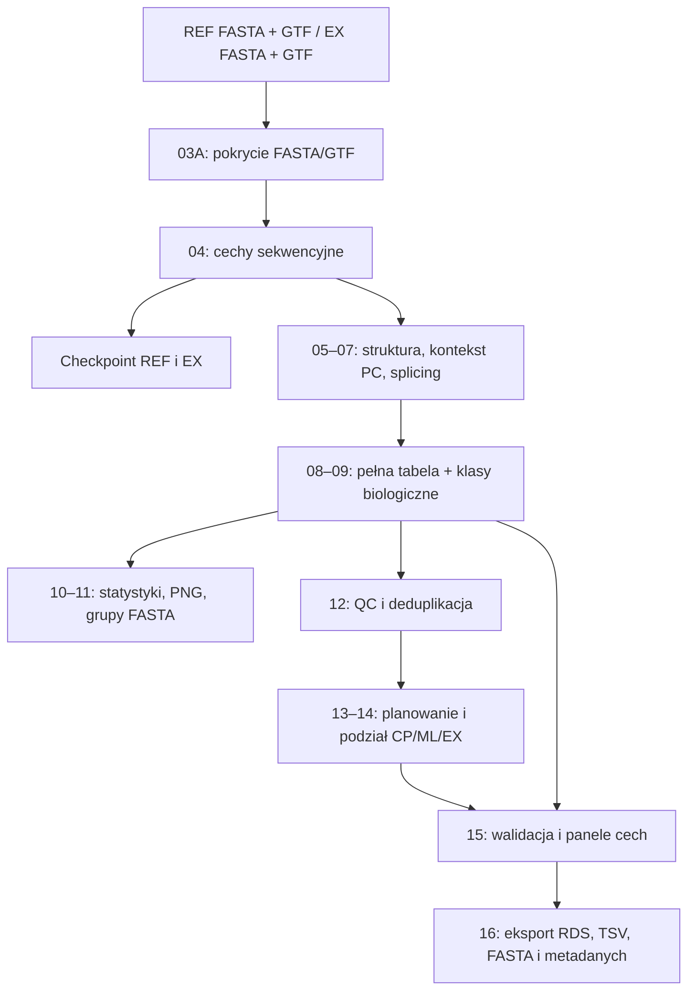
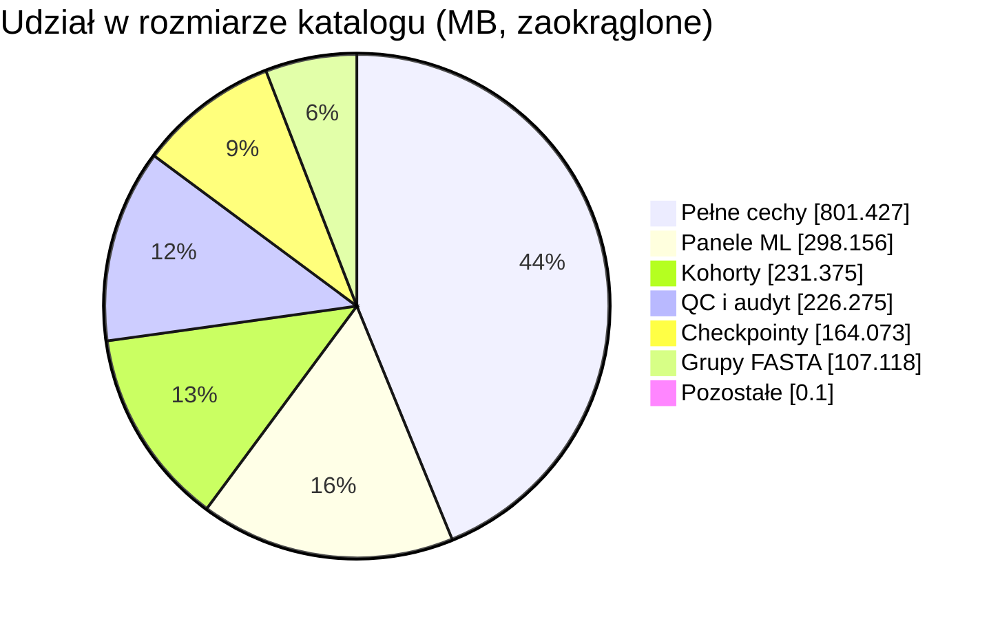
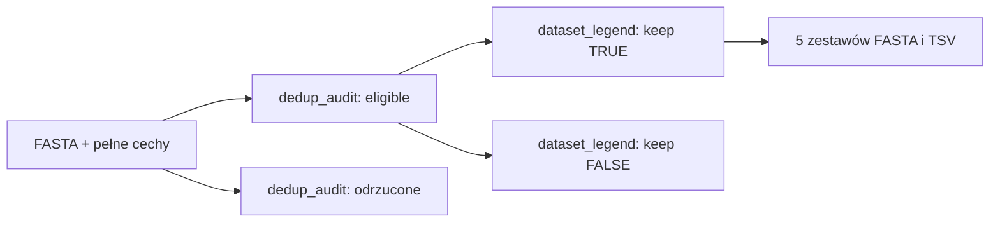

# Interpretacja plików wynikowych — CodPod_containers V4.1

**Przewodnik po wynikach `prepare_dataset_v4.1.R`** · 27 listopada 2026  
[Skrypt R](prepare_dataset_v4.1.R) · [Podręcznik techniczny i tutorial](prepare_dataset_v4.1_manual.md)

## 1. Zakres i stan danych

Przewodnik uzupełnia manual V4.1. Opisuje **wszystkie 44 pliki** zgłoszone po przebiegu Mm115 REF+EX, ich rzeczywistą strukturę według kodu źródłowego, znaczenie biologiczne, kontrolę spójności i wykorzystanie w dalszych analizach. Polecenia R są dodatkowym tutorialem do wykonania po zakończeniu głównego skryptu; nie wymagają ponownego obliczania cech.

**Granice interpretacji:** dostępna była lista nazw i rozmiarów plików, kod V4.1 oraz wcześniejsze logi diagnostyczne, nie zawartość aktualnych TSV/RDS/FASTA/PNG. Nie przypisujemy więc przebiegowi konkretnych median, odsetków duplikatów, częstości splicingu ani rzeczywistych liczebności kohort bez ich odczytu. Obecność wszystkich eksportów i zgłoszony sukces świadczą o zakończeniu przebiegu, lecz nie zastępują kontroli biologicznej, integralności plików ani walidacji modelu. R/Bioconductor nie był dostępny do wykonania poniższych dodatkowych bloków; kod sprawdzono statycznie. Podane w przykładach ustawienia to domyślna konfiguracja V4.1; rzeczywiste wartości odczytaj z `run_config.R`.

### 1.1. Jak powstają pliki?



Ważne: CP oznacza *coding potential*, ML — późniejszą klasyfikację, EX — nieetykietowany zbiór do predykcji. Skrypt nie uruchamia predyktorów CP, nie trenuje modelu ML i nie klasyfikuje EX jako lncRNA. `cds` w nazwach klas to historyczna etykieta **pełnego kodującego transkryptu**, nie sekwencji wyciętego CDS.

### 1.2. Zajętość dysku

44 pliki, 1 828 524 241 B = 1,829 GB dziesiętnie = 1,703 GiB. Wielkość pliku nie jest liczbą transkryptów, miarą jakości ani czasem obliczeń. Kompresja, długości sekwencji, liczba kolumn i długości nagłówków silnie zmieniają rozmiary.

| Grupa | Pliki | MB (10⁶ B) | Udział |
|---|---:|---:|---:|
| Pełne cechy | 3 | 801.427 | 43.829% |
| Panele ML | 2 | 298.156 | 16.306% |
| Kohorty | 11 | 231.375 | 12.654% |
| QC i audyt | 6 | 226.275 | 12.375% |
| Checkpointy | 2 | 164.073 | 8.973% |
| Grupy FASTA | 5 | 107.118 | 5.858% |
| Wykresy | 5 | 0.089 | 0.005% |
| Reprodukowalność | 3 | 0.006 | 0.000% |
| Raporty | 4 | 0.004 | 0.000% |
| Planowanie | 3 | 0.001 | 0.000% |



## 2. Kolejność czytania wyników — nie zaczynaj od największej tabeli

1. `run_config.R`, `input_checksums.tsv`, `sessionInfo.txt`: ustal, co rzeczywiście uruchomiono.
2. `fasta_gtf_coverage.tsv`, `transcriptome_summary.tsv`, `experimental_summary.tsv`: kompletność i skład danych.
3. `splice_summary.tsv`, pięć PNG: charakterystyka biologiczna i potencjalne anomalie.
4. `annotation_qc.tsv`, `missingness.tsv`, `dedup_audit.tsv`: co jest niekompletne lub wykluczane i dlaczego.
5. `dataset_legend.tsv`, `subset_validation.tsv`, `gene_overlap.tsv`: faktyczne kohorty i ryzyko przecieku informacji.
6. `epv_plan.tsv`, `test_size_plan.tsv`, `learning_curve_plan.tsv`: konfrontacja planów z liczebnościami.
7. `transcript_features.rds`, `feature_dictionary.tsv`, panele ML oraz zestawy FASTA/TSV: analizy docelowe.

### Przygotowanie sesji RStudio

```r
# Zmień ścieżkę na swój katalog. Nie wykonuj source() głównego skryptu.
out <- 'D:/lncRna/PrepDataset/Mm115_analysis_REF_EX_biostrings_v4.1'
stopifnot(dir.exists(out))
read_out <- function(n, ...) read.delim(file.path(out, n),
    sep='\t', quote='"', na.strings='NA', check.names=FALSE,
    stringsAsFactors=FALSE, fileEncoding='UTF-8', ...)
config <- dget(file.path(out, 'run_config.R'))
config[c('script_version','reference_release','assembly','include_ex',
         'genome_engine','extract_lnc','ml_neg_mode','dedup_mode','seed')]
# Funkcja dget służy do odczytu zaufanego pliku utworzonego przez własny skrypt.
# Duże TSV można szybciej odczytać z data.table::fread(), jeśli pakiet jest dostępny.
```

Wykresy tutorialowe wymagają `ggplot2`, FASTA/RDS z sekwencjami — `Biostrings`. Nie zapisujemy niczego do katalogu oryginalnego przebiegu. Własne wyniki umieszczaj w osobnym katalogu, np. `paste0(out, '_review')`.

## 3. Reprodukowalność (sekcja 16)

### `sessionInfo.txt` — 3 046 B

Raport wersji R, systemu operacyjnego, platformy i załadowanych pakietów (w tym wersji Bioconductor). Odpowiada na pytanie, w jakim środowisku wykonano analizę. Przy porównywaniu Biostrings i Rsamtools lub Windows/Linux jest niezbędny do identyfikowania różnic. Nie jest pełnym lockfile ani gwarancją identycznego środowiska; nie zapisuje np. całej konfiguracji systemu.

### `input_checksums.tsv` — 463 B

Kolumny `path`, `md5`: ścieżka i suma kontrolna MD5 istniejącego, aktywnego pliku wejściowego. Dla tej konfiguracji oczekiwane są dwa FASTA REF, GTF REF, FASTA EX, GTF EX i FASTA genomu; przy Rsamtools także istniejące aktywne indeksy. Przy silniku `none` genom nie jest uwzględniany. Kod nie zapisuje sum plików wynikowych, samego skryptu ani środowiska. Zmiana kompresji może zmienić MD5 przy identycznej biologicznej treści.

### `run_config.R` — 2 875 B

Zapis listy ustawień przez `dput()`. Przechowuje efektywne parametry, słowniki biotypów i `core_cols`. Nie jest skryptem, który po `source()` odtworzy wszystkie zmienne i obliczenia. To podstawowy dokument metodologiczny, szczególnie przy porównaniu wydań Ensembl, wariantów A/B, genomu, limitów liczebności i seed. Ścieżki mogą być względne, zatem do weryfikacji MD5 użyj pierwotnego katalogu roboczego.

```r
checks <- read_out('input_checksums.tsv')
# Uruchom z pierwotnego working directory, jeśli ścieżki są względne.
exists_now <- file.exists(checks$path)
checks$md5_now <- NA_character_
checks$md5_now[exists_now] <- unname(tools::md5sum(checks$path[exists_now]))
checks$matches <- checks$md5 == checks$md5_now
print(checks)
cat(readLines(file.path(out,'sessionInfo.txt')),sep='\n')
```

`matches=FALSE` oznacza zmianę bajtów; `NA` — brak możliwości sprawdzenia. Przechowuj te trzy małe pliki z każdym wynikiem i podaj commit GitHub, którego użyto do obliczeń. W miarę możliwości dodaj hash skryptu oraz wersje przyszłych narzędzi CP.

## 4. Raporty kompletności i charakterystyki biologicznej

### `fasta_gtf_coverage.tsv` — 2 256 B (03A)

Jeden wiersz na źródło (`reference`/`experimental`) i biotyp GTF. Brak biotypu otrzymuje `(missing_biotype)`. Kolumny:

| Pole | Definicja |
|---|---|
| `source`, `transcript_biotype` | Źródło i biotyp transkryptu, nie genu |
| `matched_n` | ID obecne jednocześnie w FASTA i GTF, po normalizacji |
| `gtf_only_n` | ID GTF bez sekwencji FASTA |
| `fasta_only_n` | ID FASTA bez GTF |
| `gtf_n` | matched + GTF-only |
| `fasta_n` | matched + FASTA-only |
| `coverage_percent` | 100 × matched / gtf_n; NA przy gtf_n=0 |

**Interpretacja:** sprawdź obecność PC i lncRNA z sekwencjami. Wysokie pokrycie nie dowodzi zgodności wersji ID lub długości. Niskie pokrycie może oznaczać niepełny FASTA, inne wydanie, błędną normalizację albo świadomie wybrany podzbiór. Dla GTF-only nie ma cech sekwencyjnych, ale część cech strukturalnych jest dostępna.

**Nasz przypadek:** wcześniejszy test jednego FASTA wykazał 152 133 ID lncRNA w GTF, zero w `cdna.all`. Drugi plik miał 158 776 ID, bez wspólnych ID z pierwszym, i pokrywał wszystkie te 152 133 ID. Oczekujemy zatem 275 134 unikalnych ID REF po imporcie obu FASTA oraz 100% pokrycia lncRNA na poziomie ID, jeśli wejścia nie zmieniły się. To oczekiwania oparte na wcześniejszym teście, nie odczyt nowego raportu. Weryfikuj, zamiast wpisywać na sztywno do publikacji.

```r
cov <- read_out('fasta_gtf_coverage.tsv')
print(cov)
stopifnot(all(cov$gtf_n == cov$matched_n+cov$gtf_only_n),
          all(cov$fasta_n == cov$matched_n+cov$fasta_only_n))
coverage_total <- aggregate(cbind(matched_n,gtf_only_n,fasta_only_n,gtf_n,fasta_n) ~ source,
                            cov, sum)
coverage_total$coverage_percent <- with(coverage_total, ifelse(gtf_n>0,100*matched_n/gtf_n,NA))
print(coverage_total)
subset(cov,source=='reference' & transcript_biotype %in% config$lncrna_biotypes)
```

Nie uśredniaj zwyczajnie odsetków biotypów — rzadkie i liczne biotypy miałyby taki sam ciężar. Sumuj liczniki i mianowniki.

```r
library(ggplot2)
z <- subset(cov,source=='reference' & gtf_n>0)
p <- ggplot(z,aes(reorder(transcript_biotype,coverage_percent),coverage_percent))+
  geom_col(fill='steelblue')+coord_flip()+theme_bw()+
  labs(x=NULL,y='Pokrycie GTF przez FASTA [%]')
p
```

### `transcriptome_summary.tsv` — 1 041 B (10, eksport 16)

Cztery grupy REF: `protein_coding`, `non_coding`, `lncRNA`, `ambiguous`. Grupy są hierarchiczne: lncRNA jest podzbiorem non_coding, nie piątą rozłączną kategorią. Kolumna `relation` opisuje relację. `annotation_missing` nie jest ujęta jako osobny wiersz. Kolumny:

| Pole | Jak czytać |
|---|---|
| `group`, `relation` | Nazwa grupy i informacja o nakładaniu kategorii |
| `n_gtf`, `n_fasta` | Liczba rekordów grupy z GTF oraz FASTA, niezależne liczniki |
| `percent_fasta` | Odsetek wszystkich REF FASTA; nie sumować z lncRNA drugi raz |
| `n_genes` | Liczba różnych dostępnych `gene_id` wśród rekordów FASTA |
| `n_unique_sequences` | Liczba różnych sekwencji w grupie (wg `sequence_group`) |
| `median_seq_length`, `mean_seq_length` | Mediana i średnia długości cDNA w nt |
| `median_exons`, `mean_exons` | Typowa i średnia liczba eksonów |
| `single_exon_percent` | Udział monoeksonowych wśród rekordów z rozpoznaną strukturą [%] |
| `median_gc` | Mediana GC w skali 0–1, wśród rozstrzygniętych wartości |
| `median_orf` | Mediana długości najdłuższego kompletnego ORF w nt |
| `median_orf_coverage` | Mediana części transkryptu zajętej przez ORF, 0–1 |
| `median_dist_pc` | Mediana odstępu do najbliższego genu PC w bp; 0 może oznaczać sąsiedztwo lub nakładanie |
| `overlap_pc_percent` | Odsetek nakładających się zakresów genowych PC wśród rekordów z rozstrzygniętą flagą |
| `missing_structure_percent` | Odsetek FASTA bez wartości `exon_count` |

Statystyki cech odnoszą się do rekordów z FASTA, nie wszystkich rekordów GTF; przy braku danych wynik jest NA. Porównuj średnią z medianą — duża różnica wskazuje możliwą asymetrię. `n_fasta - n_unique_sequences` opisuje nadmiar kopii w danej grupie przed deduplikacją; nie mierzy wszystkich wykluczeń. Suma procentów rozłącznych grup może być mniejsza od 100%, gdy występuje brak adnotacji. Nie interpretuj różnicy PC/lncRNA jako wyniku testu statystycznego ani dowodu właściwości pojedynczego transkryptu.

### `experimental_summary.tsv` — 447 B (10, eksport 16)

Taki sam zestaw statystyk (`group=experimental_unknown`, bez `relation`) dla EX. Liczebności i rozkłady dotyczą pełnej puli eksperymentalnej przed wykluczeniem sekwencji znanych w REF. Nie jest to opis samego `ex_pred`. Różnice względem REF mogą wynikać z biologii, składu próbek, assembly transkryptów, fragmentacji, różnic w adnotacji i wykrywalności. Nie przypisuj biotypu na podstawie tych statystyk. Liczba genów EX dotyczy przestrzeni nazw eksperymentalnej, np. MSTRG, a nie liczby nowych genów względem Ensembl.

```r
sm <- read_out('transcriptome_summary.tsv')
exsm <- read_out('experimental_summary.tsv')
print(sm); print(exsm)
# Rozłączne grupy REF (bez podwójnego liczenia lncRNA) + EX w osobnym panelu.
a <- rbind(sm[sm$group!='lncRNA',names(exsm)],exsm)
a$source <- ifelse(a$group=='experimental_unknown','EX','REF')
ggplot(a,aes(group,n_fasta,fill=group))+geom_col()+
  facet_wrap(~source,scales='free_x')+theme_bw()+
  theme(axis.text.x=element_text(angle=30,hjust=1),legend.position='none')+
  labs(x=NULL,y='Liczba transkryptów FASTA przed QC')
```

### `splice_summary.tsv` — 401 B (07, eksport 16)

Raport globalny wg źródła, nie wg biotypu. Dotyczy **wystąpień intronów w transkryptach**, w tym struktur dostępnych tylko z GTF; nie unikalnych junctions w genomie ani odczytów RNA-seq. Ten sam intron w kilku izoformach zostaje policzony kilka razy.

| Kolumna | Znaczenie |
|---|---|
| `source`, `genome_engine` | REF/EX, silnik użyty do pobrania DNA |
| `transcripts`, `introns` | Liczba struktur transkryptów w analizie i suma intronów |
| `gt_ag`, `gc_ag`, `at_ac` | Liczby rozpoznanych motywów końców intronów po uwzględnieniu nici |
| `canonical` | Suma trzech wyżej wymienionych motywów (definicja operacyjna projektu) |
| `noncanonical` | Pozostałe rozstrzygnięte pary dinukleotydów A/C/G/T |
| `unknown` | Motyw nierozstrzygnięty, np. brak contigu, zła pozycja, nieznana nić, N, za krótki intron |
| `resolved` | canonical + noncanonical |
| `noncanonical_percent` | 100 × noncanonical / resolved |
| `resolved_percent` | 100 × resolved / introns |

Przy `none` liczniki motywów i ich odsetki są NA, a nie zero. Przy włączonym genomie sprawdź bilanse. Podwyższony odsetek niekanonicznych w EX może być sygnałem błędu montażu, alignmentu, assembly lub rzeczywistej nietypowej biologii. Najpierw sprawdź pokrycie `resolved_percent`, zgodność genomu z GTF i motywy w konkretnych locus. Nie uznawaj każdego GT-AG za potwierdzone zdarzenie splicingu ani każdego innego motywu za błąd. Sam motyw nie rozróżnia niezawodnie U2/U12; do walidacji potrzebne są dodatkowe dane, np. junction reads.

```r
sp <- read_out('splice_summary.tsv'); print(sp)
s <- subset(sp,genome_engine!='none')
stopifnot(all(s$canonical==s$gt_ag+s$gc_ag+s$at_ac),
          all(s$resolved==s$canonical+s$noncanonical),
          all(s$introns==s$resolved+s$unknown))
sp_long <- do.call(rbind,lapply(c('gt_ag','gc_ag','at_ac','noncanonical','unknown'),function(k)
  data.frame(source=s$source,motif=k,n=s[[k]],total=s$introns)))
sp_long$percent <- with(sp_long,ifelse(total>0,100*n/total,NA))
ggplot(sp_long,aes(source,percent,fill=motif))+geom_col()+theme_bw()+
  labs(x=NULL,y='% wszystkich wystąpień intronów',fill='Motyw')
```

Ten wykres używa wszystkich intronów jako mianownika, inaczej niż `noncanonical_percent` (tylko rozstrzygnięte). Rzadkie motywy warto dodatkowo pokazać w tabeli lub osobnym panelu. Porównanie klas wymaga odczytu `transcript_features.rds` i sumowania liczników, nie średniej `noncanonical_fraction`.

## 5. Pełny katalog cech, słownik i panele ML

### `transcript_features.tsv` — 649 474 783 B; `transcript_features.rds` — 151 935 464 B (08–09, eksport 16)

Oba pliki zapisują ten sam obiekt `final_features`. Jeden wiersz na `record_id = source::transcript_id` w pełnej unii FASTA i GTF osobno dla każdego źródła. Nie tylko rekordy kwalifikujące się do treningu, również odrzucone oraz bez sekwencji. TSV jest czytelny dla innych języków, RDS zachowuje typy R. RDS nie zawiera samych pełnych sekwencji DNA jako osobnej kolumny, tylko ich cechy i nagłówki/metadane. Nie importuj 650 MB TSV do Excela jako pierwszego kroku; typy mogą ulec zmianie. Do R preferuj RDS (około 4,27 razy mniejszy na dysku, nie gwarantuje takiego samego stosunku w RAM).

Najważniejsze rodziny kolumn:

| Rodzina | Przykładowe kolumny i interpretacja |
|---|---|
| ID i pochodzenie | `record_id`, `transcript_id`, `source`, `fasta_id`, `original_header`, `fasta_files`, `gtf_transcript_id`, `gene_id`, `gene_name`; kluczem łączenia REF i EX jest record_id |
| Kontrola jakości | `has_fasta`, `has_gtf`, `annotation_status`, `length_difference`, `length_match`, `version_match`, `label_conflict`, `sequence_group` |
| Klasy biologiczne | `main_class`, `is_lncrna`, `label_source`, `transcript_biotype`, `gene_biotype`; EX pozostaje unknown |
| Skład sekwencji | `seq_length`, `gc_content`, `a_content` itd., `n_fraction`, `ambiguous_fraction`, `sequence_entropy`, `k2_*`, opcjonalne `k3_*` |
| ORF | `max_orf_len`, `orf_coverage`, `orf_count`, `orf_start`, `orf_end`; ATG do pierwszego STOP w ramce, STOP wliczony, standardowy kod jądrowy, trzy ramki cDNA |
| Koniec 3′ | `pas_present`, `pas_distance_from_end`, `terminal_A_run`; AATAAA/ATTAAA w końcowym oknie, nie dowód poliadenylacji |
| Eksony/introny | `exon_count`, `tx_length`, `intron_count`, `total_intron_len`, statystyki długości, `first_exon_fraction`, `last_exon_fraction`, `genomic_span`, `exon_density`, `exon_intron_ratio` |
| Genom | `seqname`, `strand`, `tx_start`, `tx_end`, `isoforms_per_gene`, `dist_to_pc`, `dist_to_nearest_tss`, `nearest_pc_gene_id`, `genomic_class`, `exonic_overlap_fraction`, flagi nakładania i orientacja sąsiada |
| Splicing | `gt_ag`, `gc_ag`, `at_ac`, `canonical_junctions`, `noncanonical_junctions`, `unknown_junctions`, `noncanonical_fraction` |

`seq_length` to długość FASTA, `tx_length` suma szerokości eksonów, `genomic_span` obejmuje także introny. GC dzielimy przez liczbę A/C/G/T, a nie zawsze przez całą długość. Entropia składu w bitach, teoretyczne maksimum 2. ORF coverage i frakcje w skali 0–1. `sequence_group` jest indeksem pierwszej identycznej sekwencji **wewnątrz źródła**, nie globalnym hashem i nie cechą ML. NA oznacza brak lub nieokreśloność, nie zastępuj zerem bez uzasadnienia. Monoeksonowy transkrypt ma 0 intronów, lecz nieokreślone statystyki długości intronu oraz frakcję niekanonicznych junctions. Brak PAS: `pas_present=FALSE`, `pas_distance_from_end=NA`.

```r
# Odczyt w czystej sesji: duży obiekt, zaplanuj RAM.
f <- readRDS(file.path(out,'transcript_features.rds'))
dim(f); format(object.size(f),units='MiB'); names(f)
stopifnot(!anyDuplicated(f$record_id))
with(f,table(source,annotation_status,useNA='ifany'))
with(f,table(source,main_class,useNA='ifany'))
# Przykład wyświetlenia cech jednego lncRNA z dostępną sekwencją:
ix <- which(f$source=='reference' & f$is_lncrna %in% TRUE & f$has_fasta)
head(f[ix,c('record_id','gene_id','seq_length','exon_count','gc_content','max_orf_len','orf_coverage')],10)
```

### `feature_dictionary.tsv` — 17 040 B (15)

Słownik każdej kolumny pełnej tabeli: `feature`, `use`, `source`, `unit`, `definition`, `notes`. `core_candidate` oznacza kandydat do panelu Core, `extended_requires_validation` — kandydat wymagający dodatkowej kontroli, `description_or_qc` — metadane/cecha opisowa. Definicje części kolumn są automatycznymi opisami i wymagają konsultacji z manualem; oznaczenie `category_or_ratio` jest zbiorcze. Nie traktuj słownika jako formalnego schematu typów. To dobry punkt wyjścia dla tabeli suplementarnej publikacji.

### `ml_features_core.tsv` — 139 281 009 B (15)

`record_id` + jawna biała lista 26 cech bazowych i 27. cecha `noncanonical_fraction` tylko przy włączonym genomie. Wszystkie rekordy `final_features`, także bez FASTA, nie są gotowym zbiorem treningowym. Brak `role`, więc nie ucz modelu bez przydziału z legendy. Dinukleotydy i opcjonalne trimery są w pełnym katalogu, ale nie w Core V4.1. Core zawiera długość, GC, ORF, entropię, architekturę i PAS/terminal A; nie zawiera adnotowanego biotypu, ID genu ani kontekstu PC. Przy rozpoznanej niezgodności długości lub wersji kolumny strukturalne Core są maskowane jako NA (pełna tabela zachowuje wartości). Brak struktury nie oznacza automatycznego odrzucenia EX.

### `ml_features_extended_candidates.tsv` — 158 874 940 B (15)

Core + osiem kandydatów: `isoforms_per_gene`, `dist_to_pc`, `dist_to_nearest_tss`, `neighbor_orientation`, `overlap_same_strand`, `overlap_opposite_strand`, `exonic_overlap_fraction`, `overlapping_pc_genes`. Nie jest panelem rekomendowanym do bezpośredniego treningu. Własny gen PC w referencji może ujawnić etykietę (self-match); EX ma inną historię adnotacji. Konieczne są niezależne tło genomowe, ablation study, kontrola domain shift i podział według genu/locus przed oceną tych cech. `neighbor_orientation` jest kategorią. Przy niezgodności wersji/długości maskowane są także te osiem kolumn.

```r
fd <- read_out('feature_dictionary.tsv'); print(table(fd$use))
print(fd[fd$use=='core_candidate',c('feature','unit','definition')],row.names=FALSE)
# Sprawdzenie nagłówków bez odczytu pełnej dużej macierzy:
core_names <- names(read_out('ml_features_core.tsv',nrows=0))
ext_names <- names(read_out('ml_features_extended_candidates.tsv',nrows=0))
stopifnot(identical(core_names,c('record_id',config$core_cols)))
setdiff(ext_names,core_names)
stopifnot(setequal(fd$feature,names(f)))
```

**Interpretacja metodologiczna:** wiele cech jest skorelowanych (np. ORF length, coverage i długość; statystyki eksonów), więc 27 kolumn nie oznacza automatycznie 27 niezależnych parametrów modelu. Imputację, skalowanie, selekcję cech, ewentualne kodowanie kategorii i tuning ucz wyłącznie na treningu/w foldach CV. Nie używaj testów do optymalizacji.

## 6. Pięć wykresów PNG (sekcja 10)

Wszystkie powstają z REF z FASTA, z rozłącznymi klasami `protein_coding`, `lncRNA`, `nc_other`, `ambiguous`, bez EX i bez `annotation_missing`. Boxploty wykluczają wartości niefinitywne. `genomic_class.png` wyklucza NA klasy genomowej. Rozkłady są przed deduplikacją i limitowaniem kohort. Wartość boxplotów: mediana, Q1–Q3, wąsy do ostatnich obserwacji w granicach 1,5 IQR, punkty poza wąsami. Punkty odstające nie są automatycznie błędami. Domyślna grafika nie pokazuje liczebności grup ani istotności statystycznej.

| Plik | Oś Y | Co interpretować |
|---|---|---|
| `seq_length.png` | log10(seq_length) | Długości; różnica o 1 jednostkę = 10 razy, 3 = 1000 nt. Szeroki rozrzut może oznaczać heterogeniczną grupę |
| `exon_count.png` | Liczba eksonów | Porównanie mono- i wieloeksonowych; rozkład prawoskośny może być słabo widoczny na osi liniowej |
| `gc_content.png` | GC 0–1 | Np. 0,45 = 45%. Różnice grup mogą wynikać z biologii lub techniki. Rozkłady nie muszą rozdzielać klas |
| `orf_coverage.png` | Najdłuższy kompletny ORF / długość | PC często ma większą wartość; nakładanie z lncRNA jest oczekiwane. Brak kompletnego ORF może być skutkiem fragmentacji |
| `genomic_class.png` | Ułamek 0–1 w obrębie klasy | Skład kategorii kontekstu genomowego względem PC, nie bezwzględna liczba transkryptów |

Kontekst: `intergenic` = brak nakładania z zakresem PC w objętym referencją contigu; `antisense` = przeciwna nić; `sense_overlapping` = zgodna nić i nakładanie eksonowe; `sense_intronic` = cały zakres query w intronie PC na tej samej nici; `sense_other_overlap` = pozostałe nakładanie zgodnej nici; `mixed_strand_overlap` = nakładanie obu orientacji; `overlap_unresolved` = nakładanie, którego orientacji/kategorii nie rozstrzygnięto; `protein_coding_locus` = własne gene_id należące do referencyjnego zbioru PC (może dotyczyć również niekodującej izoformy genu PC). Priorytety są ustalone w `calc_genomic_features()`, nie są to niezależne etykiety. Brak klasy nie oznacza intergenic.

Otwórz PNG w RStudio lub dołącz do Markdown lokalnymi linkami. Wykresy nie zostały udostępnione do oględzin, więc opis nie twierdzi, że widzimy konkretny kształt pudełek w Twoich plikach.

### Dodatkowy wykres porównujący REF i EX

```r
pdat <- f[f$has_fasta & f$main_class %in% c('protein_coding','non_coding','ambiguous','unknown'),
          c('source','main_class','is_lncrna','seq_length','gc_content','orf_coverage','exon_count')]
pdat$group <- ifelse(pdat$source=='experimental','EX_unknown',
                    ifelse(pdat$is_lncrna %in% TRUE,'lncRNA',
                           ifelse(pdat$main_class=='non_coding','nc_other',pdat$main_class)))
ggplot(pdat,aes(group,orf_coverage,fill=group))+geom_boxplot(outlier.alpha=.1)+
  theme_bw()+theme(axis.text.x=element_text(angle=30,hjust=1),legend.position='none')+
  labs(x=NULL,y='Frakcja sekwencji zajęta przez najdłuższy ORF')
# Gęstość dwuwymiarowa w kafelkach: obserwacje nie znikają pod milionem punktów.
ggplot(subset(pdat,is.finite(gc_content)&is.finite(orf_coverage)),aes(gc_content,orf_coverage))+
  geom_bin2d(bins=40)+facet_wrap(~group)+scale_fill_viridis_c(trans='log10')+
  theme_bw()+labs(x='GC (0–1)',y='ORF coverage (0–1)',fill='Liczba')
```

## 7. Pięć biologicznych grup FASTA (sekcja 11)

| Plik | Zawartość | Wykorzystanie |
|---|---|---|
| `protein_coding.fa.gz` | Referencyjne transkrypty PC z pełnym cDNA | Charakterystyka, kontrola pozytywnych sygnałów kodowania; w CP/ML historyczna rola neg |
| `non_coding.fa.gz` | Wszystkie REF non_coding, łącznie z lncRNA | Szeroki zestaw NC do analiz opisowych i projektu CP |
| `lncRNA.fa.gz` | Podzbiór non_coding oznaczony jako lncRNA | Analizy specyficzne dla lncRNA |
| `ambiguous.fa.gz` | REF z nierozstrzygniętym biotypem wg słowników projektu, np. pseudogeny, retained_intron | Osobny materiał do eksploracji, nie automatyczna negatywna/pozytywna klasa |
| `annotation_missing.fa.gz` | REF z klasy annotation_missing (brak odpowiedniej adnotacji biotypu) | Diagnostyka; nie zawiera GTF-only, bo nie mają sekwencji |

Pliki zachowują oryginalne nagłówki FASTA. Powstają **przed** kontrolą jakości treningu i deduplikacją z sekcji 12. Nie zastępują kohort treningowych, mogą zawierać kopie tej samej sekwencji oraz rekordy później wykluczane. `lncRNA.fa.gz` i `non_coding.fa.gz` nakładają się z definicji. Nie łącz ich bez deduplikacji. `annotation_missing.fa.gz` ma 20 B — typowy rozmiar pustego gzip w tej implementacji; najprawdopodobniej brak rekordów, ale odczytaj plik, aby to potwierdzić. Nie oznacza braku wszystkich problemów QC (np. GTF-only, niezgodności długości).

```r
library(Biostrings)
# Obsługa pustego gzip: nie zakładamy, że readDNAStringSet zawsze odczyta pusty plik.
read_fa <- function(n) {
  path <- file.path(out,n)
  con <- gzfile(path,'rt'); first <- tryCatch(readLines(con,n=1L,warn=FALSE),finally=close(con))
  if(!length(first)) return(DNAStringSet())
  readDNAStringSet(path)
}
# Czytaj po jednym, aby nie mnożyć zużycia RAM.
biogroups <- c('protein_coding','non_coding','lncRNA','ambiguous','annotation_missing')
fa_stats <- do.call(rbind,lapply(biogroups,function(g) {
  x <- read_fa(paste0(g,'.fa.gz')); w <- width(x)
  data.frame(group=g,n=length(x),total_nt=sum(as.double(w)),
             median_nt=if(length(w)) median(w) else NA_real_)
}))
print(fa_stats)
stopifnot(all(fa_stats$n[match(sm$group,fa_stats$group)]==sm$n_fasta))
```

## 8. Kontrola jakości i ścieżka odrzucania rekordów

### `annotation_qc.tsv` — 68 205 472 B (16)

Dziesięć kolumn z pełnej tabeli: `record_id`, `fasta_files`, `annotation_status`, `has_fasta`, `has_gtf`, `length_match`, `length_difference`, `version_match`, `label_conflict`, `main_class`. `matched` = ID istnieje w obu, `fasta_missing` = GTF-only, `annotation_missing` = FASTA-only. Uwaga: kolumna `main_class` o tej samej wartości `annotation_missing` może także oznaczać brak rozpoznanego biotypu w GTF; to nie identyczna definicja jak `annotation_status`. `length_difference = seq_length - tx_length`, dodatnia oznacza dłuższą FASTA. `version_match` jest NA, gdy brak porównywalnych wersji. Nie interpretuj NA jako TRUE. `label_conflict` dotyczy sprzeczności jawnej grupy FASTA i adnotacji (szczególnie wariant separate), nie niezgodności predykcji ML. Rozpoznane konflikty wersji/etykiet i domyślnie długości wykluczają REF z treningu. EX nie otrzymuje tego samego filtra etykiet — część cech może być niedostępna.

```r
# Jeśli f już w pamięci, wykorzystaj kolumny zamiast czytać drugi duży plik.
q <- read_out('annotation_qc.tsv')
q$source <- sub('::.*$','',q$record_id)
with(q,table(source,annotation_status))
with(q,table(source,length_match,useNA='ifany'))
with(q,table(source,version_match,useNA='ifany'))
with(q,table(source,label_conflict,useNA='ifany'))
head(subset(q,length_match %in% FALSE),20)
```

### `missingness.tsv` — 2 016 B (16)

Dwie kolumny: `feature`, `missing_n` (liczba NA w całej pełnej tabeli). Bez rozbicia REF/EX, bez procentów, przed maskowaniem w panelu Core. Nie liczy Inf jako NA ani pustych napisów. Duża liczba NA może być strukturalnie uzasadniona: GTF-only nie mają FASTA, brak intronów nie daje średniej długości intronów, brak PAS nie daje odległości do PAS, wyłączony genom powoduje NA wszystkich motywów. EX nie ma etykiety lncRNA, a zatem `is_lncrna=NA` jest celowe. Nie odrzucaj automatycznie kolumny tylko na podstawie globalnego NA.

```r
ms <- read_out('missingness.tsv')
ms$missing_percent <- 100*ms$missing_n/nrow(f)
print(head(ms[order(-ms$missing_n),],20))
# Dodatkowa diagnostyka modelowa: osobno kohorty, po maskowaniu, patrz sekcja 10.
ggplot(head(ms[order(-ms$missing_n),],20),aes(reorder(feature,missing_percent),missing_percent))+
  geom_col()+coord_flip()+theme_bw()+labs(x=NULL,y='NA w pełnej tabeli [%]')
```

### `dedup_audit.tsv` — 49 465 833 B (12, eksport 16)

Jeden wiersz na wejściowy rekord FASTA przed deduplikacją (nie obejmuje GTF-only). `record_id`, `raw_group`, `class`, `representative_record_id`, `reason`. `raw_group` może już odzwierciedlać wykluczenie REF przez QC. `class` to klasy po wyborze A/B, a nie to samo co `main_class`. Reprezentant identycznej kopii według wybranego klucza ma ID zachowanego rekordu; przy innych wykluczeniach często NA. Przy domyślnym `exact_seq` deduplikacja dotyczy całej identycznej sekwencji (nie podobieństwa, fragmentów, homologii, reverse-complement czy locus).

| `reason` | Interpretacja |
|---|---|
| `eligible` | Pozostaje w puli przed splitem; nie gwarantuje końcowego `keep=TRUE` |
| `duplicate` | Kopia wg wybranego trybu deduplikacji, odsyła do reprezentanta |
| `known_reference_exact` | EX identyczny z dowolną sekwencją REF, także ambiguous lub REF odrzuconą przez QC |
| `not_labeled_for_training` | REF bez kwalifikującej etykiety lub zaklasyfikowany jako annotation_missing po QC |
| `conflicting_labels` | Identyczna sekwencja oznaczona jednocześnie jako PC i NC; obie wykluczone z treningu |

`known_reference_exact` nie jest dowodem, że pozostałe EX to nowe geny/nowe izoformy. Mogą mieć minimalne różnice sekwencji, te same junctions, częściowe nakładanie lub to samo locus. Do ustalenia nowości trzeba osobnej analizy porównawczej struktur i podobieństwa. W A klasy `lnc_ext` mają pierwszeństwo przed `nc` przy deduplikacji niekodujących kopii. To polityka projektu, nie dowód biologiczny o wyższości etykiety.

```r
audit <- read_out('dedup_audit.tsv')
audit$source <- sub('::.*$','',audit$record_id)
stopifnot(!anyDuplicated(audit$record_id))
with(audit,table(source,reason)); with(audit,table(class,reason))
a <- as.data.frame(with(audit,table(source,reason)))
ggplot(a,aes(source,Freq,fill=reason))+geom_col()+theme_bw()+
  labs(x=NULL,y='Rekordy FASTA',fill='Decyzja sekcji 12')
# Do rozróżnienia braków biotypu od QC połącz z f przez record_id.
i <- match(audit$record_id,f$record_id)
stopifnot(!anyNA(i),all(f$has_fasta[i]))
with(f[i,],table(main_class,audit$reason,useNA='ifany'))
```

### `dataset_legend.tsv` — 108 601 407 B (14, eksport 16)

Mapa między biologicznym rekordem a nowym ID kohorty. Zawiera rekordy eligible z sekcji 12, również te później odrzucone przez limity/balansowanie. Nie zawiera pełnych sekwencji ani wszystkich rekordów wcześniejszego audytu. Kolumny w obecnym trybie: `record_id`, `source`, `old_name`, `raw_group`, `is_lncrna`, `class`, `ID`, `stage`, `tt_set`, `keep`, `role`, `drop_reason`, `cohort` (kolejność sprawdź w nagłówku).

- `ID`: nowy unikalny klucz, np. `Mus_lnc_0000001`; służy do powiązania przyszłych wyników CP z ML. Nie rozpoznawaj roli na podstawie samego tekstu ID, użyj `role` i konfiguracji.
- `stage`: `cp`, `ml`, `inference`; `tt_set`: `train`, `test`, `predict`.
- `role`: `pos` (NC w CP, lncRNA w ML A), `neg` (PC lub określony przez wariant NC), `unknown` dla EX; w ML przy wykluczeniu nc_other może być NA.
- `keep`: ostateczna decyzja o eksporcie; `drop_reason`: `cap_or_balance`, `ml_nc_other_excluded` albo NA.
- `cohort`: nazwa klasy, etapu i train/test lub `ex_inference`. Rozróżnia przydział także rekordów niewyeksportowanych.



```r
leg <- read_out('dataset_legend.tsv')
stopifnot(!anyDuplicated(leg$ID),!anyDuplicated(leg$record_id),
          setequal(leg$record_id,audit$record_id[audit$reason=='eligible']))
with(leg,table(stage,tt_set,keep,useNA='ifany'))
with(leg,table(class,drop_reason,useNA='ifany'))
kept <- subset(leg,keep)
with(kept,table(paste(stage,tt_set,sep='_'),role))
with(kept,table(paste(stage,tt_set,sep='_'),class))
```

## 9. Planowanie liczebności, nie wyniki modelowania (13)

### `epv_plan.tsv` — 133 B

`parameters`, `epv`, `target_ml_train_per_class`, `approximate_input_per_limiting_class`. Roboczy kalkulator EPP/EPV: cel = ceiling(parameters × epv), orientacyjna pula przed podziałem = ceiling(cel / [(1−cp_stage_prop) × ml_tt_prop]). Dla domyślnych 25 parametrów i EPV 10/15/20 cel wynosi 250/375/500 rekordów w klasie ograniczającej ML train. Przed podziałem przy proporcjach 0,4 i 0,75 odpowiednio około 556/834/1112. Nie uwzględnia dokładnie limitów, deduplikacji, niezależności genów, stopni swobody, typu modelu, prevalencji i oczekiwanej skuteczności. Nie jest formalną analizą mocy ani regułą dla wszystkich modeli.

### `test_size_plan.tsv` — 118 B

`anticipated_proportion`, `half_width`, `approximate_n_per_class`, `method`. Przybliżenie Wald dla 95% CI czułości: n = ceiling(z² × p(1−p) / d²). Domyślne p=0,90 i d=0,03 dają orientacyjnie 385 niezależnych pozytywnych przypadków. Analogicznie specyficzność wymaga negatywnych przypadków i własnego założenia p. To nie jest oszacowanie faktycznego CI. Później stosuj odpowiednie przedziały (np. Wilson) i uwzględnij zależności transkryptów w obrębie genów.

### `learning_curve_plan.tsv` — 314 B

`n_per_class`, `repeat_seed`. Siatka 6 liczebności (100, 250, 500, 1000, 2000, 5000) × 5 seedów, czyli 30 planowanych eksperymentów. Nie zawiera metryk ani wytrenowanych modeli. Dla każdej liczebności losuj podzbiór treningowy, trenuj od nowa preprocessing i model, oceniaj na odpowiednim niezależnym zbiorze walidacyjnym/CV. Końcowy test zachowaj do jednorazowej oceny wybranego modelu. Nie pobieraj brakujących rekordów z testu.

```r
E <- read_out('epv_plan.tsv'); T <- read_out('test_size_plan.tsv'); L <- read_out('learning_curve_plan.tsv')
actual_ml <- with(subset(kept,stage=='ml' & tt_set=='train'),table(factor(role,levels=c('pos','neg'))))
E$actual_limiting <- min(actual_ml)
E$target_met <- E$actual_limiting>=E$target_ml_train_per_class
L$feasible_by_count <- L$n_per_class<=min(actual_ml)
print(E); print(T); print(L)
# Wykres pokazuje wyłącznie plan i liczebności, nie accuracy/AUC.
ggplot(E,aes(factor(epv),target_ml_train_per_class))+geom_col()+
  geom_hline(yintercept=min(actual_ml),linetype=2)+theme_bw()+
  labs(x='Scenariusz EPV',y='Liczba w mniejszej klasie ML train')
```

## 10. Właściwe kohorty do dalszych analiz (14–16)

Pięć par FASTA i TSV. FASTA zawiera **pełne sekwencje** z nowymi ID, TSV zawiera `ID`, `record_id`, `role` i `config$core_cols` w kolejności odpowiadającej FASTA. Są to ostateczne kohorty z `keep=TRUE`, po deduplikacji i limitach, a nie pierwotne grupy biologiczne. CP i ML mają rozłączne sekwencje; EX pozostaje nieetykietowane. Zestawy train/test zawierają obie role. W testach nie wymuszono balansu, chociaż limity i duże pule mogą dać równą liczebność.

| FASTA | TSV | Zadanie |
|---|---|---|
| `cp_train.fa.gz` | `cp_train_features.tsv` | Uczenie/kalibracja trenowalnych narzędzi CP na NC vs PC |
| `cp_test.fa.gz` | `cp_test_features.tsv` | Ocena CP bez uczenia na tych rekordach |
| `ml_train.fa.gz` | `ml_train_features.tsv` | Trening meta-modelu ML, w A1 lncRNA vs PC |
| `ml_test.fa.gz` | `ml_test_features.tsv` | Niezależny test transkryptowy ostatecznego ML |
| `ex_pred.fa.gz` | `ex_pred_features.tsv` | Predykcja nieznanych EX, po usunięciu identycznych REF i duplikatów |

W A1 (`extract_lnc=TRUE`, `ml_neg_mode=cds_only`) NC inne niż lncRNA mogą wystąpić jako pos w CP, ale nie w ML. W A2 (`cds_and_nc_other`) ML neg może zawierać NC inne niż lncRNA. W B (`extract_lnc=FALSE`) oba etapy porównują NC vs PC. `pos` jest tu klasą niekodującą/lncRNA; narzędzie z przeciwną konwencją musi mieć jawnie przekodowany wynik.

### Maksymalne liczebności z konfiguracji domyślnej

| Kohorta | Maksimum per rola | Maksimum łącznie |
|---|---:|---:|
| CP train | 8 000 | 16 000 |
| CP test | 2 000 | 4 000 |
| ML train | 15 000 | 30 000 |
| ML test | 5 000 | 10 000 |
| EX pred | bez limitu CP/ML | liczba EX eligible |

To limity wynikające z `max_n_cp=10000`, `max_n_ml=20000` oraz proporcji 0,8/0,75, nie odczyt rzeczywistych liczebności. Losowanie osobno w klasach, następnie odrzucenie niewłaściwych klas i limitowanie/balansowanie mogą je zmniejszyć. Rozmiary plików nie dowodzą, że limity zostały osiągnięte.

### `dataset_split.rds` — 93 454 465 B

Lista `wynik` z dwoma elementami: `seqs` (DNAStringSet wszystkich eligible po przydziale ID, również `keep=FALSE`) oraz `legend` (odpowiednik TSV). To wygodny sposób odtworzenia kohort bez czytania wielu FASTA i bez ponownego losowania. Nie jest zapisanym modelem. Nie podawaj całego `wynik$seqs` do treningu: użyj `legend$keep`, `stage`, `tt_set`, `role`.

```r
# Alternatywa do czytania poszczególnych FASTA; może zajmować więcej RAM.
w <- readRDS(file.path(out,'dataset_split.rds'))
stopifnot(identical(names(w$seqs),w$legend$ID))
idx <- which(w$legend$keep & w$legend$stage=='ml' & w$legend$tt_set=='train')
ml_train_dna <- w$seqs[w$legend$ID[idx]]
length(ml_train_dna); table(w$legend$role[idx])
```

### Walidacja wszystkich par FASTA/TSV i rzeczywiste liczebności

```r
cohorts <- c('cp_train','cp_test','ml_train','ml_test','ex_pred')
selector <- function(n) {
  if(n=='ex_pred') return(leg$keep & leg$stage=='inference' & leg$tt_set=='predict')
  z <- strsplit(n,'_',fixed=TRUE)[[1]]
  leg$keep & leg$stage==z[1] & leg$tt_set==z[2]
}
cohort_counts <- do.call(rbind,lapply(cohorts,function(n) {
  x <- read_fa(paste0(n,'.fa.gz'))
  m <- read_out(paste0(n,'_features.tsv'))
  z <- leg[which(selector(n)),]
  stopifnot(identical(names(x),m$ID),!anyDuplicated(m$ID),!anyDuplicated(m$record_id),
            !anyDuplicated(as.character(x)),setequal(z$ID,m$ID),
            identical(m$record_id,z$record_id[match(m$ID,z$ID)]),
            identical(m$role,z$role[match(m$ID,z$ID)]),
            identical(names(m),c('ID','record_id','role',config$core_cols)),
            all(width(x)==m$seq_length))
  data.frame(cohort=n,n=nrow(m),pos=sum(m$role=='pos'),neg=sum(m$role=='neg'),
             unknown=sum(m$role=='unknown'),median_nt=if(length(x)) median(width(x)) else NA_real_)
}))
print(cohort_counts)
cc <- do.call(rbind,lapply(c('pos','neg','unknown'),function(k)
  data.frame(cohort=cohort_counts$cohort,role=k,n=cohort_counts[[k]])))
ggplot(cc,aes(cohort,n,fill=role))+geom_col()+theme_bw()+
  labs(x=NULL,y='Liczba ostatecznie wyeksportowanych transkryptów')
```

### Kontrola braków w panelu Core dla każdej kohorty

```r
cm <- do.call(rbind,lapply(cohorts,function(n) {
  d <- read_out(paste0(n,'_features.tsv'))
  data.frame(cohort=n,feature=config$core_cols,
    missing_percent=if(nrow(d)) 100*colMeans(is.na(d[,config$core_cols,drop=FALSE])) else NA_real_)
}))
ggplot(cm,aes(cohort,feature,fill=missing_percent))+geom_tile()+
  scale_fill_viridis_c(limits=c(0,100),na.value='grey90')+theme_bw()+
  labs(x=NULL,y=NULL,fill='NA [%]')
```

Porównanie REF/EX może ujawnić, że cecha jest prawie kompletna w treningu, lecz niedostępna w predykcji. To ryzyko domain shift. Zera nie są imputacją uniwersalną. W przypadku cech strukturalnie nieokreślonych można rozważyć modelowanie informacji o braku, ale nie pozwól, aby informacja o pochodzeniu danych stała się zastępczą etykietą. Nie dopasowuj transformacji na EX/test.

## 11. Walidacja rozłączności i przecieku informacji (15)

### `subset_validation.tsv` — 305 B

10 par spośród pięciu kohort. Kolumny `set1`, `set2`, `shared_ids`, `shared_sequences`. Obie liczbowe powinny być równe zero w każdym wierszu. Liczone są unikalne wspólne ID i unikalne wspólne identyczne sekwencje; skrypt osobno sprawdza duplikaty wewnętrzne. Nie jest to kontrola homologii, podobieństwa, locus ani wspólnych genów. Nie gwarantuje, że modele zewnętrzne nie były wcześniej trenowane na Ensembl. Własne wyniki narzędzi CP połącz z ML po `ID`, a nie po kolejności wierszy.

### `gene_overlap.tsv` — 194 B

6 par czterech referencyjnych kohort CP/ML. `set1`, `set2`, `shared_gene_ids` — liczba różnych genów wspólnych między kohortami, bez NA. Nie obejmuje EX, bo przestrzeń nazw genów jest inna. Wartość większa od zera jest możliwa i nie powoduje błędu w V4.1: podział jest transkryptowy, nie genowy. Wspólne izoformy jednego genu mogą zawyżać metryki i naruszać niezależność. Do publikacji rozważ dodatkowy benchmark z podziałem genowym lub locus, a przy silnym podobieństwie sekwencji — grupowanie homologii. Nie zmieniaj wyniku raportu na zero przez usuwanie wierszy.

```r
v <- read_out('subset_validation.tsv'); g <- read_out('gene_overlap.tsv')
print(v); print(g)
stopifnot(nrow(v)==10L,nrow(g)==6L,
          all(v$shared_ids==0),all(v$shared_sequences==0))
# Nie stawiamy stopifnot(g$shared_gene_ids==0), bo to inny poziom walidacji.
g$pair <- paste(g$set1,g$set2,sep=' / ')
ggplot(g,aes(reorder(pair,shared_gene_ids),shared_gene_ids))+geom_col()+coord_flip()+theme_bw()+
  labs(x=NULL,y='Liczba wspólnych gene_id')
```

Aby uzyskać względne nakładanie genów, potrzebny jest również mianownik, np. liczba wszystkich genów w unii dwóch kohort (Jaccard). Sam `gene_overlap.tsv` go nie zawiera.

```r
rn <- c('cp_train','cp_test','ml_train','ml_test')
genes <- setNames(lapply(rn,function(n) {
  ids <- leg$record_id[which(selector(n))]
  unique(na.omit(f$gene_id[match(ids,f$record_id)]))
}),rn)
g$jaccard <- mapply(function(a,b) {
  u <- union(genes[[a]],genes[[b]])
  if(length(u)) length(intersect(genes[[a]],genes[[b]]))/length(u) else NA_real_
},g$set1,g$set2)
print(g)
```

## 12. Checkpointy (sekcja 04)

| Plik | Rozmiar | Zawartość |
|---|---:|---|
| `checkpoint_sequence_reference.rds` | 79 239 774 B | Cechy FASTA REF po sekcji 04 |
| `checkpoint_sequence_experimental.rds` | 84 833 486 B | Cechy FASTA EX po sekcji 04 |

Oba to listy z `features`, `ids`, `parameters` (`pas_window`, `min_orf_nt`, `calc_kmers`). Zapisywane bez kompresji po ukończeniu całego źródła. Nie zawierają cech GTF, genomu, wyników podziału, pełnych sekwencji ani hashy wejść. Nie są automatycznym mechanizmem wznowienia. Większy EX checkpoint nie dowodzi dłuższego czasu analizy ani większej złożoności genomowej.

```r
chk <- readRDS(file.path(out,'checkpoint_sequence_reference.rds'))
str(chk$parameters); dim(chk$features)
stopifnot(identical(chk$features$transcript_id,chk$ids),!anyDuplicated(chk$ids))
stopifnot(identical(chk$parameters,list(pas_window=config$pas_window,
       min_orf_nt=config$min_orf_nt,calc_kmers=config$calc_kmers)))
```

Przy ręcznym odzyskiwaniu cech po awarii sprawdź ponadto identyczność plików FASTA (MD5), wersji algorytmu, konfiguracji i kolejności ID po odtworzeniu sekcji 00–03A. Nie mieszaj checkpointu V4 z V4.1 ani REF starego i nowego Ensembl. V4.1 nie ma automatycznego loadera checkpointów; wznawianie wymaga świadomego przypisania obiektów zgodnie z manualem.

## 13. Zbiorcza kontrola bilansów i najważniejsze decyzje

### Bilans rekordów od wejścia do eksportu

```r
# Zależności: wcześniej wczytane f, cov, audit, leg oraz cohort_counts.
stopifnot(sum(f$has_fasta)==nrow(audit),
          sum(cov$fasta_n)==sum(f$has_fasta),
          sum(cov$gtf_n)==sum(f$has_gtf),
          sum(audit$reason=='eligible')==nrow(leg),
          sum(leg$keep)==sum(cohort_counts$n))
balance <- do.call(rbind,lapply(c('reference','experimental'),function(src) {
  a <- audit[audit$source==src,]; l <- leg[leg$source==src,]
  data.frame(source=src,input_fasta=nrow(a),eligible=sum(a$reason=='eligible'),
             excluded_qc_dedup=sum(a$reason!='eligible'),kept=sum(l$keep),
             excluded_split=sum(!l$keep))
}))
print(balance)
stopifnot(all(balance$input_fasta==balance$eligible+balance$excluded_qc_dedup),
          all(balance$eligible==balance$kept+balance$excluded_split))
```

W REF `excluded_split` obejmuje także nc_other w ML A1 oraz limitowanie. W EX nie ma cap ani balansowania; po odrzuceniu identycznych REF i duplikatów, eligible powinno odpowiadać `ex_pred`. Bilans dotyczy unikalnych rekordów ID wejściowych już po scaleniu identycznych ID między plikami, nie pierwotnej sumy nagłówków wszystkich plików przed importem.

| Sygnał | Interpretacja / następny krok |
|---|---|
| Brak wymaganej klasy w coverage | Napraw wejście przed kosztowną analizą; nie zmieniaj etykiety, aby ominąć błąd |
| REF: dużo niezgodności długości/wersji | Sprawdź release, assembly, ID, kompletność sekwencji |
| Dużo `unknown` w splicingu | Sprawdź nazwy contigów, nić, zakresy, N, dostępność genomu |
| Dużo `noncanonical` przy dobrym resolved | Skontroluj konkretne junctions, zgodność GTF/DNA i wsparcie RNA-seq |
| `known_reference_exact` duży | Wiele EX ma identyczną sekwencję REF; nie oznacza braku nowych struktur w reszcie |
| `conflicting_labels` > 0 | Audyt rozbieżnych biotypów, bez arbitralnego przypisywania klasy |
| `shared_ids` lub `shared_sequences` > 0 | Nie trenuj modelu na tych kohortach; popraw split/deduplikację |
| `shared_gene_ids` > 0 | Raportuj ograniczenie i wykonaj dodatkową ocenę gene-aware |
| EX ma więcej braków Core | Sprawdź przenoszalność modelu i preprocessing |
| EPV cel niespełniony | Zrewiduj plan/model, nie dobieraj próbek testowych do treningu |

## 14. Porównanie przebiegów, czas i miejsce na dysku

### Raport rozmiarów w dowolnym przebiegu

```r
paths <- list.files(out,full.names=TRUE)
paths <- paths[!file.info(paths)$isdir]
sizes <- data.frame(file=basename(paths),bytes=file.info(paths)$size)
sizes$MB <- sizes$bytes/1e6
sizes <- sizes[order(-sizes$bytes),]
print(sizes,row.names=FALSE)
cat('GB:',sum(sizes$bytes)/1e9,'GiB:',sum(sizes$bytes)/1024^3,'\n')
ggplot(head(sizes,15),aes(reorder(file,MB),MB))+geom_col()+coord_flip()+theme_bw()+
  labs(x=NULL,y='Rozmiar [MB]')
```

Nie wyznaczamy czasu sekcji z dat modyfikacji plików: mogą zawierać przerwy użytkownika, oczekiwanie, zapis i ręczne wznowienia. V4.1 drukuje postęp sekcji 04 i `timed_step()` dla wybranych etapów, lecz nie eksportuje pełnego logu czasu. Do kolejnego przebiegu zbierz realne pomiary.

```r
# Dodatkowy kalkulator dla komunikatów 04 (podaj aktualne wartości).
eta <- function(done,total,elapsed_sec) {
  stopifnot(is.finite(done),is.finite(total),is.finite(elapsed_sec),
            done>0,total>=done,elapsed_sec>=0)
  estimated <- elapsed_sec*total/done
  data.frame(progress_percent=100*done/total,elapsed_min=elapsed_sec/60,
    estimated_total_min=estimated/60,remaining_min=(estimated-elapsed_sec)/60)
}
eta(60,200,360) # ilustracja, nie pomiar naszego przebiegu
# Gdy porcje mają nierówne długości, użyj przetworzonych nt zamiast liczby porcji,
# jeśli znasz tę wartość; złożoność wyszukiwania ORF nadal zależy od sekwencji.
```

### Następny test: nowy Ensembl REF-only

Utwórz odrębny katalog, zachowaj stare wyniki. Zmień `ref_fasta`, `ref_gtf`, `reference_release`, `assembly`, `include_ex=FALSE`; genom tylko zgodny z assembly albo `genome_engine='none'`. Porównaj coverage per biotyp, statystyki grup, udział odrzuceń i liczebności kohort. Nie porównuj odsetka niekanonicznych splicingów z przebiegiem `none`, a Core uzgodnij przez wspólną listę cech. EX nie będzie mieć summary ani checkpointu; przy działającym `run_split=TRUE` pliki `ex_pred` są nadal eksportowane jako puste kohorty (FASTA pusty gzip, TSV nagłówek) zgodnie z kodem. Taki pusty plik nie jest błędem przy REF-only.

```r
# Odczyt dwóch małych raportów bez wczytywania całego transkryptomu.
other <- 'D:/lncRna/PrepDataset/Mus_2026_04_REF_none_v4.1' # dostosuj
# Po ukończeniu nowego przebiegu:
# a <- read_out('transcriptome_summary.tsv')
# b <- read.delim(file.path(other,'transcriptome_summary.tsv'))
# m <- merge(a,b,by='group',suffixes=c('_Mm115','_new'))
# m[,c('group','n_fasta_Mm115','n_fasta_new','median_seq_length_Mm115','median_seq_length_new')]
```

### Co zachować i co publikować?

- **Archiwum przebiegu:** zachowaj komplet przynajmniej do czasu zatwierdzenia wyników. Najważniejsze do odtworzenia interpretacji: konfiguracja, checksums, sessionInfo, pełne cechy RDS, split RDS, audyt, QC, słownik, raporty i dokładna wersja skryptu. Pełne surowe FASTA/GTF/genom archiwizuj osobno zgodnie z licencją.
- **Do kolejnych modułów:** pięć par FASTA/TSV i legenda; do eksploracji pełny RDS, słownik i grupy biologiczne. RDS split może odtworzyć FASTA, ale zachowanie eksportów zapewnia dokładne nagłówki i prostą interoperacyjność.
- **Do publikacji:** raporty coverage, charakterystyka, splicing (wystąpienia, nie unikalne junctions), audyt liczebności, liczby klas, test rozłączności, gene overlap, parametry i wygenerowane wykresy. Dodaj walidację gene-aware i wyniki rzeczywiście wytrenowanych modeli w dalszym etapie.
- **GitHub:** kod, ten Markdown, poprzedni manual, małe zanonimizowane raporty i wykresy, o ile wolno je udostępnić. Duże pliki trzymaj w archiwum danych lub repozytorium danych z trwałym identyfikatorem i kontrolą dostępu. Zwykły GitHub ma ograniczenia dla dużych plików; nie wrzucaj całego 1,83 GB katalogu do historii Git. Sprawdź poufność ścieżek, danych eksperymentalnych i prawa do udostępniania.
- **Oszczędzanie dysku:** największą redundancją są TSV/RDS pełnych cech oraz panele, które są pochodnymi pełnej tabeli i konfiguracji (pamiętaj o maskowaniu NA). Checkpointy są przydatne do wznowień. Nie kasuj żadnych plików wyłącznie na podstawie tego przewodnika; najpierw sprawdź możliwość odtworzenia i wykonaj kopię.

## 15. Pełny inwentarz (44/44)

Poniższe rozmiary pochodzą z listy użytkownika, nie z odczytu bieżącego katalogu na jego komputerze. Daty i atrybuty systemowe pominięto.

| Plik | B | Grupa |
|---|---:|---|
| `sessionInfo.txt` | 3 046 | Reprodukowalność |
| `input_checksums.tsv` | 463 | Reprodukowalność |
| `run_config.R` | 2 875 | Reprodukowalność |
| `transcript_features.rds` | 151 935 464 | Pełne cechy |
| `dataset_split.rds` | 93 454 465 | Kohorty |
| `ex_pred_features.tsv` | 48 183 537 | Kohorty |
| `ex_pred.fa.gz` | 46 022 426 | Kohorty |
| `ml_test_features.tsv` | 2 744 580 | Kohorty |
| `ml_test.fa.gz` | 4 772 687 | Kohorty |
| `ml_train_features.tsv` | 8 240 930 | Kohorty |
| `ml_train.fa.gz` | 13 204 453 | Kohorty |
| `cp_test_features.tsv` | 1 090 694 | Kohorty |
| `cp_test.fa.gz` | 1 946 621 | Kohorty |
| `cp_train_features.tsv` | 4 363 991 | Kohorty |
| `cp_train.fa.gz` | 7 350 645 | Kohorty |
| `gene_overlap.tsv` | 194 | QC i audyt |
| `subset_validation.tsv` | 305 | QC i audyt |
| `dataset_legend.tsv` | 108 601 407 | QC i audyt |
| `dedup_audit.tsv` | 49 465 833 | QC i audyt |
| `annotation_qc.tsv` | 68 205 472 | QC i audyt |
| `missingness.tsv` | 2 016 | QC i audyt |
| `learning_curve_plan.tsv` | 314 | Planowanie |
| `test_size_plan.tsv` | 118 | Planowanie |
| `epv_plan.tsv` | 133 | Planowanie |
| `ml_features_extended_candidates.tsv` | 158 874 940 | Panele ML |
| `ml_features_core.tsv` | 139 281 009 | Panele ML |
| `feature_dictionary.tsv` | 17 040 | Pełne cechy |
| `splice_summary.tsv` | 401 | Raporty |
| `experimental_summary.tsv` | 447 | Raporty |
| `transcriptome_summary.tsv` | 1 041 | Raporty |
| `transcript_features.tsv` | 649 474 783 | Pełne cechy |
| `annotation_missing.fa.gz` | 20 | Grupy FASTA |
| `ambiguous.fa.gz` | 21 178 327 | Grupy FASTA |
| `lncRNA.fa.gz` | 26 333 042 | Grupy FASTA |
| `non_coding.fa.gz` | 26 744 726 | Grupy FASTA |
| `protein_coding.fa.gz` | 32 861 410 | Grupy FASTA |
| `genomic_class.png` | 21 461 | Wykresy |
| `orf_coverage.png` | 16 839 | Wykresy |
| `gc_content.png` | 17 839 | Wykresy |
| `exon_count.png` | 15 856 | Wykresy |
| `seq_length.png` | 16 875 | Wykresy |
| `checkpoint_sequence_experimental.rds` | 84 833 486 | Checkpointy |
| `checkpoint_sequence_reference.rds` | 79 239 774 | Checkpointy |
| `fasta_gtf_coverage.tsv` | 2 256 | Raporty |

**Wniosek:** komplet eksportów pozwala rozpocząć analizę wyników bez ponownego uruchamiania sekcji 00–16. Pierwsze merytoryczne wnioski o aktualnej puli REF/EX powinny powstać z małych raportów i audytu, a nie z rozmiarów plików. Następnie zweryfikuj ID, rozłączność, brakujące cechy i liczebności w kohortach. Dopiero wtedy uruchamiaj narzędzia CP i buduj modele ML. Ten przewodnik dokumentuje V4.1, a nie wprowadza zmian do skryptu.
